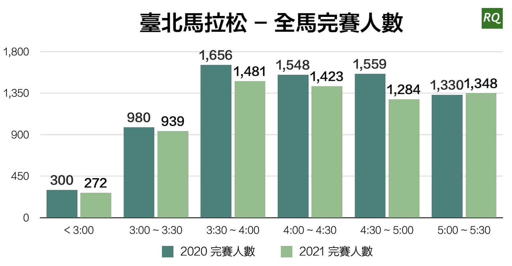
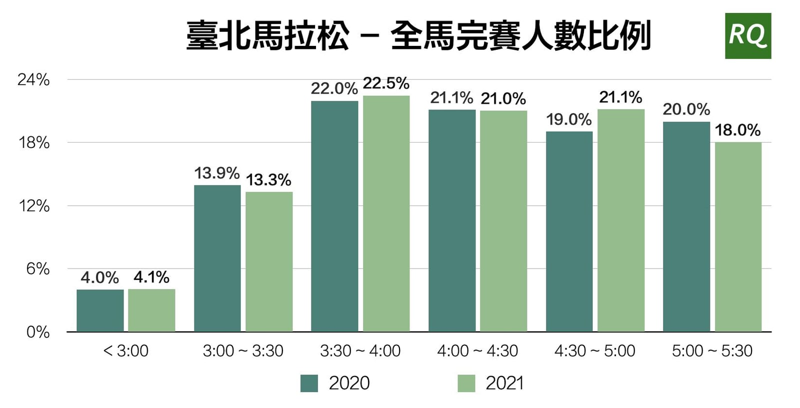
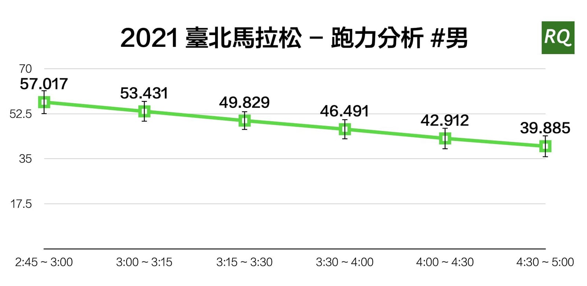
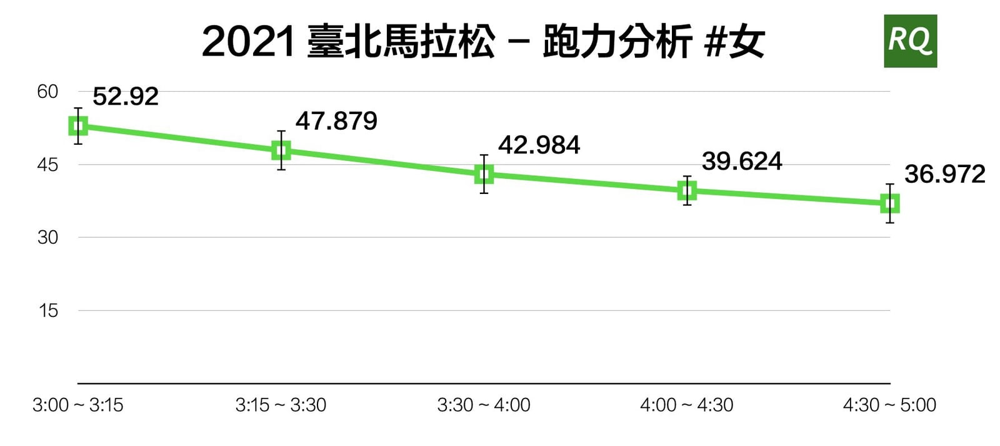

在逐漸習慣線上協作與訓練的同時，你是否也跟我一樣，戰戰兢兢地期待再次站上起跑線，與「實體」跑者齊步奔跑那刻呢？能在 12 月 19 日這天從市政府出發，享受這場萬人大賽事年末考驗，著實讓被剝奪了一段時間的我們有個圓滿的結束。

今年（2021）總共有 6,747 位跑者完成了臺北馬拉松全程挑戰，起跑溫度約為 14 度，相當適合發揮訓練成果。以下就根據 1,639 位 RQ 跑者完賽數據分析，提供你訓練上的參考。

## 全馬各成績完賽人數比例不變

相較去年來說，今年的路線並沒有太大變動，整體來說已經是臺灣相當好跑的賽道，但完賽人數卻少了 626 人，破 3 人數減少 28 位。一方面可能因為報名人數未額滿，另一方面，跑者們今年被疫情三級警戒奪走了不少訓練時間，對需要大量時間累積訓練的全馬來說，影響不容小覷。

但以完賽人數比例來看，其實並沒有太大變動，反而破五的跑者增加了 2.1%，相對五小時後的跑者比例降低 2%，說明本次賽道的難易度相較於去年並沒有太多變化。至於許多全馬跑者提到的困難點 — 河濱逆風段，也算是無可避免的挑戰。

## RQ 跑力極具鑑別度

根據資料庫，絕大部分跑者在賽前半年內的跑步次數都變少許多，對於仰賴數據量的分析來說，可能會是一個考驗。以男子全馬完賽成績的平均跑力，依然有很明確的趨勢，完賽成績越快跑力就越高。而今年特別抓出標準差，可以看出同區間的跑力震盪幅度都不大，代表跑力分析依然很有鑑別度。

特別需要注意的是，在 3 小時內的平均完賽成績，略快於平均跑力對應之全馬成績，這有可能是對於訓練有素的菁英跑者來說，訓練區間的比例需要更個人化設定，讓跑力分析更趨近於真實狀況，或者是平常訓練紀錄表現的分析，並不足以代表有豐富經驗菁英的比賽能力。

有鑑於此，我們目前正在研發中的第三代跑力分析演算法，將會有更全面的參數導入分析，並加入更多演算法，相信能夠再次提升菁英跑者的準確度。

女子全馬完賽成績之平均跑力與男子有同樣趨勢，跑力越高就跑得越快。相較於男子，相同區間的女子跑力略低一些，也更貼近實際跑出來的成績，原因除了大眾認同的女生耐受力較強之外，亦發現男跑者更喜歡執行容易提升跑力的速度課表。然而，在全馬如此長距離的挑戰下，仍需要有更紮實的有氧基本功。

下一篇將著重於探討全馬完賽者的平均心率、訓練指數與體能累積狀況。如果有更多想知道的內容，也都歡迎[直接填寫問卷](http://bit.ly/3o9vlQ5)與我分享喔，感謝。
