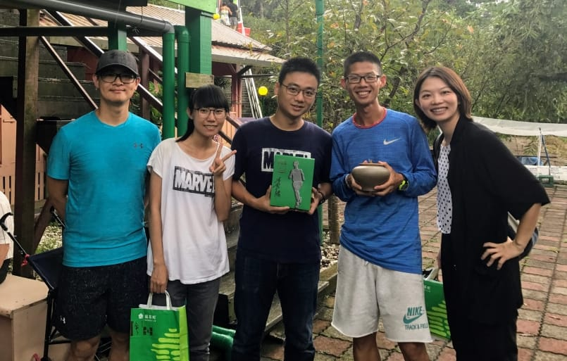
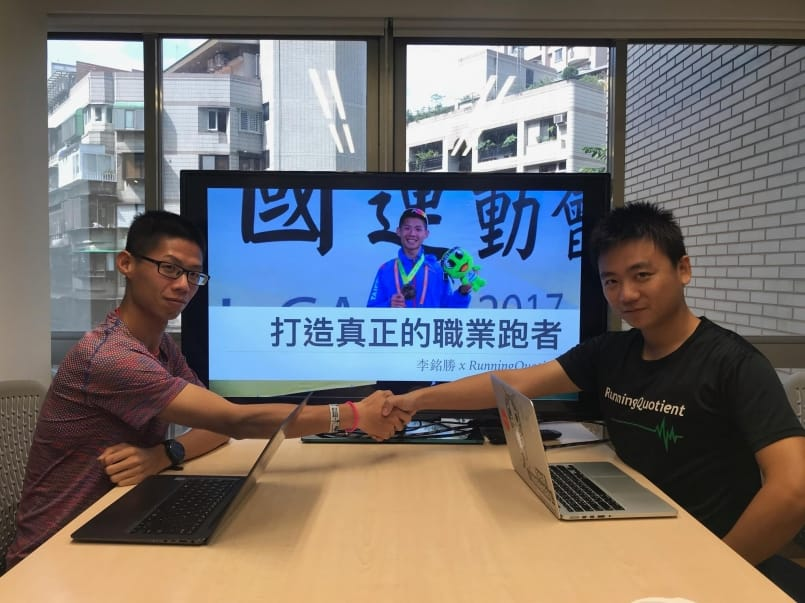

談了兩個多月，終於開張了~

[【「勝 - 九年毅力」李銘勝訂閱群組】](https://www.runningquotient.com/group/to/vincent)

一直以來，我都認為「教練」跟「選手」的專業是完全不一樣的。

教練必須要能夠持續吸收新知，把獲得的資訊好好整理並內化後，再用選手聽得懂的表達方式傳授出去，當然，本身一定要有持續訓練的習慣，但成績並不是絕對的；而一位好的選手，最重要的應該是在「目標賽事」的成績表現，屏除一切會威脅到表現的可能性，自律且有目的的好好相信教練並訓練著。

好的選手不一定能夠成為好的教練，而好的教練也並不一定非是要選手出生不可。

去年參加了 [李銘勝 Vincent Li](https://www.facebook.com/Victory0324/?fref=mentions) 在貓空舉辦的分享會，聽到他說了這段話：

「很多人都說我是職業跑者，可是職業應該是單純做這件事情就有飯吃，就像老師、教練、或是工程師才算是職業，我頂多算是專業跑者而已，我還是要靠其他方式來吃飯。」

對啊，職業跑者的本質，應該就是要能夠好好從事跑步訓練這項運動就可以獲得基本收入。台灣沒有像是日本這種實業團的文化，長跑競技運動相較於球類運動話題性也少非常多。那，為何我不來自己創造看看呢？

現在，訂閱式網紅當道，大家可以靠著各自的專業獲得訂閱粉絲的支持，無論是很會吃的、很搞笑的、很正的、很會唱歌的、還是很會打電動的，那「很會跑的」有沒有辦法成為被訂閱的網紅之一呢？

我的理念是希望創造一個可以讓「職業跑者」好好練跑、好好寫訓練日誌、好好比賽，就可以有飯吃的平台！

當然，一定會有很多很多還可以進步的地方，我想邀請您給我們回饋，到底這樣子的訂閱式服務「可以看看菁英選手的生活、訓練紀錄、分析、成長歷程故事」，您會不會願意投入支持的力量呢？

[李銘勝訂閱群組【勝 - 九年毅力】](https://www.runningquotient.com/group/to/vincent)

訂閱此群組可以獲得的權利如下：

-   查看銘勝的每日訓練總覽
-   查看銘勝的公開跑步紀錄（每月至少四筆）
-   查看銘勝的公開訓練日誌（每月至少四筆）
-   查看銘勝的公開紀錄分析（每月至少四筆）
-   獲得銘勝的訓練課表詳細內容（每月至少一筆）
-   查看銘勝的訓練花絮與成長小故事（每月至少四則）
-   特定銘勝的課程或訓練營優惠（不定期）
-   參加銘勝舉辦的團練或是分享會（不定期）

到底職業跑者能不能以這樣的方式存在呢？讓我們看下去。

