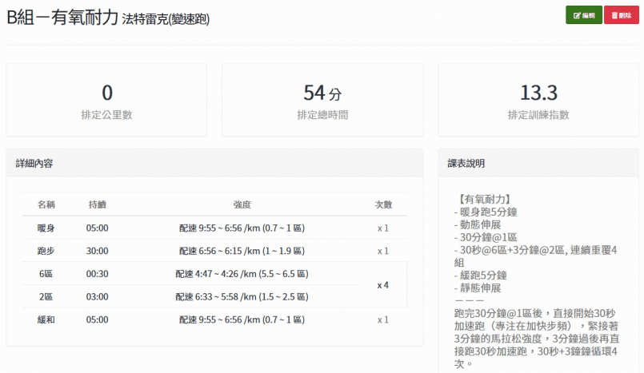
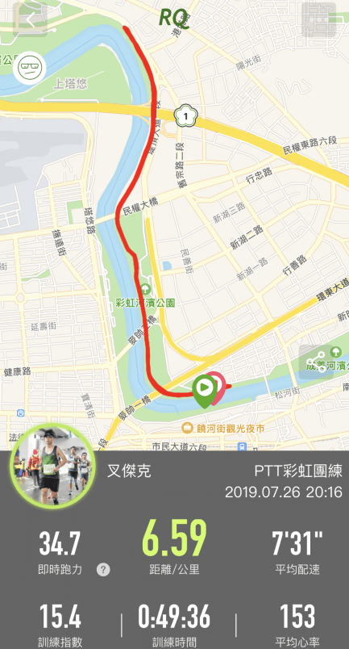

最近開始做訓練營系統新功能，看到教練們開各式各樣不同的課表，一直覺得腳很癢，就決定跟著 #RQproject B組開始吃課表。

今天課表內容是輕鬆跑30分+(速度跑30秒+馬拉松配速3分)四趟+緩和跑5分，還在想著是否要跟前幾天一樣半夜去跑，就看到神妞在PTT彩虹團詢問晚上開團事宜，線上聊一聊忽然鄰居仙女也說要加入，想想離家近又有一群人共跑，便決定就來跟這團。

八點到熟悉的彩虹橋，看到好久不見的神妞、楓哥與仙女，大家各自暖身閒話家常等到人數差不多，主揪讓新朋友仙女跟我自我介紹後，便大合照出發跑步囉。一開始跟著仙女輕鬆跑，果然一下子就看不到神妞的車尾燈。

一起邊跑邊聊邊撿蝸牛，原定要跑30分鐘折返，但不到25分鐘就遇到已經折返的第一第二集團，我就順勢折返開始跑速度間歇，好久沒有跑到五分速了，其實還蠻興奮的，想著這速度說不定有機會能夠追上神妞，卻只能眼巴巴看著她的背影越來越遠。

完成四趟速度間歇就感覺體力快用光了，只好站在河濱的劇組旁邊休息，一邊看著李千那被一個男的摸臉，一邊等著仙女經過，最後再緩跑回起點完成此課表。

忽然，腦海裡冒出了這首詩~

夏日爆雨後，天氣晚來秋。\
明月彩虹照，河畔蝸牛多。\
乏身待仙女，草動千那羞。\
隨意吃間歇，跑力自可留。

這樣可以投稿[RQ夏日文學賞](http://bit.ly/2YrGDpV)嗎？ xDDD

