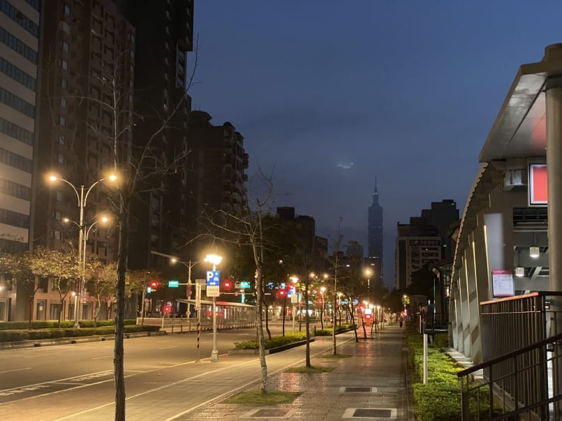
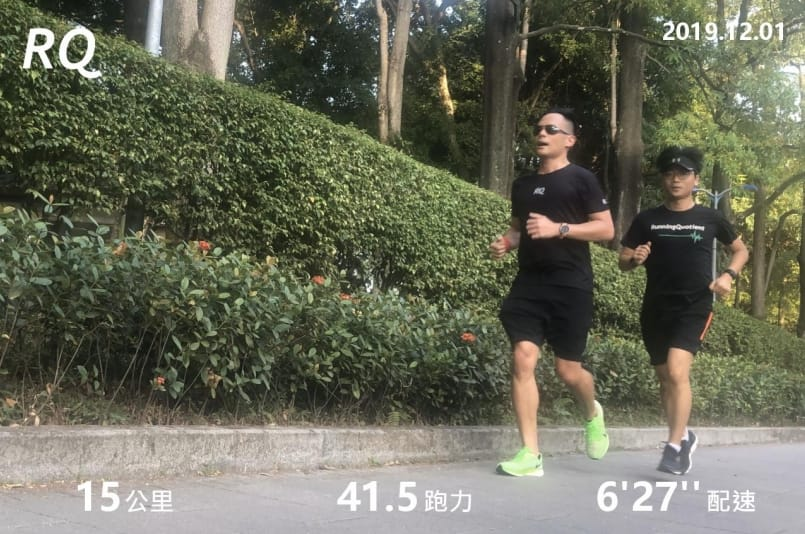

距離台北馬拉松剩下最後兩週，課表的訓練量也來到最高峰，撐過去就可以好好減量迎接美好的比賽週了！

今天課表是由國峰教練開的三趟五公里課表，間休五分鐘。第一趟當作輕鬆慢跑，第二趟再加快一些，但仍不能有喘的感覺，目標是最後一個五公里，要跑到兩週前十公里全力測驗的平均速度。

清晨五點出門，六點開始熱身，謹遵守教練說的最後一個月訓練最高原則「不超速」，以不會痛苦、無須忍耐的感覺跑完就好，而且休息如果覺得不夠可以休久一點（這個我最喜歡）。

第一個五公里我們先保守一點抓六分半速起跑，前兩公里順了之後，慢慢加速到約5:50左右，順利完成第一趟五公里，感覺還算輕鬆。

第二個五公里已經掌握到速度感，休息五分鐘後身體其實有一點冷掉，稍微熱一下之後約多休息一分鐘就出發進行第二趟，這次一開始就抓5:50的配速左右起跑，跑感還算不錯，過了兩公里後慢慢加速到約五分半速，完成第二趟五公里。

在第三趟開始前，雖然我們都還沒有肚子餓的感覺，但我還是提出到超商補一些熱量和水，提前準備肚子裡面邊消化食物邊跑的感覺。根據[台北馬補給站資訊](http://www.taipeicitymarathon.com/suppl-station.php)，十公里補給站會有香蕉、番茄、巧克力餅乾、梅乾和蘇打餅，最方便吃的應該就是香蕉了，我們便各吃一根香蕉後，準備完成今天最後一趟五公里。

兩週前的十公里測驗平均配速為5:15，所以這趟起跑便直接上到五分半速，可能是速度加了太多，抑或是肚子內的香蕉屍體們作祟，跑感整個很不順。跑完兩公里後速度開始無法維持，直到最後一公里才又恢復到五分半速左右，還算順利的完成最後一趟。

只剩下最後兩週課表了！加油！台北馬我又來了~

PS：Stryd的距離與GPS的距離差異有點多，所以我的數據其實每趟是不滿五公里的。
