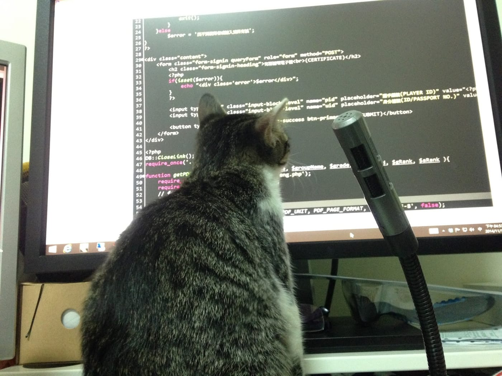

其實很早開始就有了自己維護一個私人網誌的想法

很單純地只是想為自己留下些什麼

不過，總是會有一堆藉口讓我一拖再拖

有一陣子好不容易開始寫了

沒想到才寫了三篇左右

該部落格就說要關站了

必須要轉移到另外一個部落格空間去！(驚

「哎呀，好不容易真正開始每星期寫一篇網誌，才產生三篇小小的短文而已，就要關站轉移，根本就是不想要讓我寫網誌呀。那就只好繼續使用臉書就可以了吧！」

這一個超棒的理由就讓我完全打消寫網誌的這個念頭

*此網誌預計主題之一：遊戲*

就這樣，一直到現在已經過了而立之年

臉書上洋洋灑灑留下一大堆吃喝玩樂的記錄

雖然偶爾也會忽然抒發心情打了一大長串篇感性的文字

但其實絕大部分都是比較歡樂的資訊、照片、或是轉錄的文章等

而且最重要的是也不太會加入太多自己主觀的想法與認知

最近，因緣際會之下

認識了一位運動作家，有了密切的合作

在更加瞭解他之後

發現他對於知識的渴望、閱讀的「需求」以及個人筆記的習慣

讓我整個大開眼界

原來真有人是這樣有條理且持續不斷地在充實自己的知識

也願意將所吸收的知識用自己的語言分享出來

*此網誌預計主題之一：資訊(網頁程式相關技術)*

再加上前一陣子

有一個發生在我身上刻苦銘心的事件

讓我再次深深體會到文字的力量居然可以這麼強大

強大到光靠短短「幾句話」就可以讓曾經密切交流並且一起上山下海共患難的朋友(或者是單方面認為的朋友)反目變成陌生人

所以我決定從現在起

學習如何閱讀，學習如何使用文字表達想法

磨練自己的句子，從這一個網誌開始

本網誌的主題會放在遊戲、資訊以及耐力運動

文字風格也會慢慢修正到適合我的方式

歡迎大家來批評指教喔~

*此網誌預計主題之一：耐力運動*
