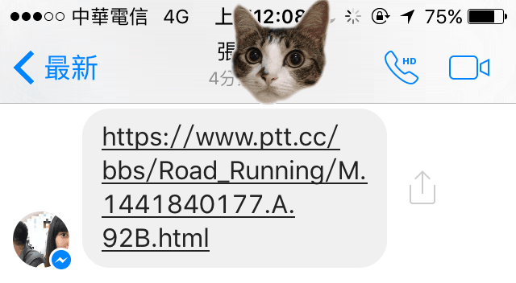
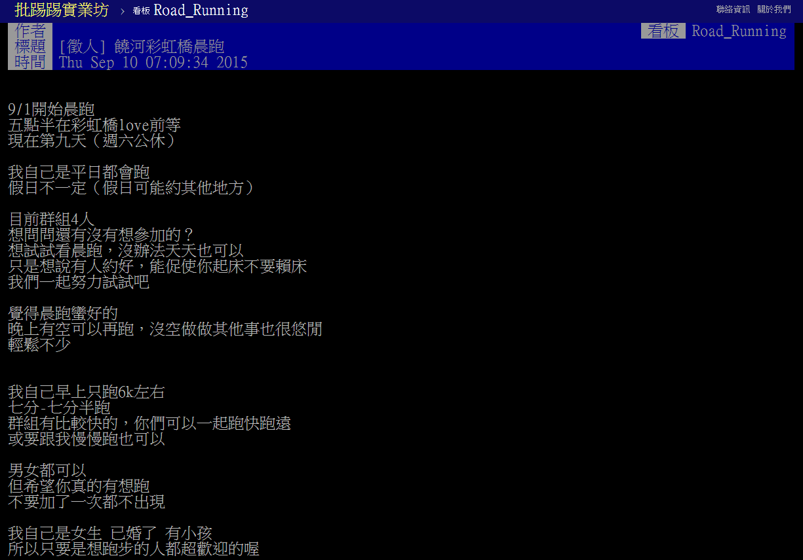

哇嗚~ 我加入一個晨跑團了！\
這可是三十多年來我加入的第一個非學校團體呢\
一定要來寫一篇紀念一下\
「晨跑好習慣彩虹一起亂一天愛兩次跑團」\
團長是美美人妻牽

回想起那一天

忽然棲碧娘丟了一個PTT路跑版的連結給我看

*棲碧娘丟的連結(已失效所以不用遮*

其實同時還有丟其他連結\
那時候覺得是她要分享什麼有用或是好玩的資訊給我吧\
所以也沒有多想（小聲說：其實也懶得去點 XDDD\
一直到晚上閒聊時\
就忽然討論到這一個連結\
只好來稍微認真看一下這篇到底是在說啥

*傳說中的PTT路跑版徵人晨跑文*

蝦米？是晨跑團徵人耶～

來到台北之後，平常會一起訓練的夥伴都不在身邊了

一整個星期完全沒動（連基礎肌力訓練都沒有

是有稍微查一下附近的跑步路線

方圓十里內的高中、國中、小都是兩百公尺操場（不想跑

盤算著最近長距離路線應該就是國父紀念館了吧

正打算要找時間去跑看看的時候

這一篇徵人文章就這樣出現在我面前

來分析一下幾個關鍵字：

1.  晨跑
    -   之前有一陣子把訓練時間改到早上，真的會感覺一天的時間變比較多了，也可以跟隨著太陽作息，把握有陽光的時間，節能省碳愛地球啊！
2.  彩虹橋
    -   喔喔喔，這地方我知道，就在饒河街附近，以前還在台北的時候也算常去逛饒河街，印象中走路過去也只要不到十分鐘，地段不錯不錯！（後來發現是舊家走過去才只需要十分鐘，現在的新家走過去居然要十五分鐘啊。如果是跟棲碧娘一起走過去的話要二十分鐘！
3.  能促使你起床不要賴床
    -   回台北之後，生活作息大亂。看到這一個晨跑團居然還特別提到這一件事情，認真思考一下，確實是這樣沒錯，如果知道有人在等當然會更有起床的動力呢！（其實我有點害怕睡過頭，不知道遲到幾次會被踢出去XDDD
4.  七分-七分半跑
    -   這是我最打動我的關鍵字！我現在E心率下的配速已經退化到大概七分半了，希望能夠趕快恢復原本的速度。
5.  女生已婚了有小孩
    -   為什麼要特別會把這一點拿出來講呢？拜託，你們難不成不知道每一個媽媽都是神一樣的人物嗎？這樣的神人還願意出來開一個晨跑團，不要說是跑步上的問題了，以後生活上有啥疑難雜症就有更多人罩了。（扣除我老媽之外，家裡還有一個老姊也是當媽了~

這麼優的晨跑團現在不加更待何時\
立馬請棲碧娘寄站內信過去詢問！

隔沒多久就收到團長牽的賴好友邀請（清晨五點丟訊息，果然是晨跑團長啊！

*晨跑好習慣彩虹一起亂一天愛兩次團長牽*

由於那時候作息大亂\
所以花了一天調整作息之後\
9/13這天（剛好是我生日）就立刻去參加晨跑囉\
不過因為是星期日所以牽團長沒有出現~ Q\_Q\
當天認識了幾位團員KK, EBow, Kelly, Naomi, 魷魚絲

「晨跑好習慣彩虹一起亂一天愛兩次」請多多指教！
