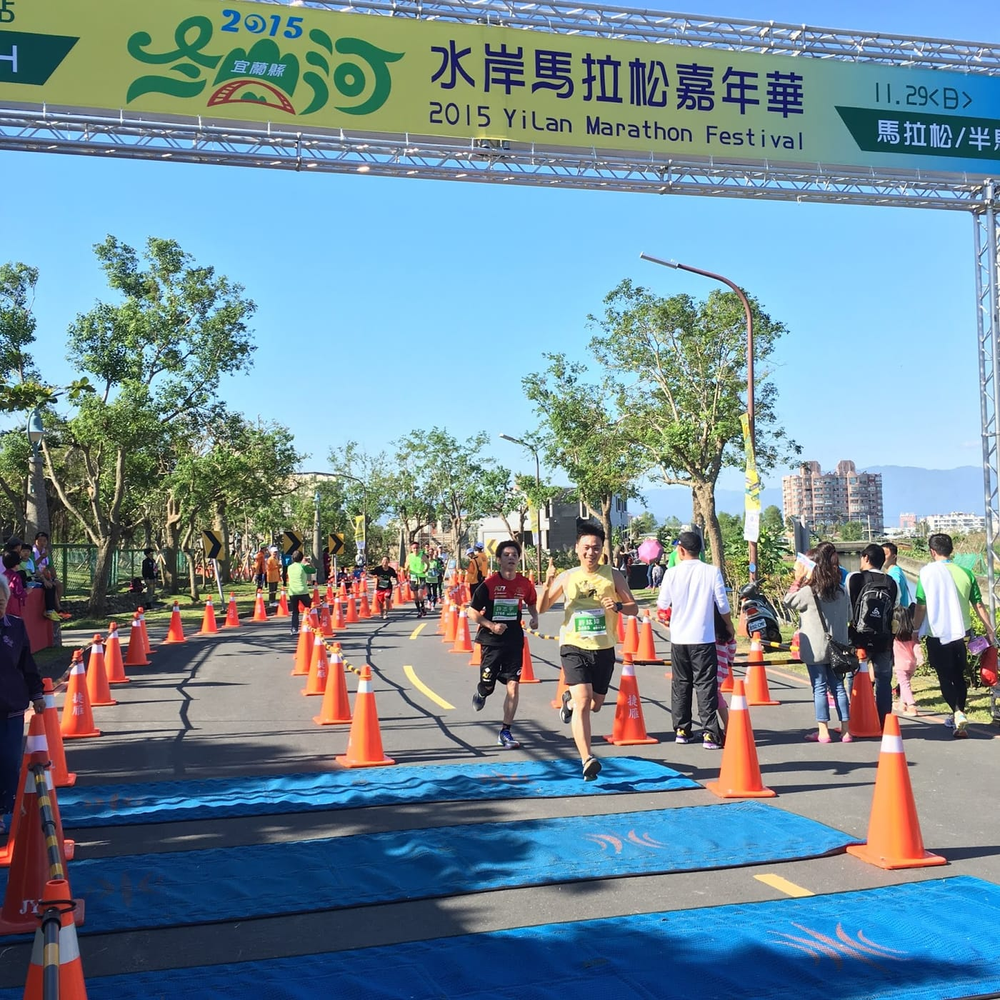
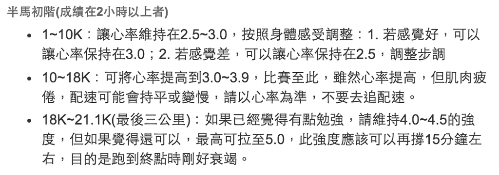
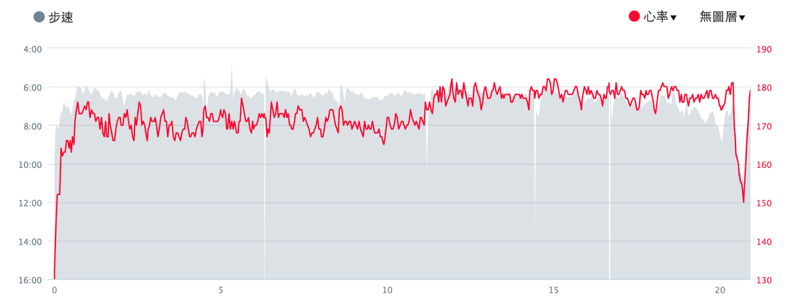
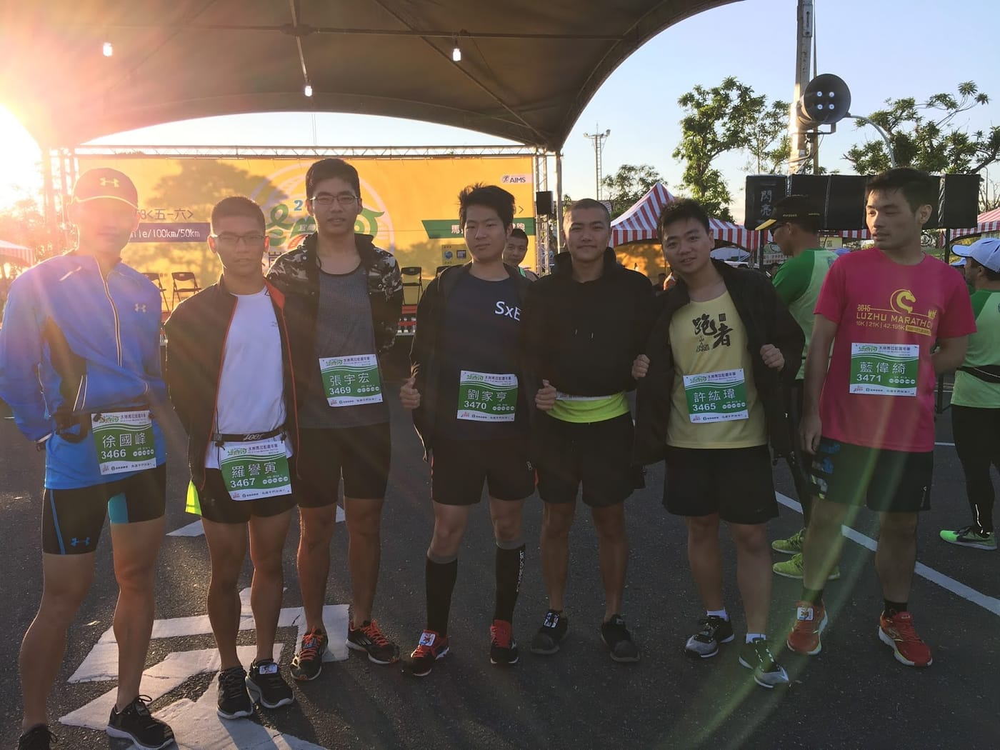
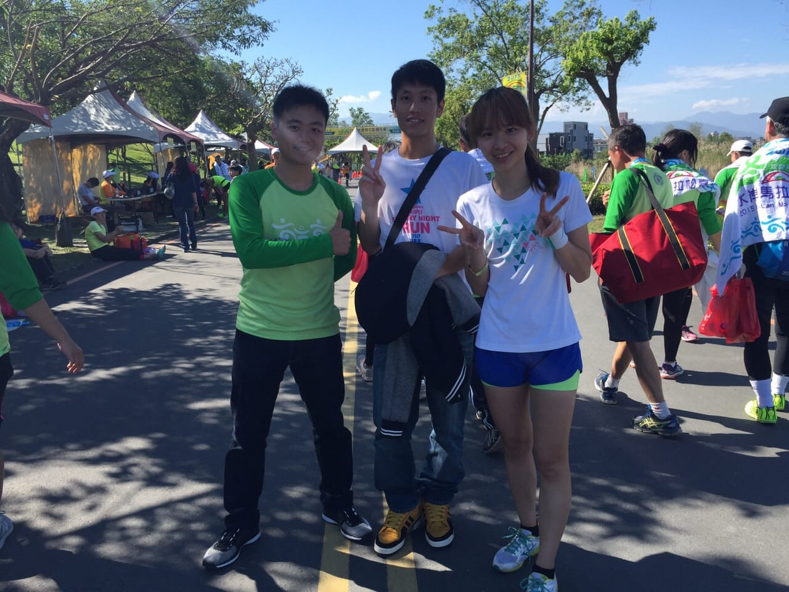
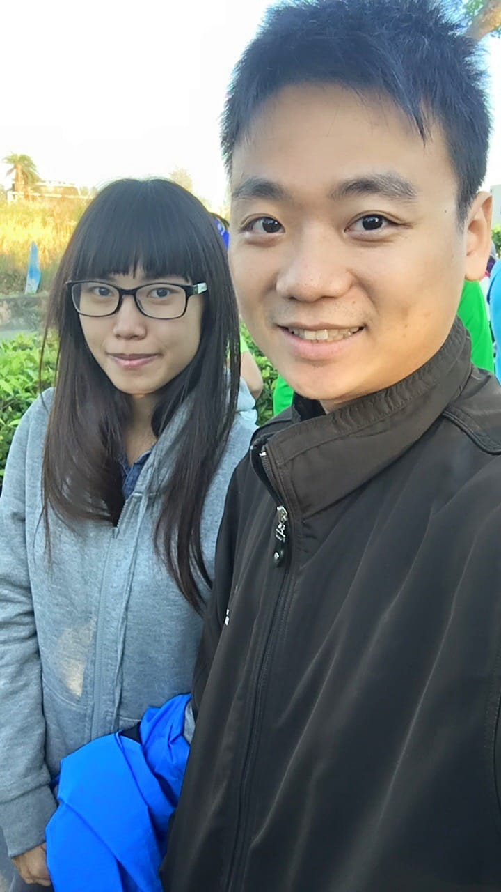
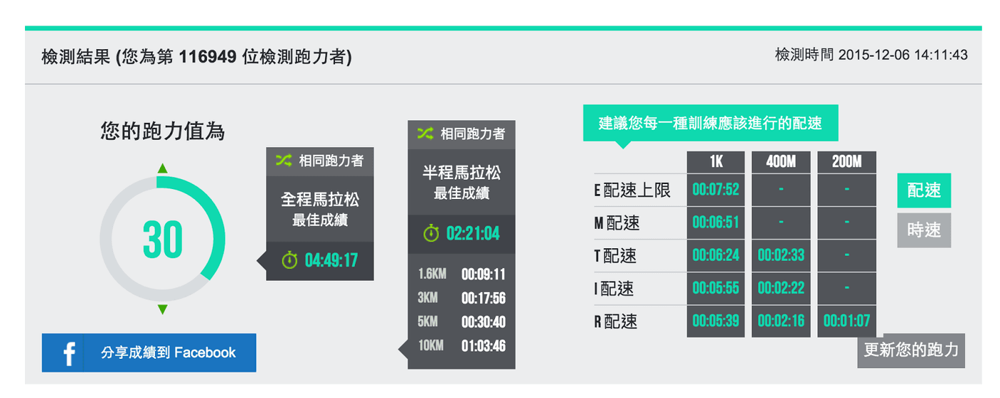

這次2015冬山河馬拉松嘉年華是我人生中完成的第三場半程馬拉松，但是，可以說是第一次有感覺到自己是一位「跑者」的賽事。

*人生第三場半程馬拉松意外大破PB27分鐘*

想起去年我的初半馬「2014台東都蘭馬拉松」整個大爆炸，在炎炎烈日下連走帶爬回到終點的時候，立刻下定決心不會再報名任何這種虐待自己的長跑活動。沒想到因為愛面子，過了半年又再次挑戰了2015台南古都馬拉松。第二次跑半馬就比較有抓到感覺，不過其實城市馬拉松給我的體驗不是很好。

這一次，打定主意要累積足夠的訓練量，再來挑戰半馬一次。就邀約DRC小圈圈的朋友們一起挑戰冬山河半馬，也使用了耐力網科學化跑步訓練計畫安排了整整16週的計畫要跟著進行訓練。不過，人算不如天算，這16週發生了好多好多事情，課表的完成率不到三成；特別是最後一個月，整個月只有跑四次而已，心裡暗自盤算著這一場能平安回到終點就很不錯了。

目標賽事就這樣默默到來，前一天晚上，聽了徐國峰教練跟學員們說的比賽策略其中一句：「目標是把目前身體狀況好好的發揮出來即可。」國峰針對每一個學員都擬定不同的配速策略。我也趁機會問看看那我該怎樣配速呢？國峰就說我可以直接使用他之前寫在網誌上面的半馬初階配速策略（[全文連結](http://rocky549.blogspot.tw/2015/10/blog-post_14.html)），完全依照心率區間來配速。

*節錄徐國峰半馬初階配速策略*

看到這種有區間的配速策略，對身體狀況非常保守的我，就決定都用區間內的較低值跑就好了。明天這場硬仗，看來其他高手朋友們一定沒兩三下就海放我，唯一的依靠就只剩下親愛的Garmin 920XT了。

我後來決定要執行的配速策略如下：

-   1~10公里：維持心率區間2.5
-   10~18公里：心率區間提高至3.5
-   18~21公里：心率區間提升到4.0，努力撐住到終點

我們選的民宿為冬山河渡假農莊，距離起點不到兩百公尺，佔盡地利之便。七點半起跑，我們七點出房間就可以了。稍微動態伸展一下，就前往起點集合。有個小插曲，在起點遇到一位運動部落客[Ariel Yu](https://www.facebook.com/juiyayu2)，才剛相認想要多聊一下時，就忽然聽到鳴槍聲，就這樣起跑了，完全沒有倒數的感覺啊～（淚

這次既然都已經決定要好好按照國峰的配速策略跑，果然開始沒多久就與小圈圈的朋友們分散，更可以專心執行我的配速策略。前十公里一直保持著心率區間2.5前進，除了因為衣服的摩擦，我的ㄋㄟㄋㄟ非常痛之外，真的感覺非常順利。過了十公里都沒有疲勞感，途中只有補水與運動飲料，速度也比以往快了許多。按照配速策略應該是要過十公里開始提升心率區間，不過由於一直沒看到折返點，一直遲遲不敢加上去。

果然後半段才是考驗的開始，過了半馬折返點（約11k）後，我將心率區間提升到3.5左右，但是速度卻還是只能跟前十公里差不多。天氣也開始漸漸變熱，就算是冬天，七點半起跑果然還是太晚了。腦子開始胡思亂想，一方面是很開心自己居然可以穩穩跑這麼久，另一方面是非常懊惱自己沒有好好執行訓練計畫，沒辦法有更好的表現。不過，一旦想到這一次應該可以輕鬆達到我們賭注的目標220內，就會不自覺興奮，心率區間也會馬上飆高到4.0以上。原來興奮還真的會心跳加速耶！

就這樣一直努力保持心情穩定並維持心率區間在3.5左右，跑到十七公里左右，被路旁的景象動搖了。有一位跑者倒下，躺在路邊，許多跑者見狀立即上前幫忙。一跑過他們，忽然就覺得心情變得有點沈重，而腳步也開始慢下來。瞬間腦海裡面閃過國峰曾經寫過的一篇文章[【從「衰竭」一詞思考「挑戰自我」的意義】](http://rocky549.blogspot.tw/2015/10/blog-post_26.html)。對掌控身體狀況非常不熟悉，只能倚靠穿戴裝置的我，是不是也要開始學習聆聽身體所傳達的聲音呢？

不知不覺就到了十八公里，依照配速策略，這時候可以開上去4.0心率區間，剛好到終點前衰竭。我猶豫了一陣子，最後決定還是要拼看看，便開始慢慢提升心率區間，但是身體的保護措施似乎同時間也跟著一起啟動，心率根本還沒提升多少的時候，我就爆掉了。很明顯地完全無力，速度一直掉下來，這時候只能夠靠意志力強迫自己保持穩定慢慢跑，但是疲憊的感覺越來越重，一直有聲音要我停下來用走的。最後的三公里非常非常地漫長，終於還是抵擋不了身體的保護措施，開始當步兵，直到終點前五百公尺才能恢復跑步狀態。

看到終點還是非常興奮，當終點前主持人喊到我的名字時，整個人忽然有力氣加速跑過終點。（結果因為後來加速太快，棲碧娘沒有幫我拍到好照片啊！QQ

*Garmin Connect上的分析資料，非常方便一次看心率與配速*

最終完賽的晶片成績為2：18：40，PB又再度往前大躍進27分鐘，對過了而立之年才開始跑步的我，無非是一個莫大的鼓勵。回想起這一次訓練計畫比起往常執行得更差，重點是體重還比上一場半馬多了整整四公斤，能夠跑出這麼大的突破，最要感謝的當然是國峰教練神奇到爆炸的配速策略（好啦，還有一路陪著我不離不棄的Garmin 920XT）、DRC小圈圈的大家、以及愛愛團的朋友們。

*ＤＲＣ小圈圈出發前合影*

*愛愛團剛好也有參加此場賽事的跑友（中間那位有上凸台啊*

最後整理一下這一次犯的錯誤：

1.  穿不合身的衣服，摩擦到ㄋㄟㄋㄟ都流血了（還結痂咧～
2.  號碼布沒有別好，整場比賽一直被飄起來的號碼布打
3.  沒有抹凡士林，或使用貼布
4.  過終點暴衝太快，應該慢跑過去才可以有好照片
5.  Garmin手錶的里程少了90公尺，應該不要停錶跑到好跑到滿才對

*棲碧爹娘*

下一場半馬目標更明確了，休息一陣子之後，我要再來開一份耐力網科學化跑步訓練計畫認真訓練！加油～

2014年8月17日台東都蘭夏日馬拉松-初半馬 3：14：47\
2015年3月15日台南古都國際馬拉松-半馬2：44：26

*使用此半馬成績在耐力網上獲得的跑力*
