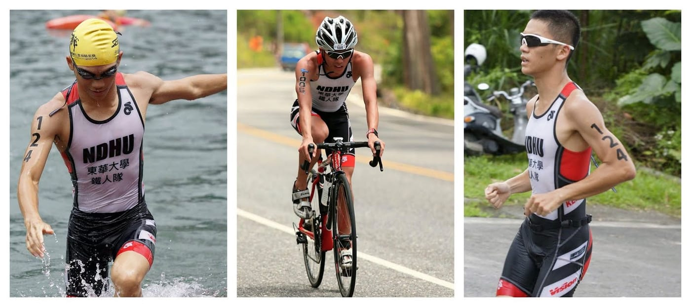
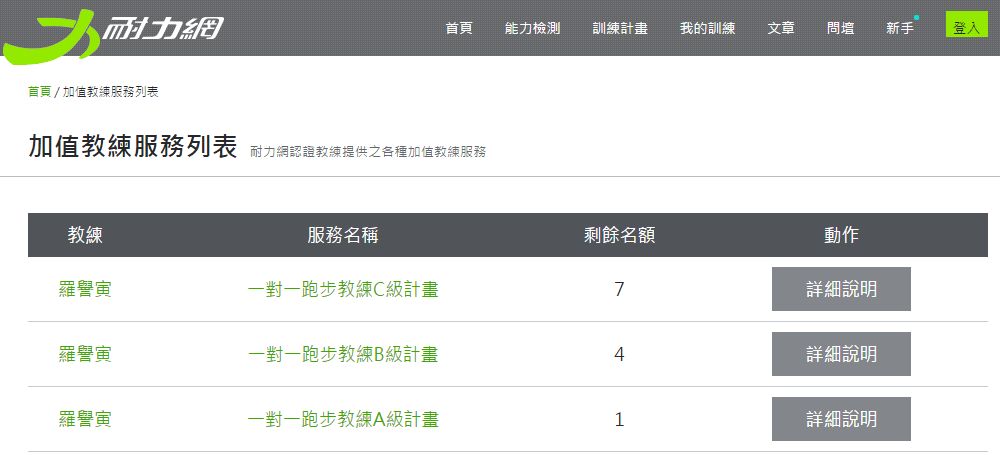
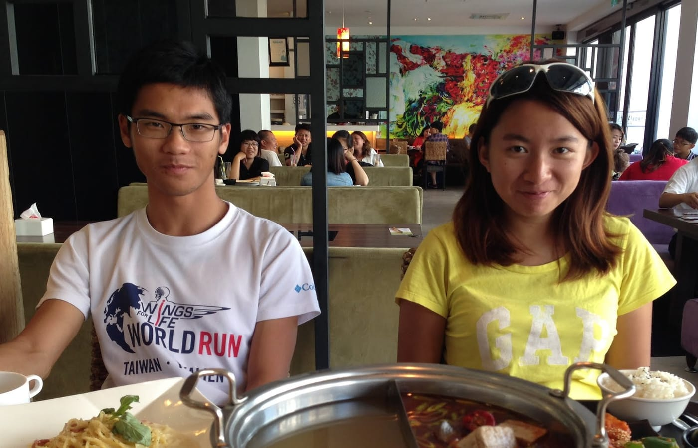

第一次聽到「羅譽寅」這一個名字，是在2013年的一場活動「[救世要跑](http://www.eqpf.org/30/jogging.htm)」，環品會與五位熱血的年輕人，以跑步環台的方式，推廣環境永續發展的重要性。而譽寅就是在其中擔任「補給騎士」。

真正的第一次接觸，是在該年底，老師帶著譽寅介紹我們認識。原來，是有一位大學就讀社會相關學系的鐵人，為了要讓所學「科學化訓練」知識能夠與資訊科技結合，決定在研究所轉換跑道，直接報考資工研究所。那時候對譽寅的印象是一位靦腆又很有自己想法的小男生，挺佩服他的決心，也立刻承諾若有疑惑歡迎隨時來找我。（不過，後來他都沒有找我問過問題。）

幾個月後，研究所榜單出爐，忽然想到有這件事，就開始從榜單備取最後一名開始找他的名字。嗯，我果然是太小看這位小男生了。一位「資訊素人」居然可以靠自修幾個月，以榜首之姿成為了我的學弟，可見得他對於新知識的吸收與理解能力有一定水準。

而後，譽寅加入相同的實驗室，也有了更多的認識。那時的他是鐵人隊隊長，也算是讓我第一次比較了解「鐵人三項」這個運動。曾經一度強迫自己使用跑步減肥的我，其實本來就對於這個自虐的活動沒有什麼好感，想到他是結合三項（自虐）運動外加各運動類型中的轉換，根本就不是正常人啊！

*[羅譽寅教練](https://www.facebook.com/louian1993)帥氣的三項照片*

因緣際會之下，我跟譽寅有了密切的合作，有很長一段時間在一起工作、一起學習、一起訓練。才了解到，原來能夠考上榜首不是沒有原因的。

譽寅每天都很有計畫的要吃兩餐，這可不是一般的「餐」啊，其實這是訓練課表的代名詞，一個星期只有一天是完全休息日。每天早上六點就要訓練，而且這樣的規律生活已經持續好幾年了，再加上還有課業、寫作、以及「科學化訓練」學習要顧及，可見時間分配管理能力與自我要求也都非同小可。

當然，這段期間，我逮到這個好機會，就開始把我當初跑步的疑惑全部搬出來詢問，明明只是個二十出頭的年輕人，專業訓練知識可完全不含糊，也都是可以讓我這個刁民非常信服的解釋。就算有問到他無法立刻答覆的問題，沒過幾天，譽寅就會從國內外文獻中翻出解答並加上自己的看法。也因為這樣，讓我重新認識並愛上跑步的感覺。

譽寅一開始被稱之為徐國峰科學化訓練的得意門生，現在，他已經有了兩本著作，從素人到神人都有非常豐富的指導經驗，也擔任過幾場訓練營的總教練，並成為耐力網核心顧問之一，而[個人FB粉絲團](https://www.facebook.com/louian1993)上，還有好幾部破十萬瀏覽人數的訓練知識影片，完完全全已經是一位獨當一面的科學化訓練鐵人教練啊！

現在，耐力網與羅譽寅教練合作一起推出[加值教練服務](http://goo.gl/IWy3qe)，讓訓練計畫活了起來。想想你在訓練的同時，有位專業教練在雲端上幫你看你的紀錄，分析後幫你調整未來的訓練課表，練習上的問題還可以有專業教練幫你回答，成為你強力的後盾，多麼令人感到安心啊。名額有限，趕快來申請吧！

*耐力網-加值教練服務*

\--

以上講的這一些其實網路上大都可以查得到，那我就來講講大家不知道的八卦好了。（希望譽寅不會看到）

某天，我坐在辦公室悠閒地啃著我的早餐時，看到譽寅滿面春風的走進來，這大概是我第一次看到他臉上出現這麼特別的表情。

「今天鐵人隊新加入一位學妹。而且她半馬跑得比你快一個多小時呢！」

「唷？這麼厲害？那我明天也一起跟鐵人隊訓練，順便介紹一下啊。」初半馬跑三個多小時的我表示。

隔天清晨六點一到游泳池集合，哇，是位超活潑開朗可愛中帶點楊貴妃的小女孩，完全跟我想得不一樣，真沒想到譽寅會喜歡這種型的。（在此澄清，他本人這時候並沒有說是喜歡，只是有好感，可是明明就像是一見鍾情的樣子。XDD）

接下來好幾個月故事的發展精彩絕倫，最終發展就是跟大家想得差不多。在情場上經驗不少的我，終於可以拿出東西可以教給譽寅。在這段期間，我也分別扮演了不同的角色，以下附上關鍵戰役的照片，我想到時候我的紅包應該不會太少吧！哈哈～

*最關鍵的三人飯局戰役*
