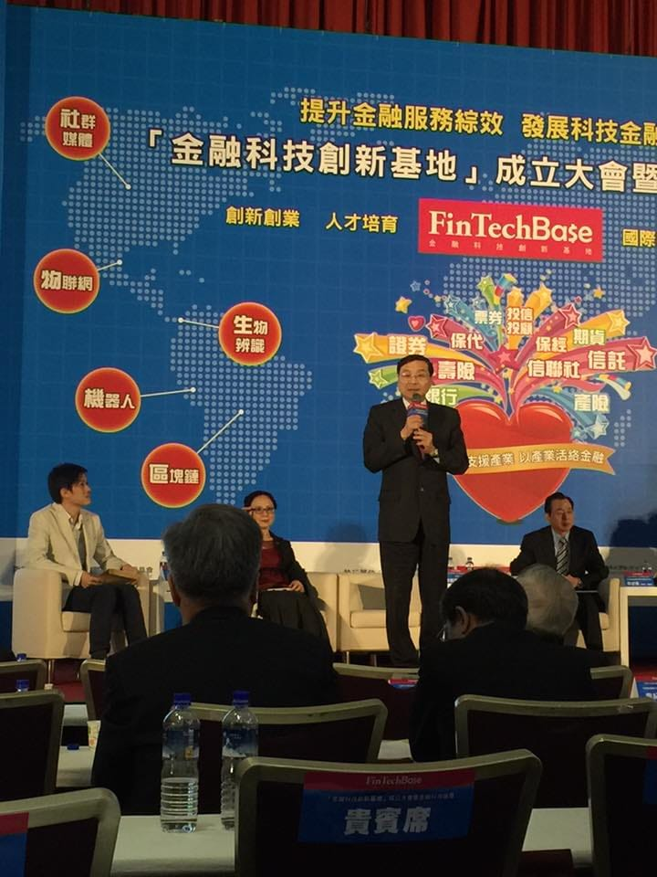
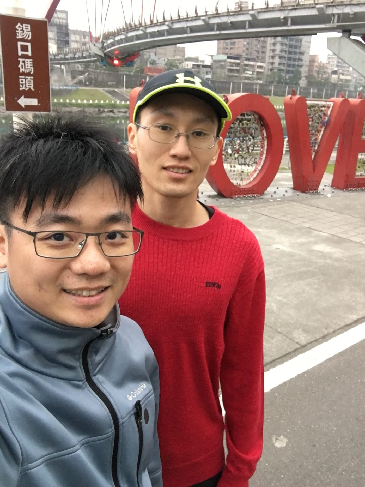

『跑步的產業需要這個領域的人共同努力，以及合作。在大陸這邊看到這個產業的缺失是，太多人都想「自己做」，而沒想到跟別的專業合作。像是做跑步媒體的想弄訓練營、做穿戴技術的想自己研究跑步科學、做訓練營的想自己弄APP……我認為跑步產業要興盛起來，要像手機產業的生態一樣，每家公司負責自己的專業，像品牌經營、設計、面板、處理器、鏡頭、電池……等。而不是由一家公司全包，要形成完整的產業鏈才能使整個產業活絡起來，而形成產業鏈的前提是大家都願意合作，「把該專業的錢給別人賺」，專心把自己專業做好，把品質不斷提高，不斷進行創新。但什麼都想做的結果就是無法提高本業的品質。』節錄自徐國峰老師部落格的一篇文章「[大陸的跑步產業](http://rocky549.blogspot.tw/2016/04/blog-post_21.html) 」。

最近很常在河濱練跑，每次跑完準備回家時，看著旁邊熱鬧的饒河街夜市，吃的喝的玩的應有盡有，而沒有交通工具的我，為了減少攜帶的物品，身上往往只有一隻Garmin錶、一台手機和一張悠遊卡，只能眼巴巴地走到旁邊的便利商店裡。

幾次之後，就在個人臉書上抱怨臺灣行動支付的不便，並期望能夠趕快有行動支付普及的這麼一天到來。沒想到，晨跑團的美麗人妻就在下面告知我，金管會現在正在努力推動這件事情，相信不久的將來就可以超方便的行動支付可以使用了。

*美麗人妻提供的成立大會照片*

開心之餘，卻看到一位多年好友在下方留言表示，與其在臉書抱怨，何不努力去查找這方面的資訊，確認目前不足的原因，實際參與且貢獻，成為台灣行動支付的推手呢？被這樣一講之後，我整個陷入了沉思，到底要不要開始花時間使用這樣的方式變成「台灣行動支付的推手」呢？

金流這一塊，對我來說好陌生，我也完全不了解到底能夠幫助這塊產業做什麼事情，除了學習曲線一定會非常長之外，感覺這是政府才能主導的事情。若真的投入我的時間下去，勢必會壓縮我精進原本專業的時間，一來一往，到底對於整個產業是好的嗎？

過沒幾天，就看到國峰老師寫的這一篇文章。確實啊，不要什麼都想要自己來！ 自己真的沒有比別人強！

我應該要專注於自己的專業，並且尊重其他的專業，盡量朝著異業結合的方向走，讓大家都可以一起賺錢，進而讓使用者可以獲得CP值更高的專業服務。以目前情況來說，應該是繼續專精現在的產品，等到台灣的行動支付一推出，立刻結合我們的產品與行動支付，讓行動支付更輕易地拓展到更多人身上。如此一來，便也可以真正成為了行動支付的推手啦！

*之前與國峰老師一起在河濱跑步*

能夠認識國峰老師實在是我的大幸運，雖然年紀相仿，撇除專業知識不說，他的人生觀與哲學思維，實在是令我佩服得五體投地。與國峰老師一起合作創業的奇妙旅程，我一定要好好花時間留下文章記錄一下。
