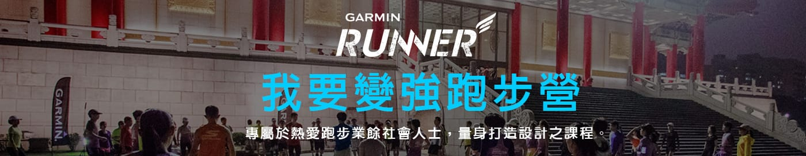
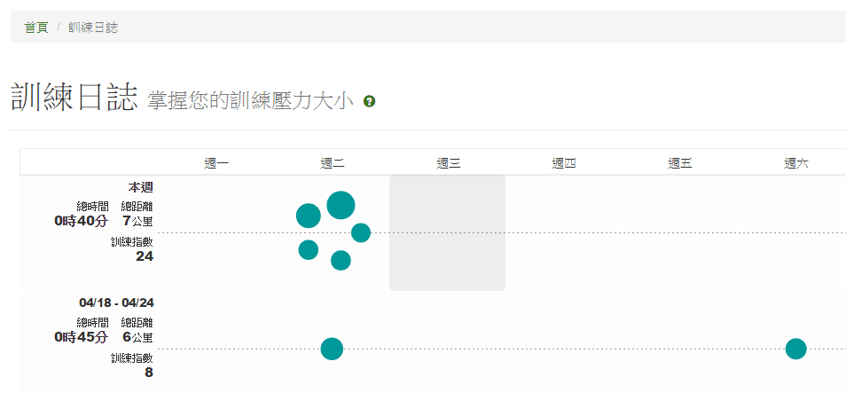
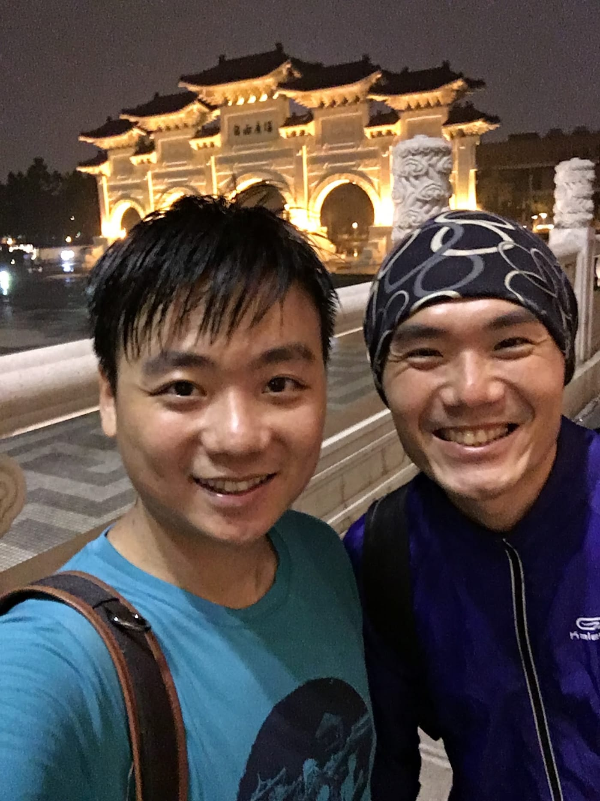
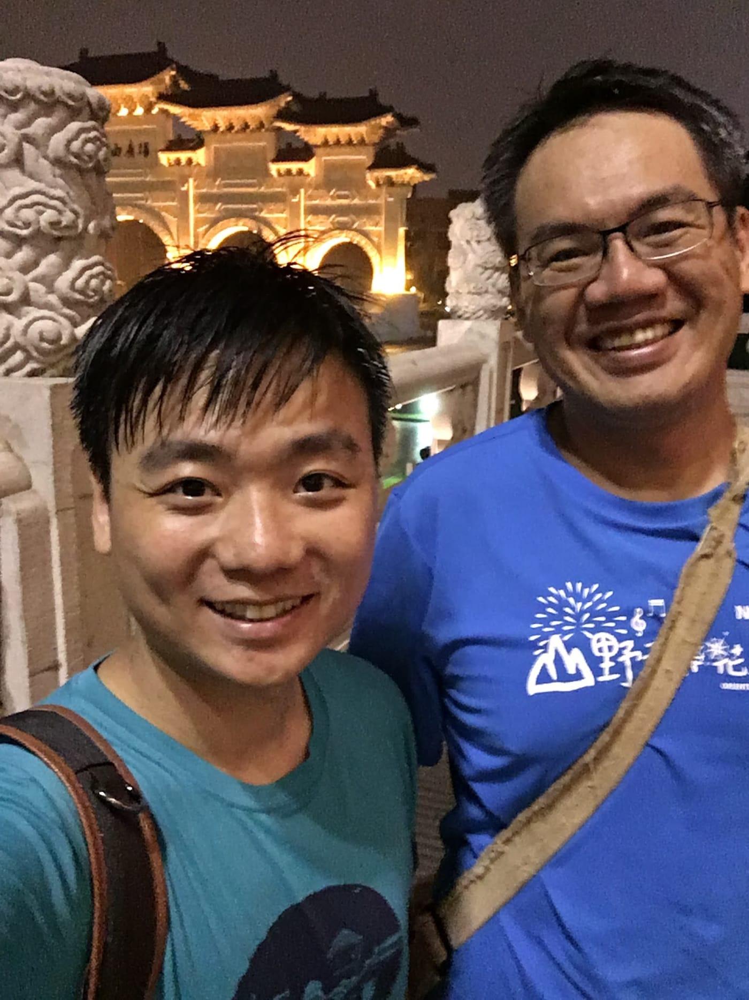

終於啊，第一次參加傳說中的Garmin我要變強跑步營，總教練是大名鼎鼎的黃崇華教練。之前就已經耳聞崇華教練帶團非常風趣且變化多端，會讓整個團的氣氛嗨到翻掉。而且，也與崇華教練有過幾次會談，印象中，他總是有說不完的故事可以分享，還會散發出來一種說不出來的魅力，讓我一直想找機會報名看看他的課程。今天總算是在Amos邀約之下如願以償啦。

*就是這一個跑步營(圖取自[活動咖](https://www.eventpal.com.tw/FOAS/actions/ActivityIndex.action?showTabContent&seqno=a1947a9c-1498-4cff-957b-e59920722cbc#))*

七點左右，天空飄著微微細雨，原本還擔心歌劇院這麼大，可能會找不到地方集合，到了現場才發現根本是多餘的，已經有很多人穿著Garmin Runner的紫色背心慢慢聚集過去。不得不說這一件衣服還真是好看啊。因為今天的課程每一位學員都可以帶一位朋友參加，所以現場大概聚集了一百五十人吧，非常壯觀。也好巧遇到了一些之前有過一面之緣的朋友，分享了一些近況。

終於要開始進入正式課程了，先由助教哲豪帶領大家做動態伸展之後，就是今天的第一道菜「暖身」跑。嗯？大家一出去就是五分半速，等等！這不是暖身跑嗎？接下來居然還有越來越快的趨勢。昨天的擔心果然是對的，以我目前的程度應該無法跟上這一團。最後是用了5:50的配速完成3.3公里的「暖身」跑，這時候我心裡起了大大的問號，究竟我能不能跟完所有課表咧？

主課表是由崇華教練帶領，超有趣的繞中正紀念堂漸速跑，詳細課表就請大家親自來聽教練說吧。第一次跑過這麼有趣的課表，除了練體力之外，還要考驗一下記憶力。第一趟我就不小心記錯了位置，所以大概少跑了300公尺（明目張膽的偷懶XD）。之後的第二趟，跑到一半的時候，忽然下起了豪大雨，看了一下前後的跑友們，居然完全沒有人有想要停下來的動作，害我也只好硬生生地跑完。第三趟也是在大雨中精實地完成了，天啊，這樣的意志力，果然是要在一群跑(ㄓㄥ ˋ)友(ㄇㄟˋ)中才能夠展現出來吧！

「好，在這裡的課表結束了，我們慢跑回去休息喝水。」

這裡不得不稱讚一下，學員有主辦單位準備的運動飲料跟水果很合理，但是連陪同來參加的朋友也可以領礦泉水就真的很貼心啦。過一會兒，看到Amos全身已經換好衣服準備要收操的感覺，我就覺得剛剛那一句「在這裡」的課表應該有問題。果不其然，接下來又是換一個場地的漸速跑，這一次的規則又不太一樣啦，教練表示這是今天最後的課表囉，原本是要兩趟的，調整成一趟就好。

此菜色吃完後，崇華教練就開始講起他以前跑馬拉松的故事，講一講，提到有一個叫做"挑戰組"的概念，所以也問大家是否也該來挑戰一下，加一趟全力的。這一次男女生分開，女生先跑。接下來換男生跑，快到終點有一個大上坡，原本我已經跑到快無力了，但是女生們就站在終點前大聲地喊著加油，完全讓我不好意思減速，用盡吃奶的力氣也要五分速衝上最後的上坡呢。這果然是要團練才可以有的威力啊！

回到家立刻將今天訓練的上傳[GC](https://connect.garmin.com/zh-TW/)，並到RQ上看分析結果，果然訓練指數出現精實的24.1點，比我前兩個星期加起來的訓練還多呢，已經可以預想明日起床會有多煎熬了。另外值得一提的是，在第一道菜暖身跑時，出現有史以來最高的即時跑力39，不錯不錯，最近的即時跑力一直有持續上升中的趨勢，可以來準備破PB囉。

*在RQ上多麼精實的圈圈們*

最後，再次感謝Amos的邀約，要不是有你的邀請，不知道哪時候才可以再次見識到崇華教練的魅力，也超期待超強攝影師Jason的照片釋出（不知道有沒有拍到我）。

*練完與Amos合照*

[Garmin Runner 我要變強跑步營](https://www.eventpal.com.tw/FOAS/actions/ActivityIndex.action?showTabContent&seqno=a1947a9c-1498-4cff-957b-e59920722cbc) 下一個梯次也開放報名了，自己一個人無法堅持練下去的跑友，可以來享受看看崇華教練如何帶領一群人一起變強的感動！

註：這不是葉佩雯啊（應該也沒人會想找我 XD），單純非常欣賞崇華教練，想說順便加進來好了，讓大家認識一下這一個好玩又有趣的跑步營！

*與今天活動的攝影師Jason大大合照*
