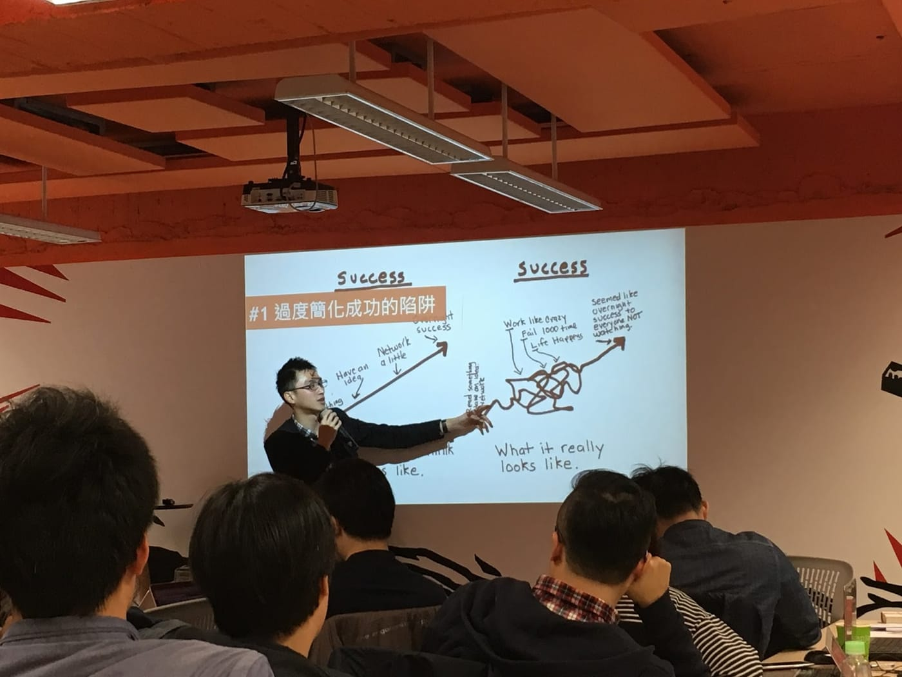

沒有真正在職場待過的我，一年多前，由於2014東海岸馬拉松的契機，與一群志同道合的夥伴們一起新創立公司，立志要將我們擁有的耐力運動科學化訓練上的專業知識與資訊科技結合，擴大服務給更多更多耐力運動愛好者。

*2014東海岸馬拉松海報*

那時候的我們太天真了，以為擁有燒不盡的熱血，還具備了走在很前面的關鍵專業知識，也確實看到了目前市場上的需求，成功建立起一個穩健的新事業絕對是指日可待的。然而，事情的發展卻不如我們所願，一轉眼就進入最黑暗的創業第二年了。

正當我們搖擺不定，多方嘗試不同的模式時，剛好朋友認識AppWorks的IC，便介紹我們可以來申請看看AppWorks Accelerator Class #12，光是看到介紹上有提供免費工作空間、免費冷氣、免費列表機、免費會議室，這幾點就可以讓我們輕鬆在台北有一個駐點，便立刻填寫表單申請了。

運氣似乎不錯，面試後不久就收到錄取通知了。當我們成功進入到AppWorks時，才發現那些免費的硬體設施相對於AppWorks能夠提供的價值，根本就是九牛一毛呀！

#我在AppWorks得到了

**創業觀念**

一進到AppWorks，Jamie的幾堂課程，讓我們了解到現在需要獲得0到1的幫助，此外，提了幾個創業上容易犯的錯，剛好我們都犯過了。那時候心想，若如果能夠早一點知道Jamie或是AppWorks，或許那些我們曾經犯過的錯，嗯，會犯的比較開心一點吧。此外，每星期的Training Tuesday以及Speaker Series課程跟講座，都會邀請非常厲害的腳色來分享你在創業這條路上所需要具備的觀念與心法，當然還有很多實作的方式。更厲害的是，成功的故事我們聽多了，AW還會邀請學長/姊回來講他們創業失敗的故事，給我的啟發絕對不會遜色於那些豐功偉業呢。

*蠻欣賞的一位學長 David 來上課*

**良師益友**

AppWorks的IC是我們很重要的Mentor，幫我們創造了很多機會。除了可以預約AppWorks的合夥人Office Hour之外，每個新創團隊都會被分配到一個組頭，我們的組頭就是傳說中創投張鈞甯Jessica大大（請原諒小弟我之前不知道您的來頭這麼大），有人盯著你的感覺真的很不錯，還會開出高高卻又似乎不是那麼遙不可及的目標，並且總是一針見血的直搗黃龍。第一次上台報告的Mentor Day也是一個重要的機會，讓你可以靠自己的產品獲得額外Mentor的指導。再來最重要的是，你在這裡可以認識很多新創團隊的朋友，每一個團隊做的事情都不太一樣，但卻都有共同的目標是希望能夠透過網路，讓這世界更美好。特別感謝同梯[Fugle](https://www.fugle.tw/)的Anyway，給了我許多幫助。我比較害羞一點，#askMafia 這個強大的功能我就沒使用過了。

(這裡本來想放創投張鈞甯的照片，可是她不准我放。Q\_Q)

另外，還有一些實質上的幫助，也是透過AppWorks的幫忙，有AWS、Microsoft、智付寶、Line等等的技術或是服務支援，再加上多了一個台北的辦公室據點。真的是非常慶幸我們能夠加入AppWorks。接下來，還有最重要的Demo Day要面對，這是一個非常好的曝光機會，無論如何是一定要搶到上台的門票啊！

現在，[第十三屆的AppWorks加速器](http://appworks.tw/accelerator/)正在招生中，朋友們，如果你現在正在創業，推薦你可以來申請看看，光是能夠面試，讓AW合夥人們問問題，就可以讓你更了解你到底真正想做什麼。第一階段到5/2就截止囉，申請表其實有點難寫，可以開始動工囉。(不然就要等到第二階段咧~

[https://www.youtube.com/watch?v=gdT_GzS9lyo](https://www.youtube.com/watch?v=gdT_GzS9lyo)
