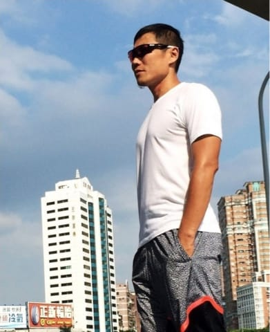
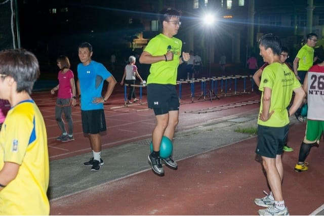
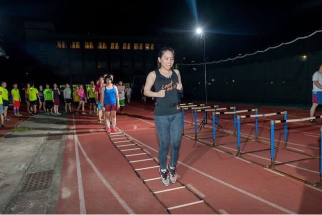
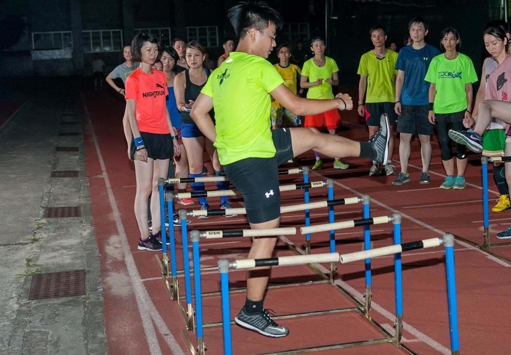
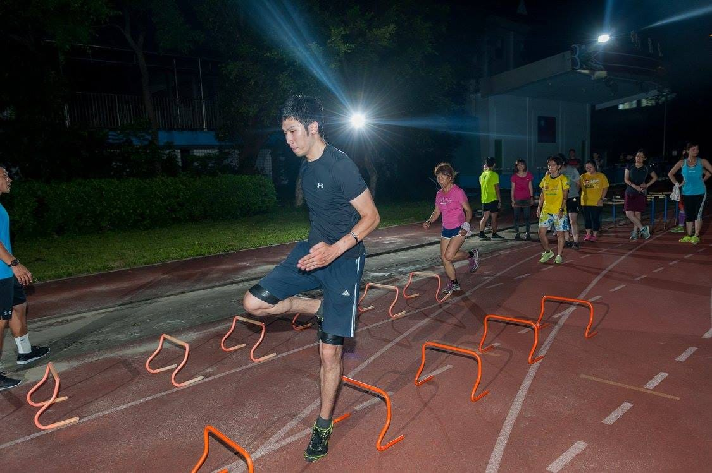
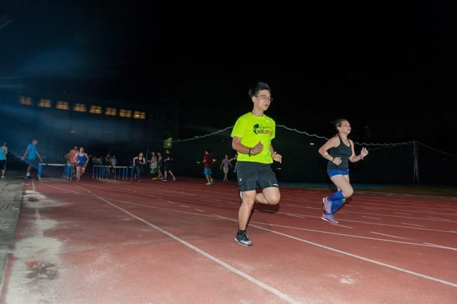
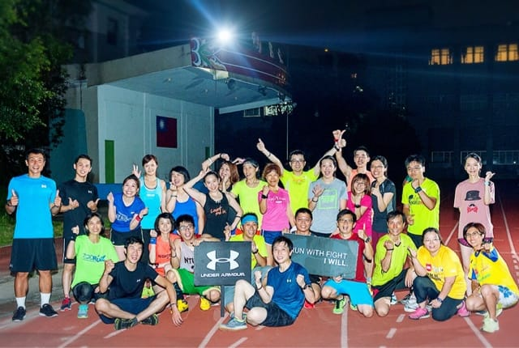

這一次能夠成為UA鬥陣跑團第一季的固定團員真是太幸運了，除了有一次工作的關係之外，我可是不管地點換到哪裡，都是風雨無阻超認真參加訓練的。原本是想說這是我第一次參加有教練的固定跑團，應該每一週都要認真寫心得才對，不知不覺六週過去了，結果一篇都沒寫，剛剛好這一週的訓練內容很特別，就從這次開始寫好了。（[文彥](https://rq.center4gaming.org/course/coach/wenyen)&[哲睿](https://rq.center4gaming.org/course/coach/JheRueiLiang)教練對不起啦～）

本次教練為光榮國中田徑隊的張振旗總教頭，聽說他可是都不接外面跑團的教練，只專心帶領田徑隊在短跑項目上努力，能夠有這一個機會算是非常難得，終於可以體驗一下真正的田徑訓練課表啦！

*總教頭張振旗*

本日課表菜色如下：

1.  暖身跑 10分鐘
2.  暖身操
3.  瑜伽球訓練 2 個動作
4.  繩梯訓練 4 個動作
5.  欄架訓練 5 個動作
6.  衝刺跑 4 組
7.  緩和 + 收操

接著，我會一一介紹每一個主菜色詳細的訓練內容，並且加上一些我自己個人的心路歷程。

**瑜珈球**

本訓練有兩個動作，於雙腳踝中間夾一個瑜珈球，要求直膝並只能使用腳掌的力量彈跳十五下三組。如果可以的話，在十五下之後加入六~八下的高彈跳加強版，要彈高到讓大腿平行地面。彈跳時要注意不能讓瑜珈球飛出去，並且無法屈膝單純靠腳掌的力量彈跳，確實有一點吃力。我加強版都只有做個幾下而已，不過跟我同組的大哥都做到滿還自己加量咧。

*瑜珈球跳躍訓練*

**繩梯**

此訓練總共有四個動作。第一個是要使用跳躍方式，每一步重心都要落到繩梯間格內，要穩穩控制每次跳躍的重心其實比想像中還要難呢。再來就是要跟繩梯跳恰恰，兩前一後，一樣控制每一步重心都要落到繩梯間格內。第三個動作是要類似行軍的方式，直膝踢正步前進，做兩組。最後一個動作是我平常就有在練的高抬腿前進，一樣兩組，差異就在要穩穩踏入繩梯間隔還是有點難度。

*繩梯敏捷訓練(我在後面左邊數來第四個XD)*

**欄架**

沒想到常常看到田徑隊在進行的欄架訓練，居然有機會可以親自來體驗一下。第一個動作為正面高抬腿繞八字跨欄，剛執行的時候，根本就是在大跨步慢慢走路，完全沒有跑步的感覺。後來有稍微順一點點，看來我應該要多加強訓練軟Q的動作才行。

第二個動作為側面直膝高抬跨欄+側面曲膝高抬跨小欄架，介紹此動作的時候，教練有特別強調屈膝高抬腿要注意讓抬起的腳在另一隻腳的膝蓋上方，並且落下時要在身體重心下方，才可以幫助腳進行「推蹬」更有力。（這裡的推蹬定義不明確，個人感覺應該比較像是支撐落地衝擊的使力。）

*側面直膝高抬跨欄中*

第三個動作是在小欄架邊欄快速抽腿跑左右各四組，一腳要在欄架內另一腳在外面，總是很擔心踢飛欄架而速度快不起來。

第四個動作為小欄架高抬腿衝刺跑，不是我在說，執行到最後一組的時候，張教練還主動跟我說「唷，你越做越像樣了喔。」哈哈哈哈哈。

*腿好長的同學跨小欄根本犯規啊XD*

再來最後一個欄架訓練動作要分組，一組五人拿四個小欄架，進行側向抬腿追逐跑，來回算一組，每個人各輪三組。由於我們這組有六個人，為了湊人數到奇數，有位小鮮肉助教加入我們，有人跑回程的時候，下一位要跟上去用同樣動作追他，這位小鮮肉的動作流暢度跟我們完全不能比，還好我沒有排在他前面過，不然肯定會被他追上翻車的。

**衝刺跑**

最後一個主菜色就是爽爽的短距離衝刺跑啦。練了這麼多敏捷的動作訓練，看能不能實際應用在短跑上。老實說，其實訓練到這裡的時候，已經沒啥力還可以高速衝刺了。所以我都是專注在步頻加快，賣力進行了最後四組約五十公尺的衝刺跑。

一堂課內享受到各種第一次進行的敏捷訓練，還挺滿足的。（雖然代價是隔天起床全身痠痛啊~ QQ）結束本日課程後，Elva報告了一個好康的秘密消息，並且提醒大家今天是夏至剛好遇上滿月唷，要抬頭看看天空中那一輪明月。順著話我也抬起頭看著月亮，忽然想起這跑團也接近尾聲了，在這跑團認識了好多新朋友，特別是一位總愛酸我而且還很「幫我」的「長跑建將」，就剩下最後三堂課程了，要好好把握啊！一起 Run with fight！

體驗學員是可以每週三中午搶名額，大家一起來當同學吧 → [報名去](http://bit.ly/28NN0bx)

