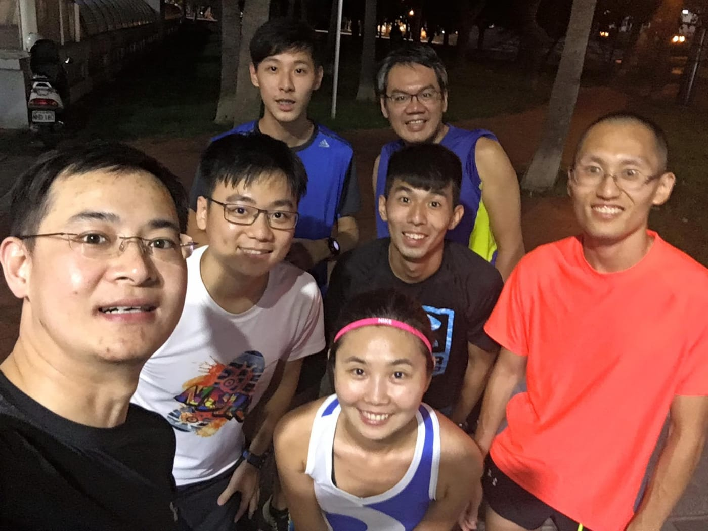
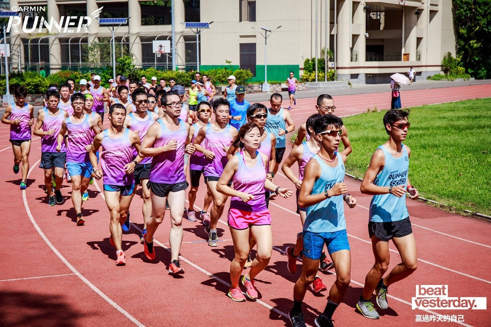
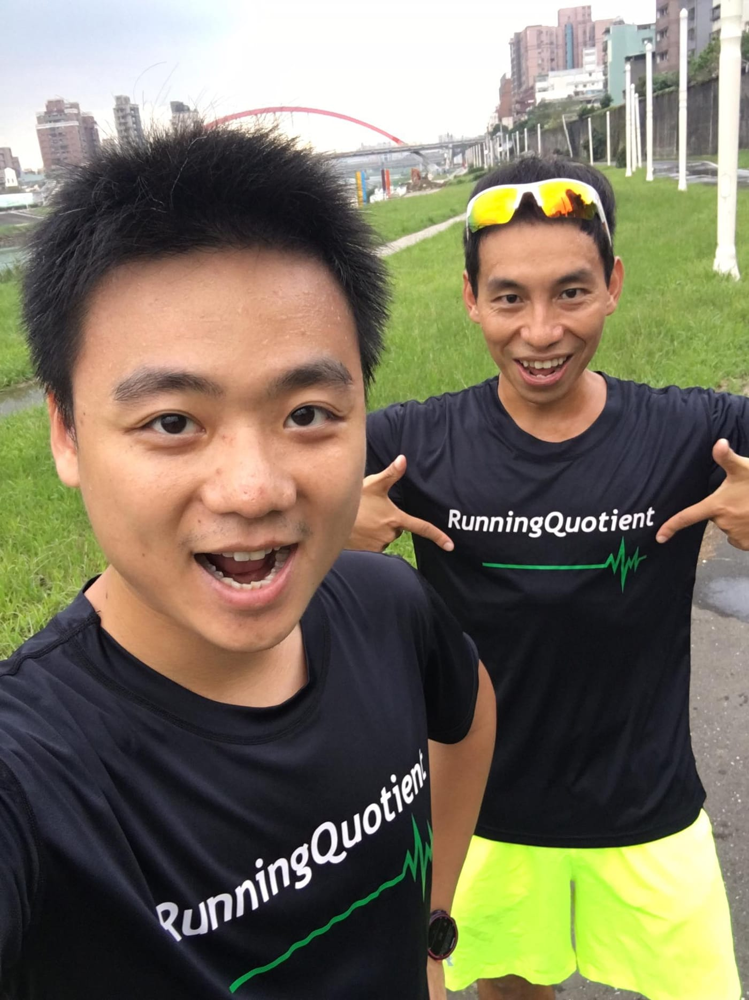

是的！我決定要挑戰人生中第一場全程馬拉松，「2017渣打馬拉松」！

（先來公開宣告後，就不會找退路啦～）

到現在為止，我已經挑戰過了三場半程馬拉松了，雖然每一場體重都比上場多了三公斤，但是每一次的成績卻都是進步了約三十分鐘左右呢！就在我盤算著，下一場應該有機會挑戰進到兩個小時左右時，這一場Garmin全馬PB挑戰訓練營的消息就這樣忽然出現，讓我不禁想著是否該提前挑戰全馬了。

那時候，我已經獲得了Garmin北區心率教練證照，正與Garmin團隊前往高雄準備下一批的心率教練培訓。傍晚時分，一群人在旅館內待不住，便一起到隔壁的文化中心跑步。我與Jason (Garmin行銷副理)速度差不多便一起跑，聊天中得知了Garmin有意將在上海舉辦非常成功的全馬PB訓練營引進台灣舉辦，也跟我提出了一個能夠一起幫助跑者們的合作計畫，讓[RunningQuoitent](https://www.runningquotient.com/)參與並協助整個訓練營，提供更好的紀錄科學分析服務。

*一群人跑去高雄不忘先跑步*

其實行銷活動可以有很多種，但Jason團隊選了相對難的一條路，從支持科學化訓練開始，到持續推廣心率訓練、花了大量力氣培養心率教練，並整合所有資源舉辦全馬PB班，讓致力於科學化訓練的先驅徐國峰教練能夠盡情發揮！一切的一切，都是希望能夠徹底翻轉台灣整體耐力運動環境，並讓耐力運動圈各個環節能夠一起形成完整並健全的產業。

回想當初，我們創業的初衷也就是希望能夠讓科學化訓練知識在台灣遍地開花，透過我們開發的工具，能幫助時間有限的跑者們可以更有效率地突破自己最佳極限，嘗到自我升級的樂趣與那真實痛苦後的純粹幸福。從耐力網開始，到現在的RQ專注於跑者紀錄科學化分析，提供工具給真正需要的人，又能夠讓我們更貼近這群目標明確的跑者們，不就正好是我們努力追求的嗎？

「登峰造極 Garmin全馬PB班」是提供最完整軟硬頂級服務給跑者的訓練營，有被稱為紫色旋風帥到不行的團服、Garmin最新的鐵人錶735XT(試用)、超完整記錄平台[Garmin Connect](https://connect.garmin.com/zh-TW/)、讓教練輕鬆了解學員課表達成率與開課表工具Garmin Sports(在中國稱為佳速度)以及專注於科學化分析跑步紀錄的[RunningQuotient](https://www.runningquotient.com/)，再加上由徐國峰教練親自培訓出來的[Garmin心率教練團](http://www.garmin.com.tw/event/grc/coach.html)的幫助下，相信入選的七十位跑者都能在這十八週進到下一個層次。

*先修課程第一天*

此外，Garmin還將所有的課程投影片以及訓練計畫，都無私分享在FB的[Garmin心率訓練](https://www.facebook.com/groups/809109535899954)社團中。每週一次的大團練也都歡迎所有跑者來旁聽，了解整個訓練的內容。這麼強大的陣容誘惑之下，原本身為贊助廠商的我，雖然入營條件不符合(沒跑過全馬)，也決定要親自跟這一次訓練營完整訓練計畫，並挑戰我人生中第一場馬拉松。

*跟著文彥教練準沒錯*

就讓我們拭目以待，十八週後見真章！
