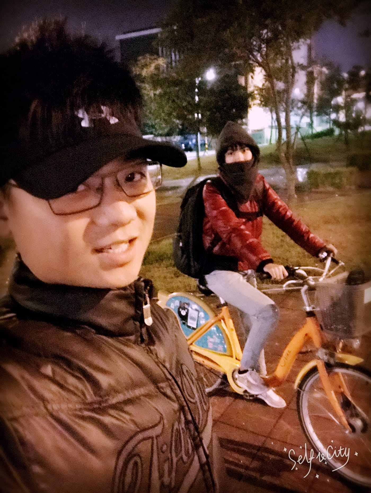
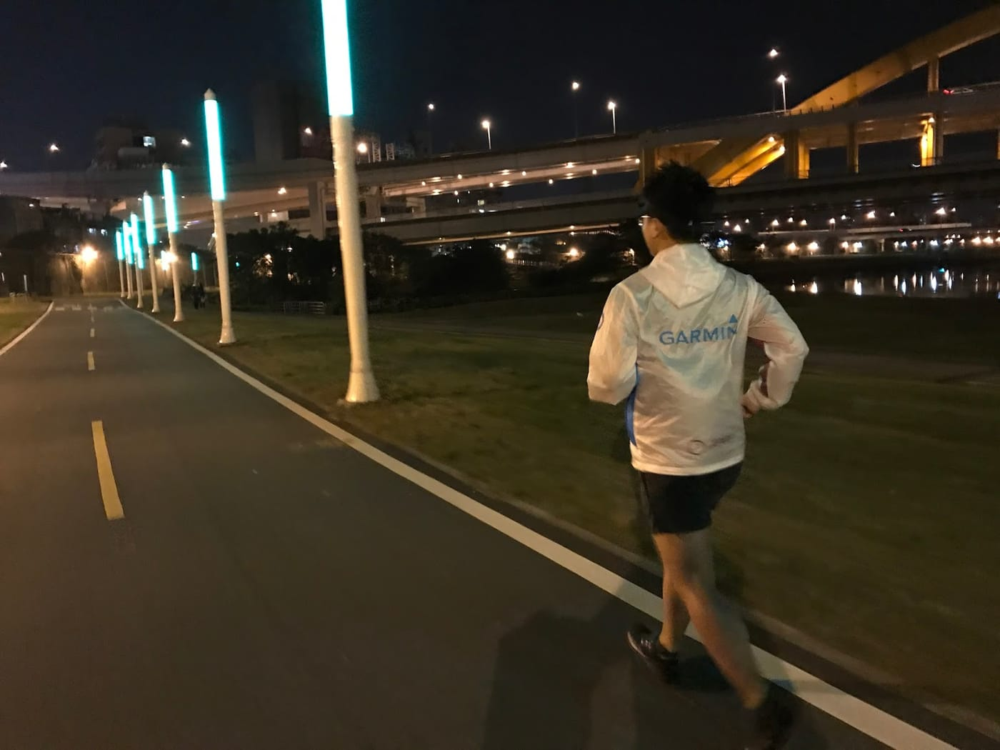
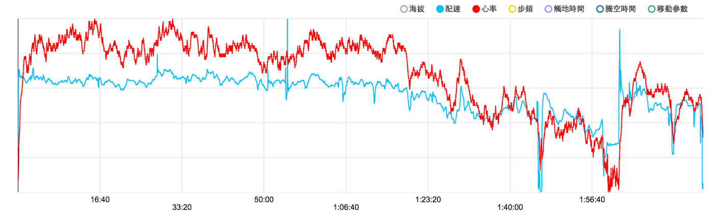
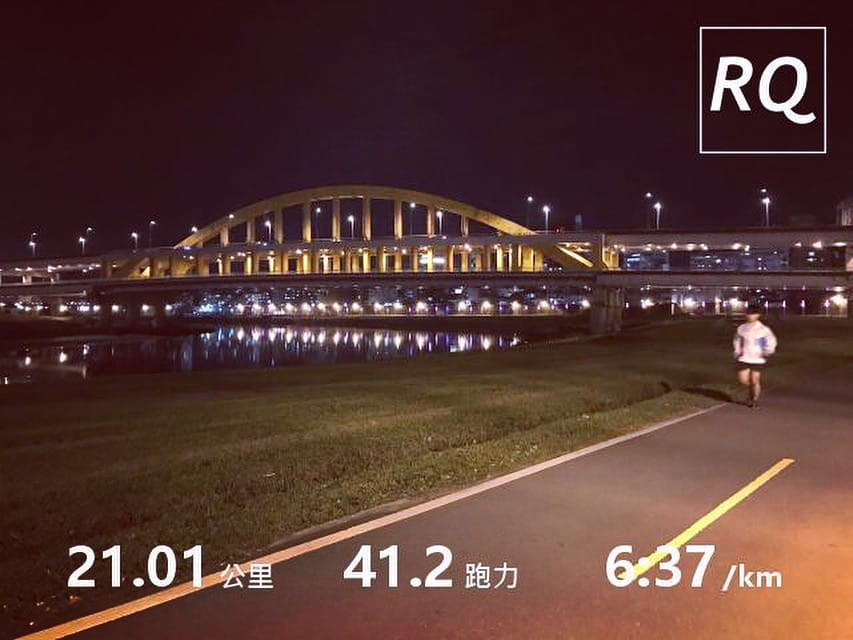
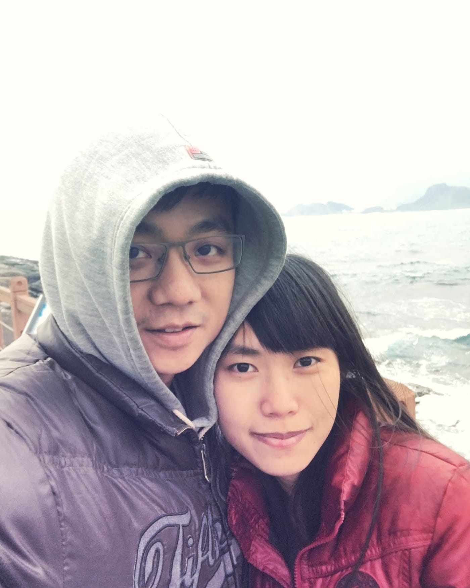

就這樣不知不覺吃了近15週課表，終於到PB班的最後一個週期「比賽期」。這一個週期的最主要目的就是讓身體以最佳狀況應戰目標賽事，課表的訓練量會開始逐步減少，並且訓練強度也轉成以比賽目標強度為主，也就是馬拉松配速（Ｍ 強度）。

雖然我曾經自己吃過三次耐力網的訓練計畫（兩次半馬與一次五公里），不過獨自一人執行計畫的完成度與達成率都大大不如這次。我想除了擔任第四組教練之外，最主要的原因就是有一群相同目標的夥伴一起執行「自找的痛苦」吧。

*第四組人最齊的一次團練*

而上個週期「巔峰期」的最後一個課表也是最重要的一次長距離訓練【M強度21km+4ST】（第一組是M強度25km+4ST），原本打算跟PB班風兒開的自主團，但後來決定要先去買渣打馬的戰靴，只好忍痛放棄地瓜湯跟小鮮肉，添購好裝備後再去跑。結果在下午的時候，看到幾位穿新鞋跑的同學都出現意外狀況，便立刻打消主意。剛好這週依婷來台北參加尾牙，所以就帶著一位專屬補給前往彩虹河濱跑課表囉！

*出發前鬥志滿滿，殊不知...*

本次的策略也打算與上次相同，五公里補一杯水，十公里半包能量包，十五公里吃完剩下半包能量包，挑戰全程都不看錶。在滿滿情侶的彩虹橋暖身後，便開始起跑，自我感覺狀況還不錯，身邊還有一台專屬補給車（配黑美人），雖然不該抱持著這種心態，但是其實心裡想著肯定是萬無一失可以再次破半馬紀錄。

前五公里比以往更大膽地抓馬拉松強度的感覺，速度跟心率也都能維持在M強度（事後分析）。第一次補水的時候，專屬補給車往前騎一小段就停下來準備補水，但是他連水壺都還沒打開我就一溜煙的從她身邊跑過，順便還說了聲：「啊你是在準備給誰的？」現在想想還蠻好笑的，但，接下來就是惡夢的伏筆了。

*一開始感覺狀況還不賴*

過五公里後，明顯感覺到順風，以往的順風通常都是沒感覺的，只會等到跑回程的時候面對逆風才會警覺到原來剛剛是順風。但是這一次，順風的非常誇張，還會有被吹著跑的感覺，第一次遇到這種情況還沾沾自喜，想說速度應該會快更多，雖然有稍微跟補給車提一下等等應該會逆風很難騎/跑。不過，還是做了一個錯誤的決定【繼續跑下去】。

經過十公里後準備折返，均速5:44/km平均心率區間偏高了一些到達1.9，整體狀況都還很不錯，也自認為可以再跑個二十公里沒問題。ＢＵＴ！接下來就是痛苦的開始，一折返就是如預期般的逆風，但是還在可以忍受的範圍之內，速度降了一些又繼續跑到十三公里。再來的考驗根本就是夢靨，風大到我根本抵擋不住，雖然身體不會感覺冷，但是手腳其實都已經很凍了。

就這樣一路降速到十八公里，意志力似乎完全耗盡，同時也感覺到肚子餓，但是又不想吃多帶的能量膠，還好依婷有帶一塊蜂蜜蛋糕可以解解饞。最後面的幾公里，終於沒有明顯的逆風，很想趕快把體力花光回到起點，但是又想著要用這樣的配速維持一個馬拉松，就在天人交戰的情況之下，一步步完成剩下的課表。

*可以從[紀錄](https://www.runningquotient.com/calendar/record/401851)中看出後十公里有多麼痛苦*

在這一次的訓練中，出現過很多之前訓練沒出現過的狀況，舉凡自我感覺異常良好、面臨強大逆風的考驗、肚子餓得很奇怪、手腳凍到硬邦邦、負面情緒瘋狂出現等，真的是還好這些都是在訓練時出現，距離目標賽事越來越近了，現在千萬要好好照顧自己的身體，循序漸進地調整到最佳狀況，挑戰我人生中第一場馬拉松。

*加油！*

最後紀錄一下，國峰總教練在前一天晚上提醒學員們一些注意事項：\
「1、明天跟上週六一樣不看錶。以自己體感的馬拉松配速來跑21公里(第一組跑25公里)，所以我們只看里程數。

2、明天一樣是模擬渣打馬的前21公里(第一組則是模擬25公里)，所以心裡上的目標是：跑完還要能再跑21公里(第一組是還能再跑17公里)。在跑的過程中要一直問自己，這是我到時要跑全馬時的體感嗎？確認之後把這種感覺與知覺記下來。感覺是指呼吸與心跳的節奏；知覺是指身體落下的角度、腳掌拉起的高度。跑完回到家再把自己的知覺和感覺跟數據做對比，好好的思考自己在渣打馬的M該怎麼跑。

3、記得吃早餐。模擬渣打馬當天要吃的東西和份量。開跑前30分鐘吃點小零食，要吃多少也請先模擬一次。

4、穿2/12當天比賽要穿的跑鞋、跑褲、衣服、帽子或太陽眼鏡……比賽當天要穿什麼，明天就穿什麼來訓練。

5、練習跑最短路徑。練習邊跑邊吃補給，補給品要跟2/12比賽當天的一模一樣。

明天是一次很重要的訓練。跑完後，想要麻煩大家回覆下面的問題，然後給我一些回饋，這些回饋也有助大家釐清自己接下來三週的訓練重點，請直接留言在此篇下面：

先說學號\_姓名\_21K時間(第一組的一樣只報前21K的時間即可)，再回覆下面問題：

一、整體感覺如何？(簡單一兩句話描述一下今天感受)\
二、有疼痛的感覺嗎(包括水泡和側腹痛)？\
三、肚子餓嗎？\
四、覺得冷嗎？\
五、有發現什麼問題可以改進嗎？\
六、還能用同樣的配速再跑完21公里嗎？(用1~5回答)\
1：很輕鬆，後半程每公里可以再加速10~20秒。\
2：輕鬆，可以維持速度，而且最後五公里可以再加速。\
3：剛剛好，後半程可以維持等速完成。\
4：累，後半程可以跑完，但速度會掉。\
5：很累，後半程可能跑不完。」

以下為我回報的紀錄：

Xx\_許紘瑋\_219\
ㄧ、前十公里大順風輕鬆自在，後十公里大逆風只想棄賽。\
二、11k吃完半包能量膠開始些微側腹痛。右大腿後側有快抽筋的感覺。\
三、18k開始餓，不想吃能量膠，還好依婷有帶一塊蜂蜜蛋糕。\
四、大逆風開始手腳都很凍，但是身體不會冷。\
五、大逆風完全不知道怎麼跑，跑到意志力用光光。\
六、5:今天這狀況後半程一定跑不完。

國峰教練回覆：

叉傑克：如果到時看氣運報告很冷的話，應該要準備手套。上次跑208，這次跑219，明顯是恢復不夠，沒關係，準備減量了，要開始回彈了。記得訓練量變少，飲食要控制，多吃營養的東西，而且要開始早睡早起了！

「意志力用光光」→用光之後才能把底挖深再裝更多。你的意志力將在這四個月的訓練中脫胎換骨，你的重生將是RQ與所有跑者之福！！

最後的最後，感謝一起陪我在寒冷的風中吹兩個多小時的專屬補給人員，我想這一次的訓練量一定遠遠超過她變回懶人模式之後半年加起來的量吧！哈哈。
