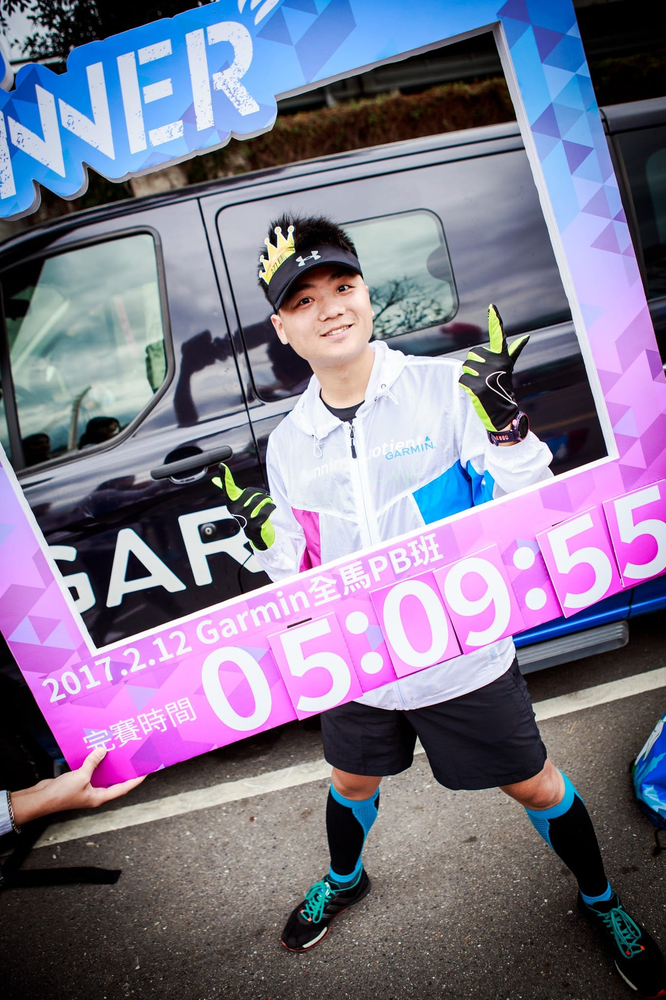
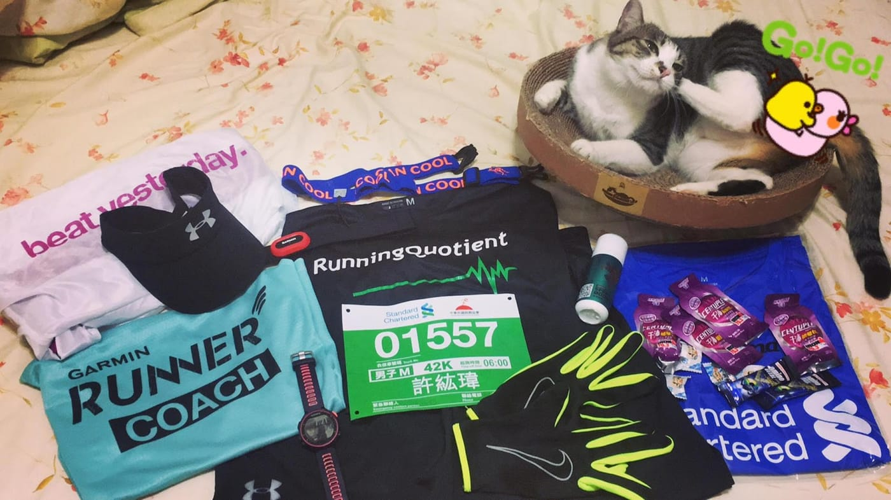
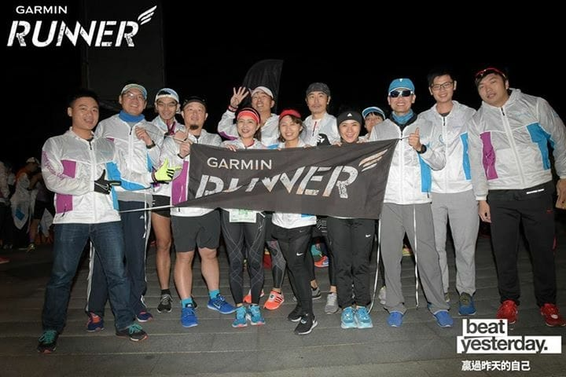
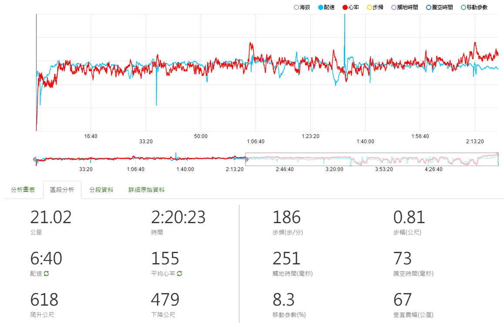
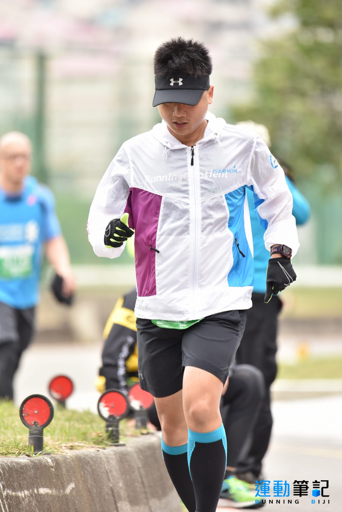
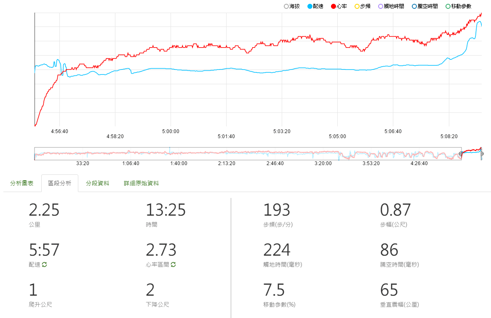
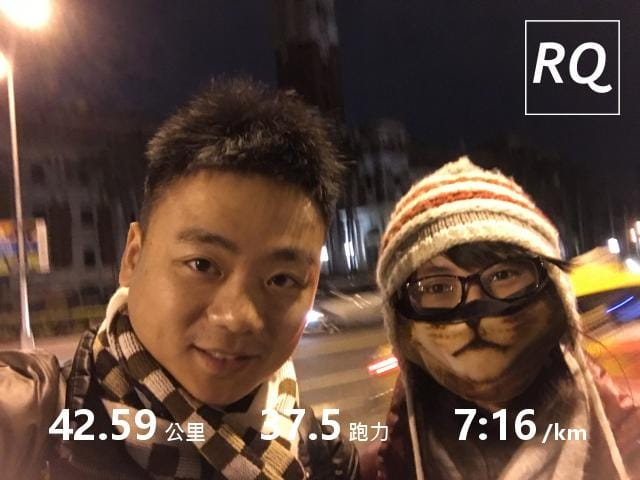

*馬拉松真的很不簡單！*

準備了整整十八週訓練，完成了好多課表，突破了一些小記錄，經過了歡樂過年增肥期後，目標賽事「2017臺北渣打馬拉松」就這樣到來啦！雖然我是第一次挑戰全程馬拉松，但其實我已經看過非常非常多的實際案例，在這四十二公里中，什麼樣的事情都很有可能會發生。抱著既期待又怕受傷害的心情，迎接我的初馬挑戰。

*終於可以曬裝備了~*

一早不到四點就起床，邊吃麵包邊灌溫水，想著起跑前要盡量「減輕」身體負擔，到廁所待了一陣子沒收穫，只好先前往集合地點囉。第一屆Garmin全馬PB班不算我總共有61位學員出賽挑戰，幾位學員因故無法出賽，也幾乎都到場跟大家一起迎接最後一次「團練」。經過前一天國峰總教練的[賽前大補帖](http://bit.ly/2kBrIq0)之後，整個氛圍似乎蠻歡樂的，有的討論著下午要穿怎樣，有的在講該去哪裡按摩恢復等等，似乎心態都轉變成只是來拿個成績單這樣。

*起跑前第四組團拍*

BUT！其實我還是很緊張，畢竟是我的第一次啊。可能國峰有注意到，過來問了一下我打算怎樣跑這一場。

「應該是會按照四小時的比賽體能分配策略進行，過21K之後再來調整看看。」

「前面35K你就當成是LSD，輕鬆跑即可。最後7K當成是高強度課表來進行，一定會很痛苦，但是要堅持住。」國峰這麼說。

「好，我努力看看。」

結果，到鳴槍前一刻，我還在跟大排長龍的流動廁所奮鬥。才沒多久已經上過三次廁所了，也太緊張了吧！(倒

*國峰賽前「溫馨」提醒*

鳴槍時剛好從起點旁的流動廁所開始起跑，望著前面萬頭攢動，依照過去觀摩比賽的經驗，萬人賽事加上全馬半馬同時起跑，後段班的人應該不少（自以為應該有中段班，殊不知...），所以想在分流之前，至少先擠到中後人群區段會比較洽當。便開始靈巧地在人群中鑽來鑽去，但人群比想像中的可怕，才鑽不到一分鐘便放棄這念頭，順順地跟隨著人群跑了。

雖然人群非常多，但其實也沒有想像中速度慢，過起跑線後約六~七分鐘，就接近設定的心率區間1.7左右，但配速比以往吃課表時的速度慢上許多，應該是比賽氛圍的影響吧。為了能夠安全完賽，決定保守一點選擇維持這樣的感覺跑下去。到全/半馬分流以前（約十公里），周圍的跑者們速度也都穩定下來，除了偶爾需要注意一下忽然慢或是停下來的跑者之外，基本上都還算順順跑。

分流後，人群瞬間分散，想說也差不多熱開了，應該是可以提一些速度了。沒想到，一直在我附近的一位女跑者似乎跟我的想法一致，一分流便開始提升速度，瞬間競爭意識被激起來一下，立刻跟了上去一段時間。啊，我比賽前一天不是才貼文說要當一位「自由」的跑者嗎？還是會被別人影響呀。

重新把心穩定下來後，就維持在1.8左右的心率區間穩穩跑下去。本次比賽我已經打算完全不看配速與時間，所以把此數據欄位從手錶中移除，大約一公里左右看一下顯示的距離跟心率區間。原來，前面的路段算是很好跑的，接下來還有各種上下橋與河濱路段考驗才正要開始。老實說，我還蠻討厭上下橋的，緩坡就算了，上橋的坡道雖然很短，但是還蠻陡的，為了要能夠維持住心率，勢必速度會降非常多。但是，我下坡的跑步技術還沒練好，所以無法在下橋的時候把時間追回來，平常練習的時候故意忽略上下橋路段真是不應該啊。

在接近第一個折返點的時候，我終於看到第一位紫衣戰隊的光男同學飛奔而過，接下來陸陸續續經過好多同學，看著他們一個個從我身邊經過，個個表情都非常認真，不知道為什麼有種莫名的感動。特別是有幾位同學看到我還特地喊了聲「叉傑克，加油」，還真的有灌輸力量的感覺呢。

開始興奮之後，忽然感覺到一股飢餓感，糟糕，我失算了，原本打算在二十公里左右的補給站補充一包能量包，居然還沒到就感覺到餓了。往回想忽然想起第一個能量包我是在約八公里處吃的，所以應該要提前一個補給站補充才對。立刻拿起準備的鹽錠先吃一顆，一邊想著下個補給站趕快到來。補給策略果然還是需要經驗，早上準備了兩個大麵包，結果吃了一個就飽了，身體也還來不及消化排泄。雖然賽前一個月總教練要求大家慢慢把生活作息調整成早上訓練，但是就是會有各種意外出現，或者說是我對於生活作息的重視優先權還不夠呀。

*前半馬的數據（[完整紀錄](http://bit.ly/2lyTkvq)）*

下一個挑戰就是約二十五公里左右的逆風段了。其實折返之後雖然還能夠維持著差不多心率區間，但有明顯感覺到配速降了不少，也有一點開始覺得跑得悶悶的。就這麼頂著熟悉的風前進，直到大直橋出現在眼前時，我內心的小惡魔就立刻跳出來了。

「終點就在橋的對面，要不要直接棄賽走回去啊？」

這念頭居然出現在我心中，而且我似乎是認真的有考慮這一個選項。現在還剩下十七公里，再過五分鐘就三個小時（第一次看手錶的時間），我現在上橋走回去剛好可以趕在同學們的完賽時間，是不是就不用讓大家在終點等我，早早結束收工呢。從來沒有連續跑超過兩個半小時的我，該不該就此打住下次再來挑戰呢？邊跑邊望著熟悉的大直橋，心裡頭一直在想這件事情，速度也漸漸慢了下來。

盤算著身體的狀況，體能感覺還好，肌力已出現疲勞狀態，腳底也開始有點痠痛，再加上速度不夠快，其實身體還蠻冷的。過了大直橋後，速度也拉不起來，心情也開始越來越沉重，也開始消耗意志力了。努力撐著到了三十一公里後，終於抵擋不住心魔，開始用走的了。

跑跑走走了一段距離後，就被五小時配速列車追了上來。難不成第一場全馬真的跑不進五小時內嗎？忽然燃燒起微微鬥志的我，立刻把「自由」拋棄，進到五小時列車集團內。「天啊！好暖和啊~」一進入集團內，馬上周圍氣溫提高了不少，搭配著大家的節奏，似乎真的省力不少，也因為旁邊後面都有人跟著，速度可以穩穩維持住。

*難得一張沒閉眼（因為遮眼了）*

就這樣跟著列車到了下一個補給站時，列車長表示休息補給一分鐘，完全不想吃能量包的我，立刻大放縱開始吃香蕉、餅乾、酸梅，拿了水跟運動飲料狂灌，從來不知道原來這些食物這麼好吃啊！正當手上還拿著一堆食物時，五小時列車就這麼開走了。不是說休息一分鐘嗎？我還沒吃飽啊~~~趕快解決手上的食物，想嘗試跟上去列車，可能是吃太多的關係，速度也拉不起來，就這麼眼巴巴看著五小時列車越開越遠，剛好一個過彎就消失了。（這時也差不多經過地上有一個抽水馬達的位置，跑完才知道原來發生了一件這麼可怕的事情。）

被列車長拋棄的我，又恢復到之前沮喪的狀態，一路上跟著幾位跑友互相超車、被超車、跑一下、走一下，啊，其中有一位還蠻可愛的（誤）。辛辛苦苦訓練了十八週，還有人在終點傻傻地等著我回去，我到底怎樣才可以振作啊。看著路邊的里程數慢慢開始倒數，心裡還想著平常這點距離我應該可以很快就跑完才對啊！

在剩下最後三公里的時候，偶爾會互相刷過的可愛跑友似乎燃起鬥志，開始持續跑了起來，離我越來越遠。受到打擊的我，腦海裡面閃過國峰說的「最後面是強度課表」，我怎麼可以認輸呢！原本以為意志力早已耗光的我，開始啟動腳步，慢慢把速度加上去回到六分速，不一會兒就刷過那位可愛跑友後，朝著終點直直挺進。

*過四十公里終於振作起來了（[完整紀錄](http://bit.ly/2lyTkvq)）*

遠遠看到國峰站在終點前一百公尺，讓大家在寒流來襲的河濱等我這麼久，忽然覺得有點慚愧，只好完全不減速直接過去。到了終點拱門前，這一次我有經驗了，一定要放慢速度，這樣照片才會好看，也四處搜尋三小時半就在終點等我的那位女孩，跟她比了一個讚，我終於回來了。完賽晶片時間 5:09:23 ，先留個紀錄，未來年年破PB囉！

[https://www.youtube.com/watch?v=qaLliCVmQ0Q](https://www.youtube.com/watch?v=qaLliCVmQ0Q)

初馬完賽後訪問

真的很感謝Jason邀請[RunningQuotient](http://bit.ly/2ljQfwK)加入這次Garmin全馬PB班，感謝總教練國峰、班主任神妞與Garmin團隊願意投入資源，Garmin心率教練團的大力支持，還有我最親愛的夥伴Hank與文彥兩位教練。很慶幸我自己當初選擇跟著大家一起吃這份課表，整個完整週期走下來的收穫比想像中多很多，無論是RQ或是我都進化了，還沒有結束，這只是一個開始，相信接下來我們的成長肯定會讓更多跑友受益的，敬請期待！

下一篇【自我數據分析】，希望能夠盡快寫完，分析完之後，還有同學們的數據要分析呢。

*二十九歲開始跑步，三十二歲拿下初馬。*

當然，不免俗的要給看到最後以及直接End的朋友一張閃照啦！謝謝妳的相信，感謝有妳。
