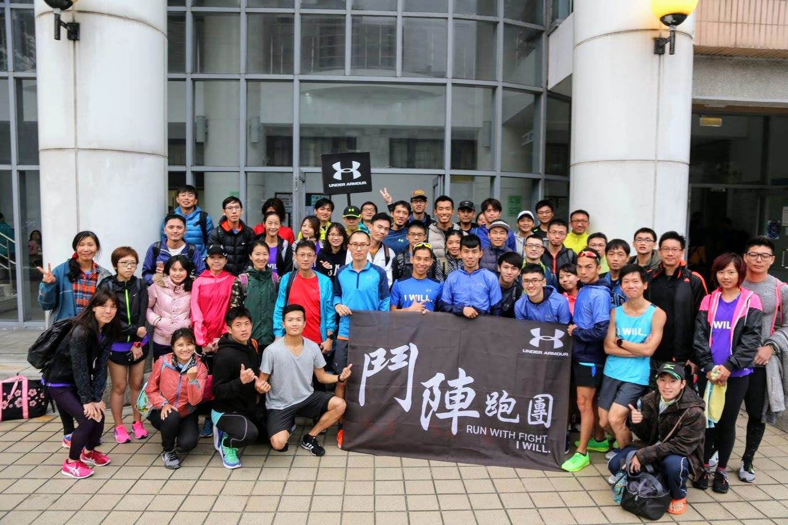
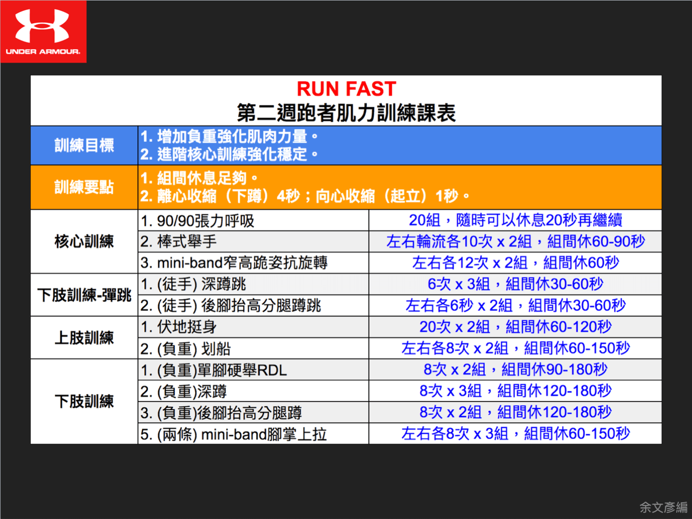

經過四週「Run Long」基礎期，UA鬥士挑戰營的學員們已經打下良好的有氧基礎，不管是體能、肌肉與心志都已經準備好接受全新的訓練挑戰！

*UA鬥士挑戰營的鬥士們大團拍*

從上週起開始進入「Run Fast」巔峰期，為了幫助學員達到「跑得更快」的目標，跑步訓練開始加入高強度間歇訓練，肌力則正式加入負重訓練，上週六全員移師到TFL淬煉體能忠孝訓練中心進行肌力訓練團練。內容以巔峰期RUN FAST新增的肌力訓練動作指導教學，以及幫助學員找到適合的訓練重量（8RM），以維持接下來四週的訓練品質。

（這張圖在原站就已經失效，找不回來了。）

*RM：Repetition Maxitmum；意思是能以標準訓練姿勢完成特定重複次數的「最大重量」。8RM是能以標準姿勢完成8次訓練動作的最大重量。*

本週肌力團練課程由余文彥教練負責指導肌力動作，陳政翰（Hank）教練負責巔峰期跑步技術訓練動作的教學，由第四組組長古漢斌（小寶）負責帶領所有學員進行暖身操並協助動作調整，而梁哲睿教練負責協助指導動作與緩和收操。當天挑戰營四組分別在四個梯次進行訓練，整個教練團之間合作非常流暢，明顯感受相當用心。

（這張圖在原站就已經失效，找不回來了。）

## 動態伸展

學員陸續報到與換裝完畢後，由小寶帶領進行暖身操，動作以打開全身關節的活動度為主，不管是跑步或肌力訓練前都適合操作。

（這張圖在原站就已經失效，找不回來了。）

（這張圖在原站就已經失效，找不回來了。）

## 核心訓練

伸展結束後，由文彥教練說明核心訓練的動作要求以及注意事項。進入RUN FAST巔峰期，為了讓身體穩定性更好，核心訓練的難度提高。第一個動作為棒式舉手，動作目的是要強化身體核心的抗伸展能力，同時加入一點抗旋轉的元素，文彥教練特別提醒：「很多人在進行棒式時都以為肩膀、臀部與腳踝要成一直線，但其實這樣會對下背造成較大壓力，我們應該要讓臀部略為抬高，以專注核心出力減輕下背的負擔。」

（這張圖在原站就已經失效，找不回來了。）

*  教練講解動作要點，學員無不細心聆聽。*

（這張圖在原站就已經失效，找不回來了。）

*文彥教練認為進行棒式動作時應該把臀部微微上抬，才能降低下背的負擔。*

第二個核心訓練動作是Mini-band「窄」高跪姿抗旋轉，這個動作要求學員在弓步姿勢下，進行核心抗旋轉的動作，而且雙腳的支撐點要在同一條直線上，相當考驗身體核心的穩定能力。教練提醒：「進行動作時軀幹要維持直立，雙手往前推時身體不能被彈力帶的拉力帶走。」動作看似簡單，但實際執行過後才知道操作起來有多困難。

（這張圖在原站就已經失效，找不回來了。）

（這張圖在原站就已經失效，找不回來了。）

*小寶助教為學員示範Mini-band窄高跪姿抗旋轉動作，從表情可以知道必須要非常專注才能執行正確。*

## 主訓練

核心訓練結束後，馬上進入主訓練的部分。文彥教練把內容切成三大塊，分別是彈跳訓練、上肢負重以及下肢負重訓練，跟跑步動作息息相關。文彥教練說：「進行負重式肌力訓練是為了發展最大肌肉力量，同時增加對肌纖維徵的招能力，經過持續刺激後身體的素質將會大大提升！」「最大肌力訓練也是專項肌耐力與爆發力的基礎。」可見接下來四週的肌力訓練有多重要！

### 彈跳訓練

首先進行彈跳訓練，分別是深蹲跳與後腳抬高分腿蹲跳，由於跳躍式訓練的風險較高，而且彈跳訓練的目的是要強化身體的彈力，所以動作皆以徒手的方式進行。

進行深蹲跳時，教練提醒：「蹲到最低時很容易把重心移到腳尖徵招腿部前側肌群。因此在最低點時要把注意力放在腳跟，帶動腿部後側的臀部、腿後等肌群，搭配吐氣上推將身體往上帶。」另外，「受傷都是發生在支撐期，所以落地的方式非常重要；身體回到地面時不能急剎車，雙腳要作出適度的緩衝，可以想像屁股坐到一團棉花上，同時也要注意兩隻腳掌在開始與結束的位置有沒有不一樣，避免愈跳腳掌打愈開，或是愈來愈外八的情況，這樣很容易導致膝蓋受傷。」

文彥教練表示：「彈跳訓練目的在訓練下肢動力鏈的力量與反應速度。下肢動力鏈是將腿部視為一個整體、一環套著一環的概念。一個很容易檢測訓練正確與否的方式：深蹲跳訓練是訓練腿部整體的動力鏈，不應該有局部特別酸痛。當有地方特別疲勞時，表示動力鏈的某個環節遺漏造成他處過勞，需要針對動作模式調整。」

（這張圖在原站就已經失效，找不回來了。）

*教練向學員說明蹲跳後落地的正確方法。*

接下來挑戰難度更高的彈跳動作：後腳抬高分腿蹲跳。這個動作需要兩人一組，一人在後以弓步姿讓另一位擺放後腿，進行單腳式蹲跳。由於只有一隻腳在身體下方，穩定平衡能力將會是動作流暢程度的關鍵，同時也更加貼近實際跑步時只有單腳落地的需求。

（這張圖在原站就已經失效，找不回來了。）

*文彥教練示範後腳抬高分腿蹲跳。*

### 上肢負重訓練

要維持正確的跑姿，上肢的肌力絕對不容小覷。在完成彈跳訓練後，教練馬上帶領學員進行負重式的單手划船訓練，這個動作主要上背部的力量與肩胛穩定之外，由於重量集中在身體的側邊，軀幹必須要發力抵抗，所以也可以訓練到核心的抗旋轉能力，動作CP值非常高！

教練提醒：「把重量拉上來的時候，要專注在手肘上，手掌會在手肘的正下方；同時要注意身體是否有直立，重量上下移動時身體不能也跟著轉動。」另外，執行重量要能夠剛好完成8下為目標，如果拿起壺鈴後覺得可以拉20下的話，代表這個重量太輕了，可以換成更大的重量進行，如此才能對肌肉帶來足夠的刺激。

### 下肢負重訓練

最後是跟跑者最直接相關的下肢訓練，分別是：單腳硬舉、深蹲與後腳抬高分腿蹲，動作皆以負重的方式進行，強化下肢肌群的支撐能力。

單腳硬舉是跑步的專項訓練動作，在過程中只有一隻腳支撐在地面上，鍛鍊臀部與背部的肌群。教練叮嚀：「在進行動作時如果覺得背部有痠痛狀況，就應該立刻減輕重量，不然很容易養成錯誤的習慣甚至受傷。」「訓練時要把注意力放在腳跟上，動作會更加穩定。」

（這張圖在原站就已經失效，找不回來了。）

*教練細心調整學員的動作，為求達到最佳的動作品質。*

另一個下肢訓練動作就是有「動作之王」稱號的深蹲，相信大家都已經很熟悉了，不過在教練一再重覆動作正確的重要性。很多人在進行深蹲時，由於身體功能不佳或清楚動作的要領，最後都沒有動用到正確的肌群，甚至可能練出一身傷。因此，教練統一先從徒手方式講解動作重點，一步一步把動作調整到位後，再開始負重，務求以最安全有效的方式變強。

（這張圖在原站就已經失效，找不回來了。）

*教練講解深蹲時該注意的重點。*

最後一個動作為深蹲的變化式—後腳抬高分腿蹲，就如同後腳抬高分腿蹲跳，需要兩個人一組，只是把跳躍的動作改成負重。跑步時永遠都只會有一隻腳支撐身體，分腿蹲的目的除了能夠鍛鍊下肢肌力之外，也可以強化單腿的平衡穩定能力。

教練提醒在進行訓練腳掌貼平踩穩、啟動整體下肢動力鏈、掌握身體重心是訓練重點。足夠的負重刺激能有效強化肌力，讓腿部在高速下輕鬆穩定的支撐身體、快速回彈。在未來四週將逐步提高負重，讓學員的身體素質更上一層樓。

*RUN FAST巔峰期第二週肌力訓練課表。*

[https://www.youtube.com/watch?v=EC3zAT2Rx1c](https://www.youtube.com/watch?v=EC3zAT2Rx1c)

## One more thing…跑步技術訓練

光練出一身強健的肌肉，並不會讓你跑得更快；想要跑快，技術就絕對不能忽視！所以，在肌力訓練結束之後，由Hank教練帶領進行巔峰期跑步技術訓練動作的教學，過程中教練不斷提醒動作的要領，也會貼心為學員調整動作，而學員也都非常專心，因為我們都知道「只有不斷精進跑步技術，才能跑得更強、更快！」

（這張圖在原站就已經失效，找不回來了。）

*Hank教練帶學員進行多種跑步技術彈跳訓練，有學員甚至表示練技術比練肌力還要累！*

UA鬥士挑戰營每週的團練都有開放體驗名額，歡迎有興趣的朋友注意每週三中午在[UA Running Taiwan](https://www.facebook.com/uarunningtw) Facebook粉絲團上開放的團練活動，相關知識與課表相關消息也都會在[官方網站](https://web.archive.org/web/20170505000821/http://www.underarmour-runwithfight.com:80/)上可以查看喔。歡迎大家一起決戰意志力，成為一個UA鬥士吧！
