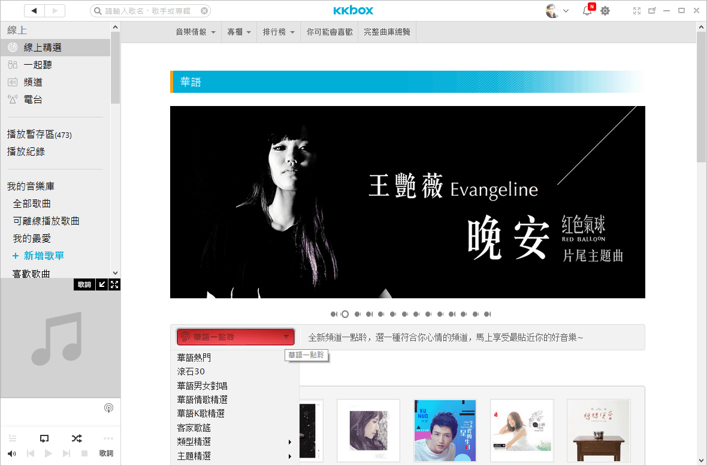
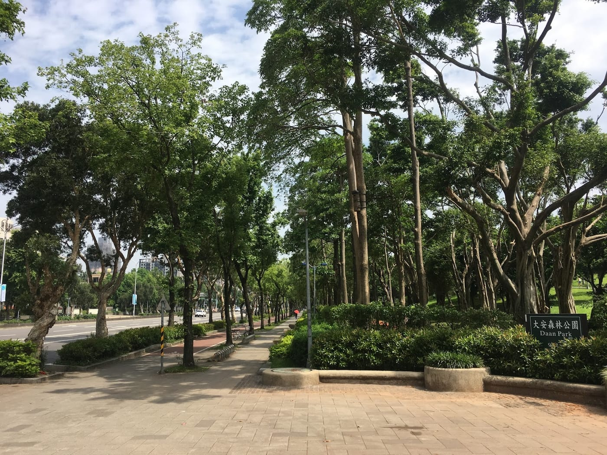

前陣子才看過一篇KKBOX總裁 Izero 的[勵志故事](https://yesmedia.com.tw/2017/05/04/%E6%9D%8E%E6%98%8E%E5%93%B2%E7%88%86%E7%98%A6%EF%BC%81%E4%BD%A0%E8%AA%8D%E5%BE%97%E5%87%BA%E4%BE%86%EF%BC%9F/)，從一個14x公斤的肥宅進化成一位剛從台大EMBA校園馬拉松接力賽拿下冠軍的陽光型男。沒想到，剛好有機會能夠與 Izero一起跑步，並且聊聊有沒有合作的可能性（我們絕對不是翹班喔）。

*練跑完先來合照一張*

KKBOX為音樂訂閱制服務的始祖之一，十幾年前剛推出時，天天都要聽音樂的我就當然就有注意到。不過，那時身為大學生的我，對於每個月都必須持續付費的服務還蠻排斥的，大概只能接受魔獸世界的月費吧。後來，買了第一台哀鳳用專案優惠加購KKBOX後，也連續訂閱六年多到現在了。

而 Izero 剛好也是[RunningQuotient](https://www.runningquotient.com/)（一個跑步科學分析服務）付費使用者，我們採取的商業模式都同樣是訂閱制，也都是提供「Good to have」（非生活必需品）的服務。除了遊戲外，對於願意付費使用虛擬加值服務的用戶，以整個群體來說是相對小眾，一般人還是比較願意花費金錢在實體事物上。但，就算服務的類型差異不小，但是經營產品的核心概念卻是非常類似的。

*每天必用功能，華語一點聆*

Izero 也很直接指出現在RunningQuotient有兩個比較大的問題。第一個就是「名稱」，對於大部分台灣人來說，Quotient這一個詞是比較難發言的，品牌命名必須好上口又能夠具有某種產品上的意義是相當重要的，這也是為什麼KKBOX後來推出的幾個服務都是能夠朗朗上口，譬如：KKTV、KKTIX等；再來，也是我們目前正在仔細審思的問題「產品本身的定位」，是否能夠用一句話就具體讓新接觸的使用者認識產品本身，以KKBOX為例，他們的核心價值為「Connecting people through their shared passion for music」，而接下來做的所有事情都必須圍繞在核心之上，並且搭配當時環境背景轉換成貼近一般大眾的一句話描述。譬如：十年前KKBOX剛推出時，使用了每天幾元就可以擁有五萬張CD，若是現在講這句話，我猜想很多人會問CD是什麼吧！（笑

我們接下來聊到對於產品市場的戰略，Izero 認為大致上分成三個大階段。

**第一階段：技術戰爭**

一個產品在市場上剛推出，通常能掌握新技術就可以領先一陣子，就像KKBOX剛移植到iOS上時，它是全世界第一個能在哀鳳上使用的音樂服務，誰不想跟它合作啊！而RunningQuotient這一個產品目前應該比較接近這一個階段。

**第二階段：行銷戰爭**

技術是不可能永遠獨家的，一旦被開拓市場之後，一定會有很多追隨者迎頭跟上，而且速度絕對會比你當初做的時候快相當相當多，這時候你的行銷策略就能決定產品到底能不能掌握領先地位。 Izero 也提到，當你的產品已經打到這一個階段的時候，其實就應該開始準備下一個戰場了。

**第三階段：商業手段戰爭**

當會走到這一個時期，其實就代表這市場已經接近飽和了，單單靠行銷手法或是策略已經不夠了，此時，大家就會陷入倚靠商業手段來競爭的惡性循環。更應該開始試著找尋下一階段新的戰場了。

*大安森林公園真是個不錯的練跑地點*

這一次能夠有機會與 Izero 聊聊真的非常開心，除了比較嚴肅的話題之外，我還獲得幾個很有用的資訊，像是KKBOX裡面居然還有聖歌、佛經、童話、有聲故事書等等，可以滿足好多不同的需求呀！連完全不聽音樂的[文彥教練](https://www.facebook.com/CoachWenYen)也似乎心動想要訂閱了呢。啊，還有現在用指定國泰世華信用卡購買KKBOX可以六折啊，也太便宜了，回去要趕快修改付款方式了！

參考文章：

[【你訂閱了嗎？】專訪總裁李明哲：KKBOX 怎從非法下載猖獗環境，靠訂閱制活下來？](https://www.inside.com.tw/2017/05/10/kkbox-subscription)
