6/3(六)補班日下午來聽在森林跑站舉辦的【飛跑吧！何信言 40年長跑傳奇，越野超馬賽事分享會】 ，為了讓這一次蹺班心安理得，我決定把分享會的內容整理起來並分享給大家，也算是盡我的綿薄之力讓想參加卻又需要補班的跑友們有個大概的樣貌。當然，這是有徵求過何大哥的同意喔！

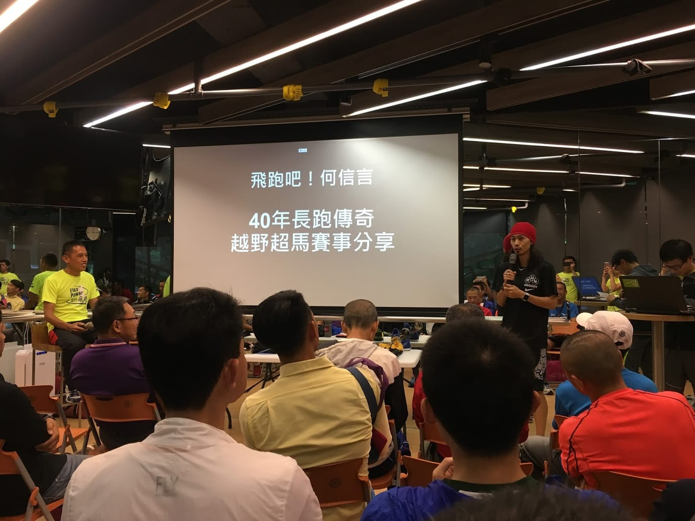

*真男人張嘉哲開場*

這一次分享會可以說是重量級人物雲集，主持人是著名越野登山教練戴佑瑞大哥，而一開始就是請到特別來賓奧運國手真男人張嘉哲為大家暖場，接著是，越野菁英選手江晏慶跟大家聊聊何大哥的「意志力」有多驚人。再來還有張叔叔、吳勝銘、郭豐洲老師、最速CEO冠翔等等知名人物都到現場聽聽年近六十卻是第一次舉辦分享會的何信言大哥說說他的故事。

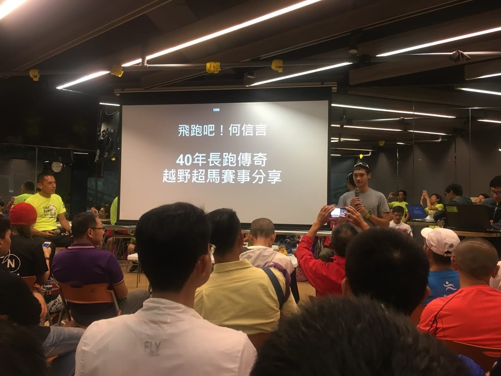

*野跑悍將江晏慶*

嘉賓介紹完後，當然就換主講人何信言大哥上場囉！一開口就用獨特的嗓音先跟大家說，這是他的第一次分享會，還蠻緊張。對何大哥來說，可能準備一場分享會比跑一場百K越野賽事還困難呢。但是他卻認為無論到什麼年紀，都是需要不斷挑戰自己並持續學習，所以願意嘗試跨出這第一步，接下來才能夠繼續成長。

**近半世紀的競技、越野、超馬之路**

1979年，非科班出生的何信言大哥在台灣區運會拿下五千與一萬的雙料冠軍開始他的跑步人生。服完兵役後，在教練的建議之下，開始轉戰馬拉松項目進行訓練。而後，在1986年，與兩位夥伴一起去參加首次國外賽事「檳城馬拉松」，才完成三十公里的何大哥開始肚子疼，堅持了一陣子之後，在三十五公里左右發現追到前導車了，就這樣一路領先到最後，拿下可能是台灣人在國外的第一個馬拉松冠軍，成績為 2:28:14 。之後，也陸陸續續在各地的馬拉松賽事上創下佳績。

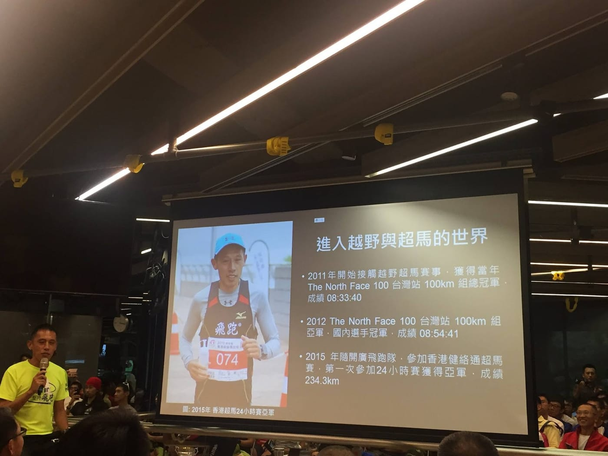

*2011年開始進入越野與超馬的世界(圖：[森林跑站](https://www.facebook.com/runbasetw/))*

**賽事訓練、飲食、裝備、天侯適應秘笈大公開**

接著何大哥給想要進入百K越野的朋友們一些訓練指引，請依照個人狀況適當調整，而大哥也特別強調：「課表是死的，人是活的。」要能夠靈活運用知識，才可以獲得最好的成效。

首先，循序漸進是非常重要的一件事情，至少有跑過好幾場馬拉松或是二十五公里以上的越野賽事之後，再來挑戰百K越野超馬。此外，課表準備期間建議要有十八週，而每週的跑量約介於105 - 150公里之間，以每月來說，低標要有四百公里，而高標約在六百到六百五十公里之間，才是比較恰當的訓練準備。

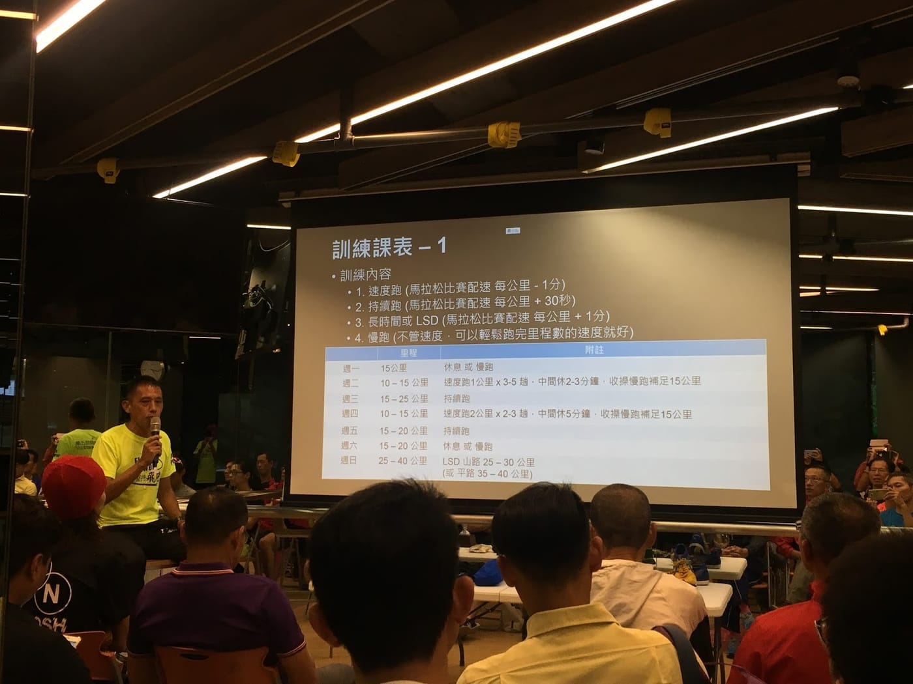

*何大哥提供的訓練課表*

訓練週期中，可以挑選第九與十四週的週末去比一場馬拉松賽事當成長距離訓練，但是千萬要注意不能全力拚，需要刻意放慢速度。而且，若是超過三十五公里的訓練，何大哥建議都不要一個人做，不怕一萬就怕那一個萬一出現。還有，盡量要找住家附近可以練跑的路線，唯有「方便」才能夠持續。

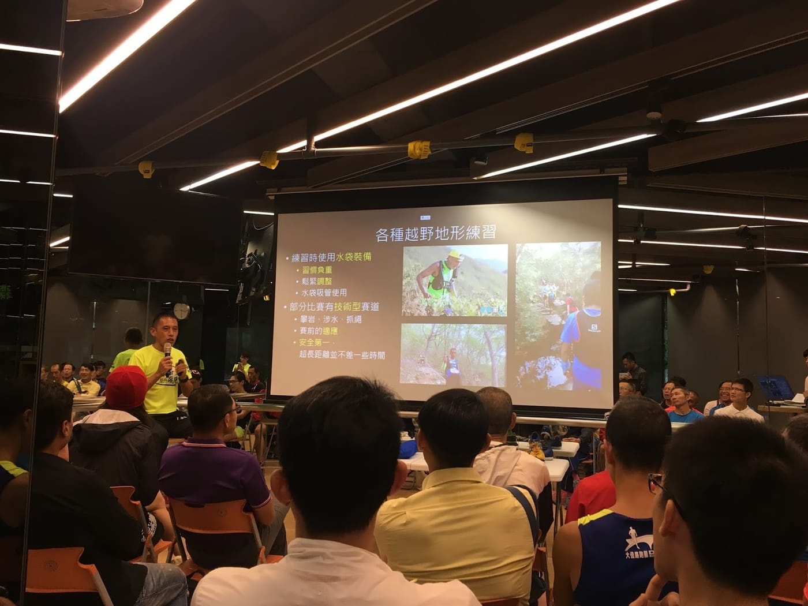

*練習注意事項，可以看出何大哥很強調安全*

再來，就是何大哥推薦的北部越野路線囉。首先登場的就是「陽明山十連峰」，咦？等等，這不就是我們與江晏慶合作才剛公開的「[陽明山東西大縱走](https://myrace.tw/race/classic/yangmingshan)」經典路線嗎？看來英雄所見略同，這一條路線總長約二十四公里，算是階梯多的中長距離路線，中間有幾段平路可以奔跑，也有很便利的補給點。

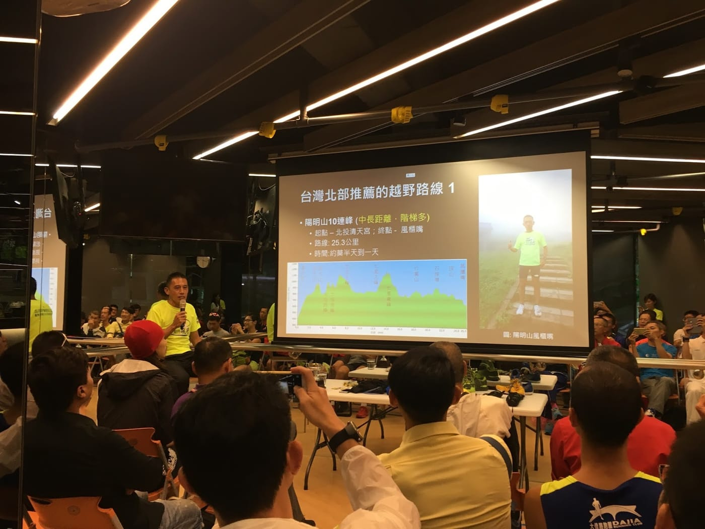

*陽明山十連峰 ([陽明山東西大縱走](https://myrace.tw/race/classic/yangmingshan))*

在這邊先說一下，課後我有跟晏慶聊了一下這條路線的困難度，晏慶認為這非常適合想開始挑戰越野跑的朋友們，可以視為進階的第一個挑戰，除了補給便利之外，還有撤退路線也是相當方便。

以夏季來說（冬季撤退時間要提早1小時），若是早上七點起跑出發，下午三點若還沒到小油坑，建議可以先撤退，那地點搭車十分方便，而且後續還有五座山要爬。第二個撤退的機制是，如果傍晚五點還未到面天山，那建議就不上面天山和項天山了（除非有照明設備，如頭燈手電筒並且食糧充足），可以直接往清天宮方向下山。

而何大哥第二條推薦的越野路線為「天母古道」，起點在公車天母站，終點為公車公仔后站，全線約四公公里，其中越野步道有二點六公里。何大哥表示，這路線是他最常練習的路線，原因很簡單，走路到起點不用五分鐘，當然要常來練習囉。

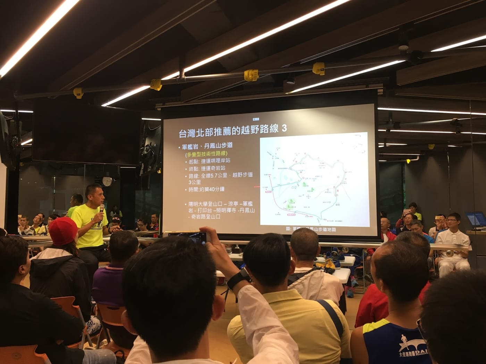

*北部推薦的第三條路線-軍艦岩、丹鳳山步道*

再來聊到賽事時的飲食，關於身體能吸收多少，是需要自己嘗試的。何大哥提供了他自己賽事準備的依據給大家參考，起跑前三小時，會以米飯為主。出門前會補充葡鯊錠，而比賽前會吃兩顆B群以及兩顆BCAA，完賽時間會超過十小以上的賽事，前段可補充粥類、麵食類等食物，後段則可以用能量膠代替。而賽事過程中不能覺得吃不下就不吃，可以吃一下走路一會兒再跑，反正長距離賽事不太會差這一點時間。假如不吃東西讓胃完全排空的話，可就得不償失了。

*參加講座拿到的贈品們*

而關於比賽裝備這部分，何大哥提到的重點就是，所有比賽大會要求的「必要裝備」，都是以跑者安全為最優先考量。「為了安全，寧可備而不用」一般比賽大會在賽前、賽後、更甚至是賽中都會檢查必要裝備，如果沒有攜帶的話，最嚴重還有可能直接是以棄賽處分呢！

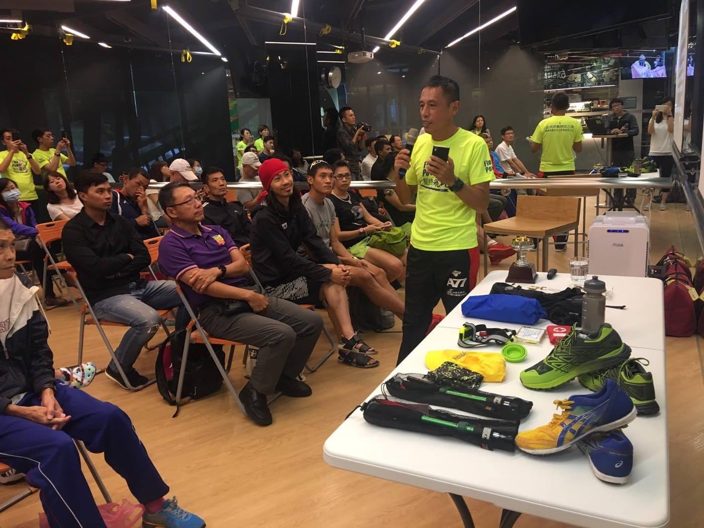

*放在前面桌子上的都是何大哥比賽裝備(圖：森林跑站)*

台灣越野路線將較之下是比較複雜的，何大哥認為一般來說會挑選兩種鞋款，其一是專為越野設計的越野鞋，其鞋底較厚，保護功能性較佳，特別是背負較重的時候。另一款當然就是馬拉松鞋，鞋底較薄但重量輕，可以用於短距離賽事以及相對不易滑動的環境。

**TNF100K 亞洲七大賽介紹分享**

在聊這七大賽之前，何大哥提供了越野跑路線的耐力值與ITRA積分計算公式，之前進行[RunningQuotient訓練指數](https://www.runningquotient.com/article/single/28)演算法分析時曾經有參考過，所以還不算陌生，但一看到想挑戰環白朗峰越野賽(UTMB)，必須要在三場比賽內獲得15點 ITRA積分，這就令我光看就覺得冷汗直流。

接下來就是展現何大哥驚人成績的時候，這TNF100K亞洲七大賽其實我今天算是第一次聽到，何大哥在一年內完成這七場難度都不低的越野賽事，並且成績都還蠻不錯的。看著何大哥一一針對自己在這七大賽的表現進行結果整理成表格並依照各賽事的屬性進行分析，還統整出一些這不就是我們正在進行的任務嗎？能夠幫助跑者們更客觀地從過去的紀錄中更了解自己的能力、優點與缺點，就像一條長鎖鏈圈般，整體的強度就取決於最弱的那一環，是一定要去克服的！

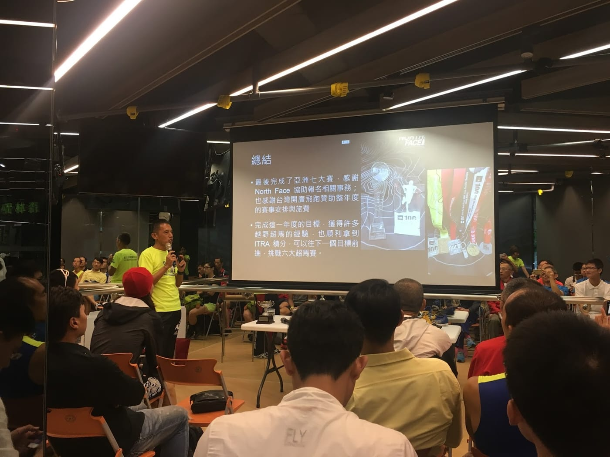

*完成亞洲七大賽的總結*

**未完的長跑路\_待續**

挑戰完七大賽只不過是一個開始，看到何大哥接下來的年度規劃也著實令人感到佩服，都已經規劃到二零一九年了呢！

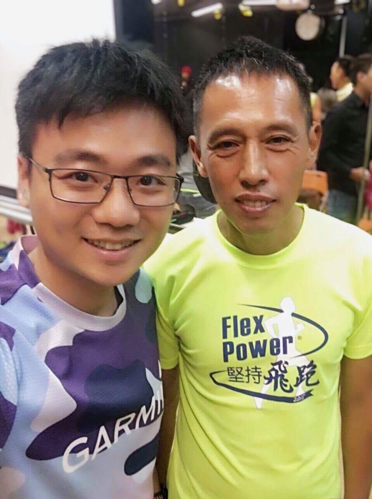

*很開心能認識何大哥*

至於會後問與答，何大哥似乎也比較放鬆了，不少名人都提了蠻犀利的問題，何大哥回答的行雲流水般，主持人戴大哥還笑稱問與答是何大哥整場表現得最好的時候呢！當然，也因為有超馬協會理事長、秘書長等人在場，獲得了一些最新消息，這部分就等著正式公開才讓大家知道囉。很開心這一次翹班來吸收了稍微不同領域的知識，期望未來還有機會能夠多聽多看多學習，就像何大哥一樣，把每個人都當成學習的對象，從三個人都各學一步來，就可以走了三步呢！

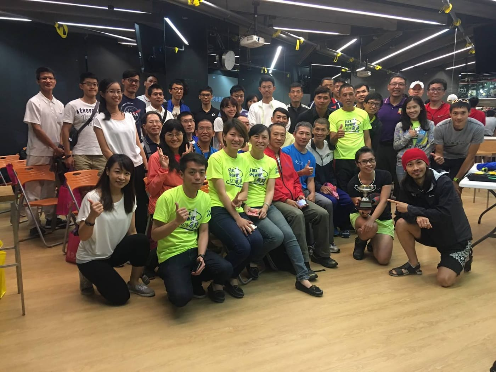

*最後大合照 (圖：森林跑站)*
