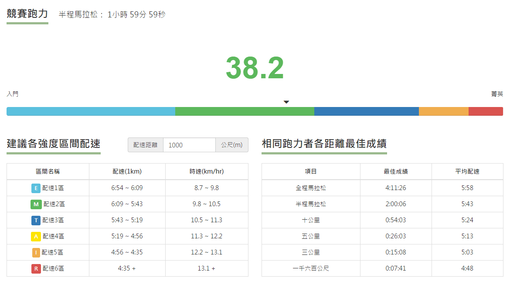
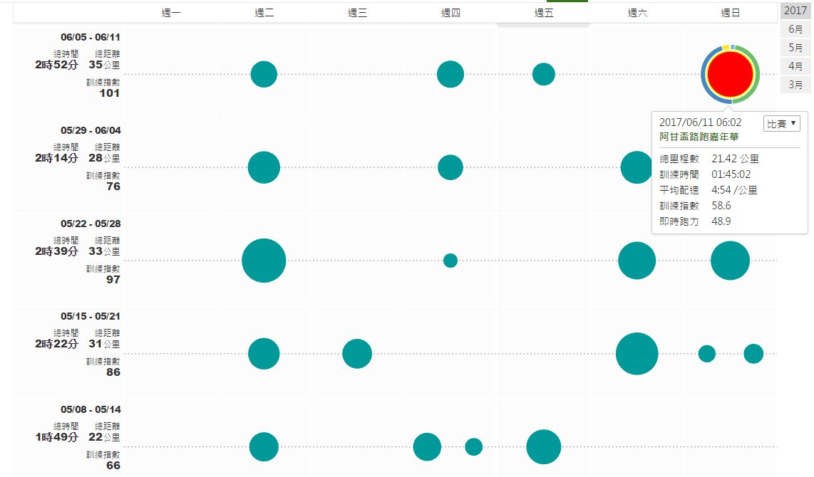
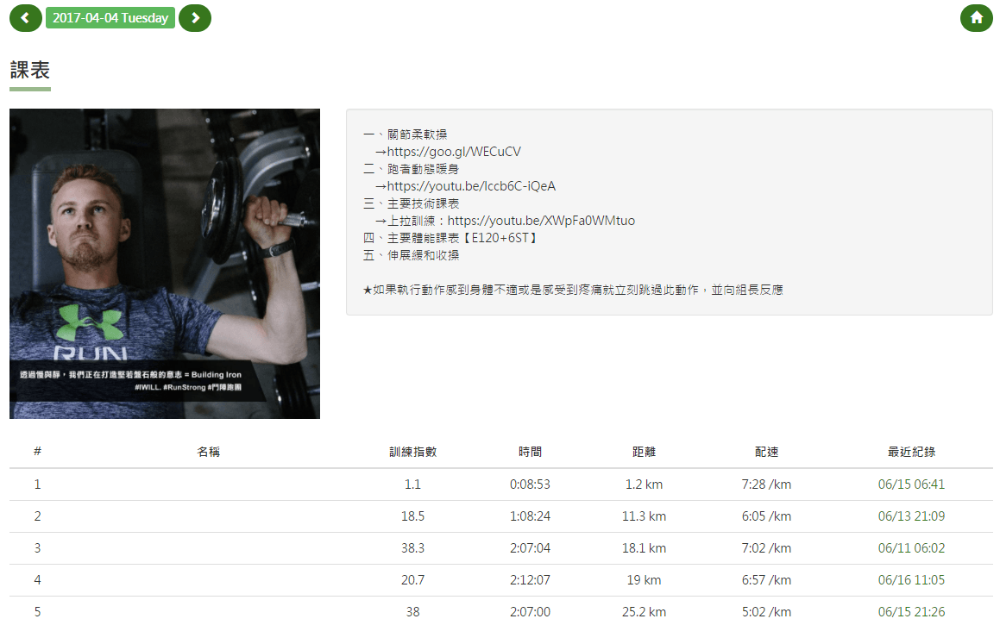

*UA鬥士們大合照*

為期十二週的UA鬥陣跑團-鬥士挑戰營台北場，在2017第八屆阿甘盃半程馬拉松中劃下一個短暫的句點。以「意志力」貫穿核心價值的半馬挑戰營，以「配速」作爲原則的訓練計畫，以「自立」視為比賽的最終目標。從三月開始進行訓練，目標賽事選在跑者們為之避諱的初夏，每一項都是嶄新的挑戰，也因此各位鬥士的堅強意志一覽無遺。而其中，扮演著意志力下的科學「RunningQuotient」便是一個很重要的關鍵。

[https://www.youtube.com/watch?v=ZRrN2lZidUI](https://www.youtube.com/watch?v=ZRrN2lZidUI)

RunningQuotient為一個專注於跑步科學化訓練的服務，希望能夠幫助所有跑者都能夠透過自我大數據分析更客觀的了解自己，並能夠進一步有效率地突破自我極限。核心團隊主要分專業跑步教練團與資訊團隊，於2016年三月正式上線，並朝著成為華人世界最頂尖的跑步科學訓練服務邁進。

「分析自己，是變強的必經過程。」- 徐國峰

大數據時代來臨，若沒有專業跑步教練協助或是足夠的專業知識與耐心，就算擁有成千上萬筆訓練紀錄也頂多只是看看基本的數據，像是配速或里程數等等。而這正是我們第一步解決的問題，讓這些紀錄變得更有價值！資訊團隊將鑽研多年科學化訓練的教練團隊知識，一個一個轉換成不同的分析演算法，讓雲端伺服器二十四小時不停地以秒計算每一筆訓練記錄，並將隱藏在背後的意義萃取出來讓跑者知道。

而這次RunningQuotient在UA鬥士挑戰營內，主要提供了以下四項服務：

**取得您的當前跑力**

每一位跑者的跑步能力都不相同，如何更客觀地衡量跑者的能力便是一個重要議題。而跑力這概念因應而生，它代表著跑者真正表現出來的能力，又稱偽最大攝氧量（VDOT)。鬥士挑戰營使用前測三公里的成績，透過競賽跑力檢測取得每一位跑者的跑力，並透過跑力分組讓實力相當的跑友們能夠一起變強。此外，在一個近百人的挑戰營中，要能讓一份訓練計畫適用於所有鬥士，那就一定要仰賴跑力所提供的個人化配速區間了。

*[競賽跑力檢測](https://www.runningquotient.com/tools/estimate)結果*

**精算您的訓練質量**

大家都知道訓練量不該只是單看里程數或是時間，較精確的壓力計算方式應該是用訓練強度乘以訓練時間，而RunningQuotient便提供了每秒訓練強度的計算，再加上配速、坡度、里程數的修正，完整呈現您當前的訓練壓力，稱之為「訓練指數」。除了知道壓力外，還可以透過訓練指數安排不同強度的課表，幫助跑者訓練得更科學。

*UA第一組組長的訓練日誌*

**瞭解您的貼心助理**

整整十二週的訓練計畫，近乎每一天都有課表要執行，而鬥士們本身應該要專注在完成今天的課表即可。這時候，有一位小助理每天會依照您希望的時間，使用影片、圖片以及文字等方式，用手機傳訊息告知您今天的課表。自己的數據還可以透過訊息直接詢問她。每星期都會總結上星期的訓練總覽給您。如果有疑似過量訓練的情況，還會貼心地提醒您要注意身體。此外，教練若有特別需要注意的學員，還可以讓小助理每一次學員訓練完就提供該筆訓練摘要。這，就是RunningQuotient LINE跑步小幫手。

*貼心小助理每日發的訊息*

**關心您的同袍戰友**

鬥士挑戰營之所以有別於以往的跑步系列課程，最重要的因素應該非這群朝著相同目標前進的鬥士們莫屬了。一開始從各地幸運中選而聚集在一起，大部分彼此之間都不太熟悉，除了經過長達兩個整天的先修課程、一次又一次的團練之外，RunningQuotient專屬群組功能也扮演了相當重要的角色，同組的鬥士們可以快速查看今天哪位有跑、哪位還沒跑，自己又是第幾位完成課表的鬥士。當然，如果是組長或是教練的話，還可以看到每一位跑友課表的配速準確度以及時間準確度呢。

*透過群組功能讓鬥士們感受到每位夥伴的努力*

當然，除了上述四點之外，RunningQuotient還提供各種強大的進階分析，舉凡透過訓練紀錄了解身體的體能、疲勞與狀況指數變化，各個配速強度下的技術指標評估，進階區段分析功能，避免過量訓練的警告通知等等功能，都等著身為跑者的你前來體驗。

一起加入跑步科學訓練吧 → [http://www.runningquotient.com/](http://www.runningquotient.com/)

也歡迎各位跑友一起加入[RunningQuotient - 跑步科學交流社團](https://www.facebook.com/groups/RunningQuotient/) 一起聊跑步科學喔！
