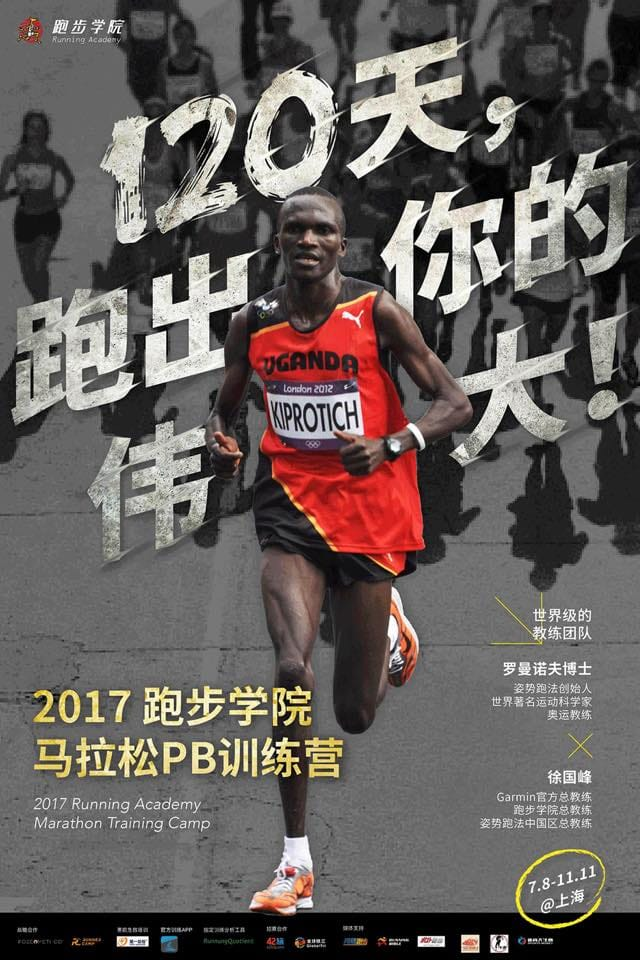
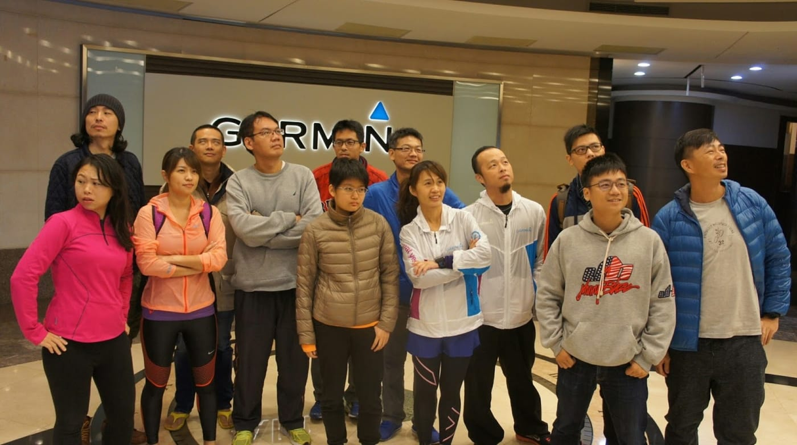
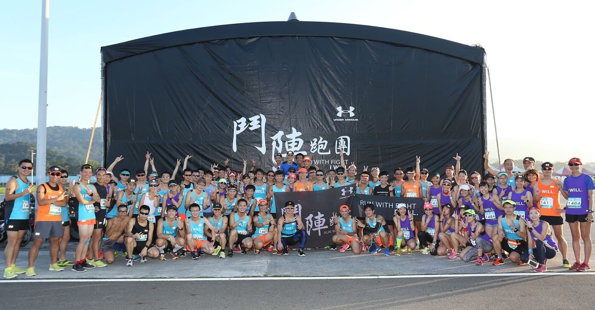
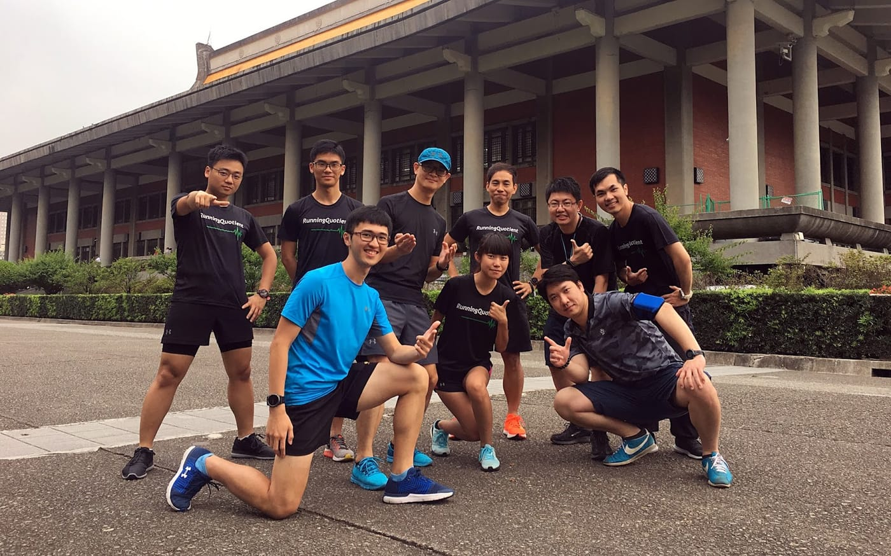

看到上海訓練營的報名簡章，忽然有感而發寫了一些文字。

*[2017上海馬拉松PB訓練營](https://mp.weixin.qq.com/s/GVHpYwFx8_MF7YlVu3SxGQ)*

擁有世界級教練團隊的上海訓練營報名費是人民幣$6000 (相當於台幣兩萬七千元左右)，個人認為這一個定價非常合情合理，有一個完整的團隊願意幫助你好好專注在課表上，其他的細節都不需要考慮，享受這美好的120天訓練旅程，並能夠在目標賽事上看到一個嶄新的自己！所獲得的價值肯定超過這一個價錢。

而回頭看看台灣，忽然覺得跑友們好幸福。

除了有許多熱血運動團隊願意從各方面幫助大家解決跑步上的問題之外，還有兩個超級品牌，願意跳脫行銷活動的框架，去做一件真正能夠幫助想變強的跑友突破自我極限的「訓練營」。

想跑全馬的朋友，有Garmin主辦的登峰造極全馬PB班，借你一隻頂級跑錶、給你一份完整16週科學化訓練計畫、還許你一整個堅強的Garmin教練團，這麼完整的全馬訓練營規劃，居然不需要收你任何費用，所有的支出都是由Garmin承擔，你只需要好好享受訓練就可以了。

*2016年GarminPB班擔任第四組教練合照*

詳細資料 → [http://www.garmin.com.tw/event/grc/course8.html](http://www.garmin.com.tw/event/grc/course8.html) (6/30截止)

再來，想挑戰半馬的朋友，有Under Armour主辦的UA鬥陣跑團鬥士挑戰營，整個挑戰營以嶄新的概念「意志力 (WILL)」貫穿所有訓練，從 RUN LONG (跑更遠)開始，建構強韌的體能基礎；再來透過 RUN FAST(跑更快)，打造相對於全馬所更強調的速度；最終以 RUN STRONG (跑更強)，強化每一位UA鬥士身軀下的盔甲，進而無畏地面對目標賽事。

整個訓練旅程絕對可以感受到UA團隊的認真，每一個小細節都是為了確保所有團員都可以專心面對每一次訓練，訓練過程中一再出現的驚喜就不透露了。這樣的挑戰營，居然只收費台幣一千五，就算只拿到的那件UA戰袍就超值了吧！

*UA鬥陣跑團鬥士挑戰營@台北 大合照*

詳細資料 → [http://www.underarmour-runwithfight.com](http://www.underarmour-runwithfight.com/) (6/30截止)

接下來的台灣跑步科學訓練進化史，我們也不會缺席！ 我們是 [RunningQuotient](https://www.runningquotient.com/) 團隊。

*RunningQuotient 團隊合照*
