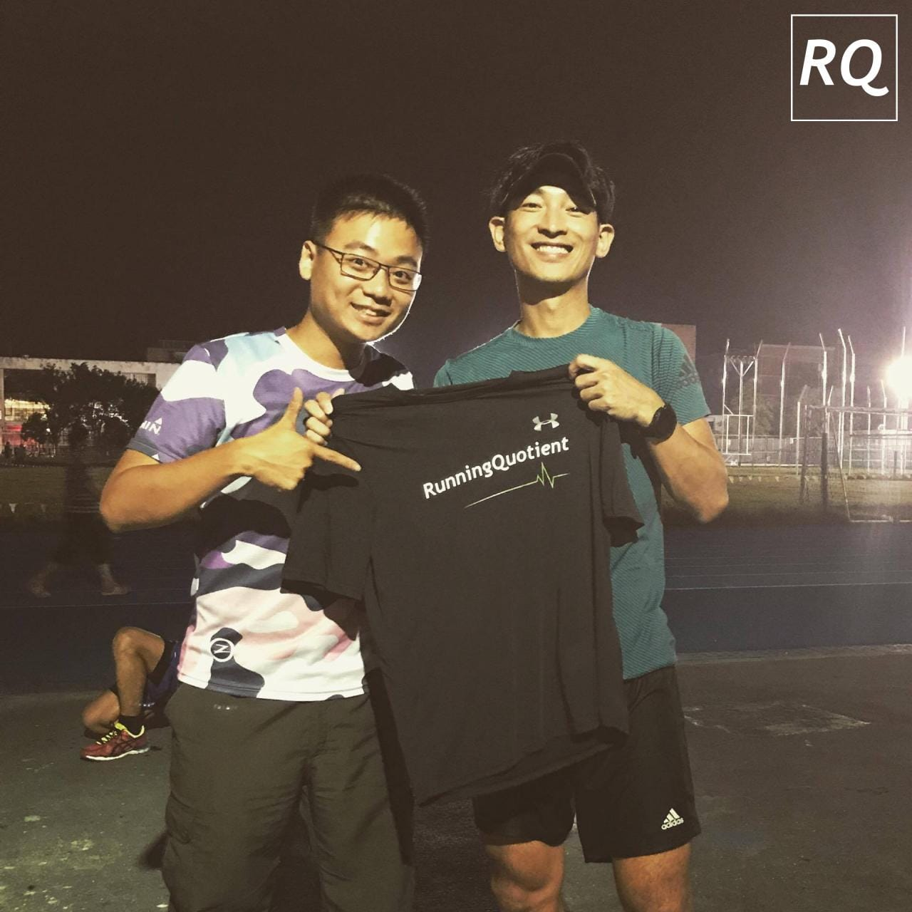
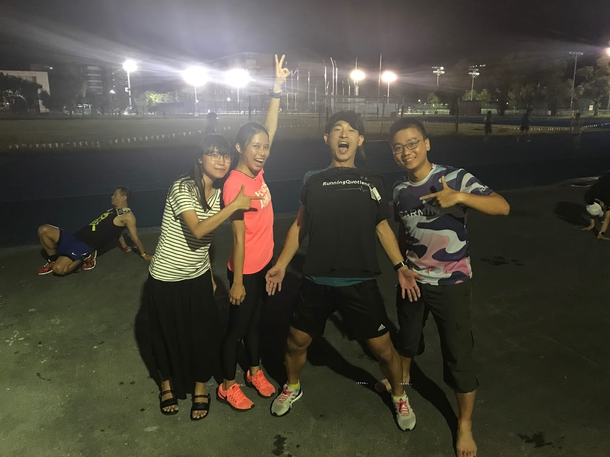

經過上週紮實的花蓮移地訓練，再加上昨日崩潰的課表，總算來到我最愛的每週一休息日。平常一到這天肯定是要好好把握時間宅在家裡趕進度，BUT，今天應夥伴黑黑的建議，決定不在家裡當宅宅，前往最高學府台大田徑場參加傳說中的最速CEO回饋日進行「意~ 象~ 訓~ 練~ 」！

*RQ榮譽顧問 冠翔*

這是我第一次來到台大田徑場，一路上看著各個運動場上都有不少學生們揮汗訓練著。走著走著，還沒找到最速CEO，就先被一個熟悉地聲音叫住，這不是三小時就可以完成陽明山東西大縱走的江晏慶教練嗎！？真是巧遇啊，前一次交流已經有一段時間了，可惜他有要事在身，無法多聊上幾句。

後來在司令台前看到被跑友們包圍的冠翔，他一看到我的打扮就很明顯知道我真的只是來晃晃而已。由於很多人本週末都有比賽，所以今天的課表是自由輕鬆跑。而最速CEO似乎答應兩位跑友要帶他們跑間歇，機會難得，我便坐在場邊觀察冠翔以及其他跑友的跑姿，當成本日的意象訓練。不過，本人能力跟經驗都還不夠，單憑肉眼只能夠感覺跑得很好看，或是長得很好看（誤），像是看到冠翔飛奔而過的樣子就覺得好像很省力，也是有可能是人長得帥的關係。跑步真的好複雜啊~~~

最後，很開心最速CEO王冠翔能夠成為[RunningQuotient](https://www.runningquotient.com/)的榮譽顧問，也期望未來我們能夠有更多火花，幫助更多更多跑友！

*最狂最帥最速CEO (是中間那位XD*
