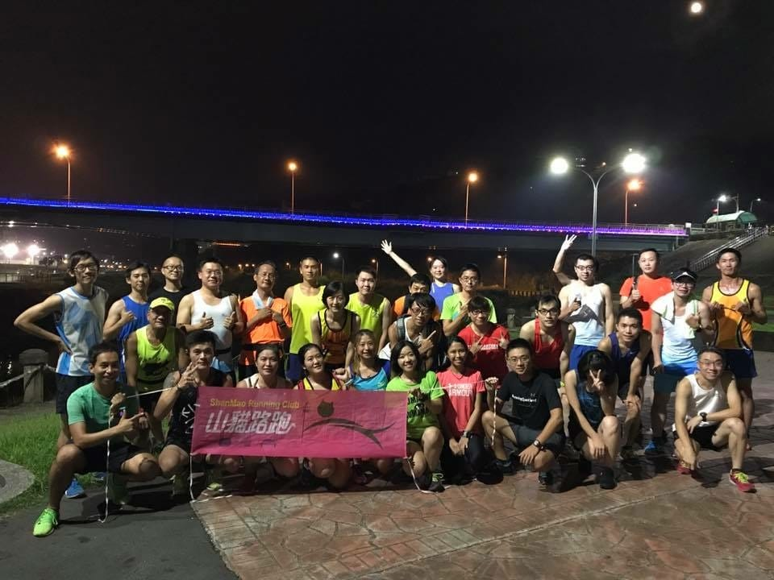
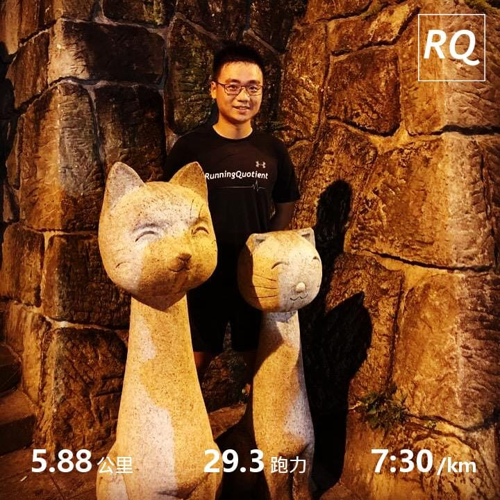
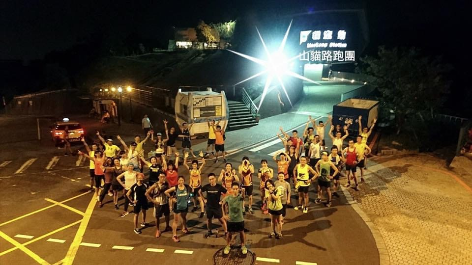

原本固定每週三都要進行肌力訓練，但剛好本週肌力教練晚上有空閒，就問我要不要改成山路訓練「山貓路跑團的貓空動員令」。想了一下覺得好像還蠻有趣的，貓空只有之前參加UA鬥士挑戰營的時候去過這麼一次，就趁這個機會來挑戰我的第一貓吧！

*八點出發梯次團拍*

約七點四十多抵達集合點，就看到已經有一團人先出發了，第一次參加還是等待八點團一起上山吧。山貓團會請新人先自我介紹一下，沒想到第一位自我介紹的“新人” 是文彥教練，阿不是元老等級的成員嗎？是太不常參加變成新人嗎？XDDD

上週才剛挑戰過花蓮[楓林步道](https://myrace.tw/race/classic/maple)的我，知道自己對於山路訓練還蠻沒輒的，畢竟開始跑步以來，鮮少跑山路，起跑前還是有點小擔心。剛好聽到姚姚因為連日來的登高訓練，所以今天打算慢慢跑上去，心裡就打定主意要跟著她了。

開始跑沒多久，心率就立刻飆高到超過三區，但是體感卻沒有感受到這麼痛苦，正打算仔細聆聽身體的聲音時，忽然想到剛剛起跑前去便利商店買了一杯黑咖啡喝，這應該就是最主要的原因吧！

再跑一陣子後，看著姚姚離我越來越遠，自我感覺應該是無法追上去，才在擔心第一次跑這路線會迷路在山林之中，這時候主揪子毛就出現了，接下來一路上就跟著子毛，偶爾聊一下天，偶爾打氣一下，偶爾介紹這附近的風景，就這麼一路順順地攻頂成功，拿下我的第一貓！（聽說某教練覺得我第一次沒辦法上山的樣子喔～

*第一貓取得*

整團人在貓空團聚，整個超熱鬧的。大團拍各種POSE還有規定要站陣型，初貓者還要特別跟貓咪雕像拍照，還有人為了要獲得更高的爬升，再往上挑戰一百多公尺的高度，真是超級佩服他們的體力。 超開心能夠跟這一次團練，未來還有機會一定要再來玩～

*貓空集合團拍*

您於今天20:04開始跑步，紀錄摘要如下：\
時間：0:44:04\
距離：5.88 公里\
平均配速：7:30 /公里\
平均心率：174 bpm\
訓練指數：25.6 點\
即時跑力：29.3 (↓6)

詳細連結：[https://www.runningquotient.com/calendar/record/947741](https://www.runningquotient.com/calendar/record/947741)
