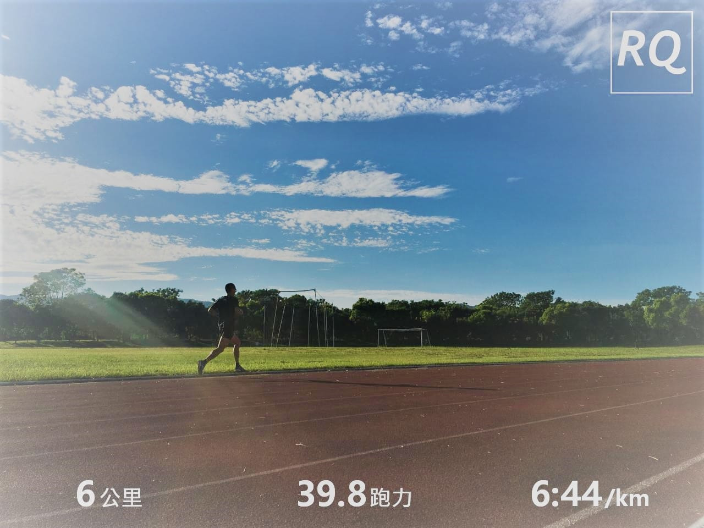

「(我)在台北勒 老人家」

週五晚餐前，收到一位十幾年老友的訊息，我們高中、大學、研究所都念同一間，但是自從他畢業一段時間決定"出國深造"後，我們就鮮少聯絡。難得他這次回台灣有空找我，當然要把握機會吃頓飯好好聊一下。

*出賣他大一青澀照片*

這次從外派東南亞工作的甘苦談到我在台灣跑步圈子努力，從需求聊到工程聊到行銷聊到管理，不同環境下的挑戰都很不一樣也都很不簡單。我講我的理想，他談他的規劃，完全不同背景下的建議也給了我不少衝擊。

「我接下來也會創業。」

「好，那有能力了別忘記把RQ代理過去發展！」

滿腦子的新建議，再加上新企劃的構思，剛好今天課表又是輕鬆跑而已。讓我超級有動力想趕快去跑課表順便好好整理。不過，感冒還沒有完全好，所以今天就保守一點直接從家裡出發，跑完剛好回到家裡，訓練紀錄就不分享了。

暖身關節操的時候左小腿後側還是有一點緊繃不適，有特別加強多活動一下。跑出去感覺狀況不錯，可能是心跳帶剛換好電池，終於又可以檢視我的技術數據感到很興奮的關係；也有可能是最近連日來的計劃，再加上老友提供一堆圈子外的想法感到很新鮮的關係；抑或是終於入秋了，天氣轉涼跑起來也特別舒適的關係。總之，已經可預期的是今天跑力應該會提升不少，也確實比當前跑力足足高了接近四啊！

這可能是我第一次覺得課表太短吧！想了快四十分鐘還沒把所有完整的規劃想透徹，但是已經有好多以往不會想到的層面，接下來，就是好好規劃好好實踐它了。

*我不會被打敗，只要我拒絕停下來*
