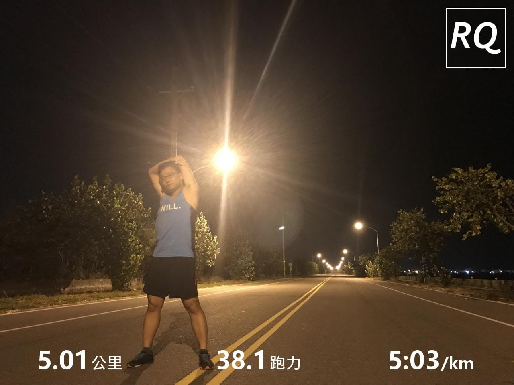

「看起來剛剛跑得很累喔！」\
拖著疲憊的步伐帶著渾身濕透的身軀一進門，阿姨便這樣對我說。

「是啊～」

「不是才跑五公里嗎？」叔叔疑惑地說。

「這次是全力跑的五公里，跟之前跑的五公里不同呢。」才剛跑完累累的我這樣回答。

兩天前，在中興大學打算挑戰五公里測驗，天真的我以為現在入秋了，可以在正中午的上課日，在校園內挑一條筆直的路線測驗，果不其然跑沒兩公里就爆了。根據教練指示，我需要在星期日（也就是今天）重新測驗一次。

天氣：微微悶熱，手機顯示29度

裝備：舊版RQ衣服 + UA短褲 + Boston 3 + 735

心情：還沒準備好，很想跑又不想跑

路線：雲林鄉道產業道路一公里路線來回五次（單趟約爬升20公尺）

夥伴：一個人騎黑都賣陪著一位要挑戰半馬的人跑課表（相同路線）

*出發跑課表囉*

有了上次的經驗，決定第一公里先維持五分速看看狀況。第一公里折返前有一小段下坡，完成時間為4:54，跟原本預計的時間差不多。但！是！一折返跑這段小上坡時忽然一陣側腹痛，天啊，才第一公里而已就遇到狀況，到底該不該跑下去呢？內心一直湧現負面情緒，一邊調整呼吸，並透過主動核心出力方式與跑步姿勢微調希望讓症狀減輕，一邊想著到底要不要放棄。

「我該誠實面對現在的自己，跑出很爛的成績也該坦然面對，就把它跑完吧！」

第三公里開始，側腹痛的情況似乎變得更嚴重，速度也已經完全無法維持，這段期間不太敢看錶上的數據，繼續邊跑邊嘗試各種方式讓狀況恢復，並不斷告訴自己不能放掉，一定要跑完。

進入第四公里，側腹痛的症狀開始明顯減輕了，此時還蠻慶幸我有堅持下去的，慢慢嘗試回到五分速，這時雖然身體還蠻痛苦的，但是卻有出現跑得很開心的感覺呢！

最後一公里有一點奇妙，跑步這些年來，曾經有過幾次跑課表出現掌握姿勢跑法的感覺，但還沒有今天感受到這麼明確，讓身體的重心前傾帶動整個身體前進，整體來說痛苦程度差不多，但是配速變快多了！阿，最後幾百公尺有點太得意忘形側腹痛又跑來找我。

2017/10/9 五公里測驗：25:17

4:54 > 5:10 > 5:25 > 5:04 > 4:44 看分段配速其實就可以看出我的心路歷程了說 XDD

*爆掉的[五公里測驗](https://www.runningquotient.com/calendar/record/1058910)（圖片是昨天的XD）*

後記，後來洗澡的時候一直想著到底要怎麼讓一般人可以快速知道訓練壓力不單單只是看公里數這個概念，嗯，還是請教練團多寫些文章分享好了～
