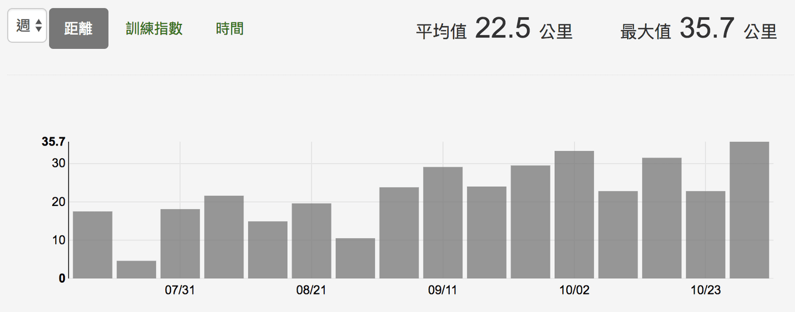
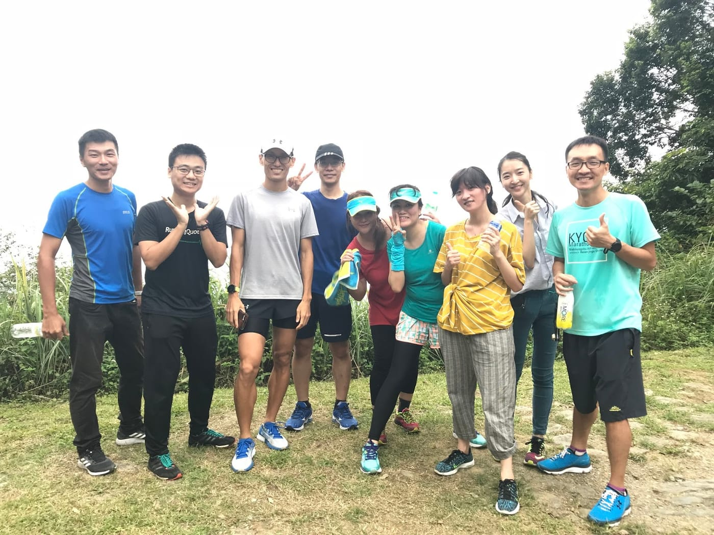
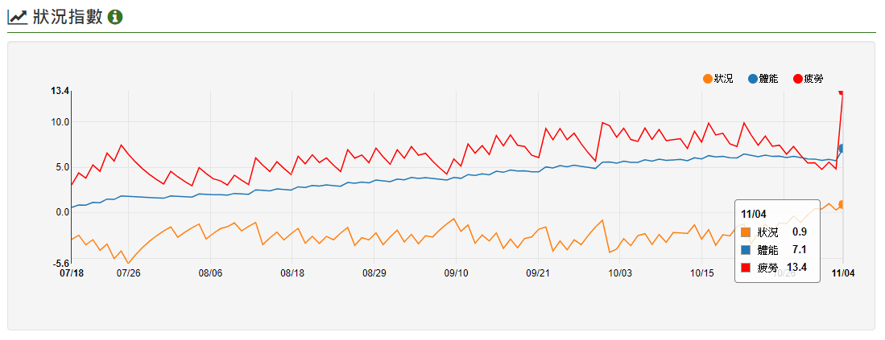

「請問年底要去跑太魯閣半馬 最近要怎麼練比較好？」

今年七月初，在FB收到這句話，讓我們有了一段為期四個月連結。他是力賓，一位幾年前在花蓮因為Ingress而認識的朋友，也成為了我第一位線上一對一跑步教練收費學員。

當時我先給了他一些進入訓練的基本概念與工具應用，並安排了兩週的課表嚇嚇他，想說這樣應該就足夠了，再加上我時間有限，線上教練也不是我要繼續鑽研的專業，就沒有花太多心思在這件事情上。

BUT！沒想到力賓每一次練完都會回傳訓練記錄給我看，還會分享一下他的感受，維持了兩週都還是很認真。我便決定協助開設個人化課表，依照他的生活幫助他能夠完成在2017太魯閣半程馬拉松訂下的目標-「全程不當步兵無傷完賽」。

*初山路半馬以1:51:18無傷完賽*

線上教練的難題之一就是要在無法實際看到這個人真實跑步狀況，單從他的數據與訓練日誌回饋中去分析並了解他的情況，進而提供適合的課表幫助他朝著目標邁進。並且，力賓以前都沒有長跑經驗，平常進行的幾乎都是球類運動。為了更瞭解他的體能狀況，前幾週我安排了幾次測驗，也稍微測試一下他能夠吃課表的承受度。

*完整18週訓練平均每週只跑22.5公里*

**原地跑的重要性**

很多人都知道，步頻是一個很重要的技術指標（註）。一般來說，步頻越慢但是速度又不慢的跑者，肯定會伴隨著過度跨步造成的大步幅，跟隨而來的就是跑步效率不佳以及增加受傷風險。從一開始的課表與測驗當中，我就發現力賓在慢跑（六分速內）的情況下，步頻不到170，就算跑到三分多速，步頻也只有到180左右而已，所以，我需要優先解決這一個重要問題。

線上課表並不像一般一對一碰面指導可以當場看到他的跑步姿勢去直接調整，如果貿然增加跑步技術訓練到課表裡，很容易造成實際動作與影片不符合的問題。所以我選擇採用加入「原地跑」，並要求依照規定步頻進行原地跑課表。

以一個三分鐘的原地跑來說，我會要求前一分鐘用180步頻進行，第二分鐘改成200步頻的原地跑，第三分鐘回到180步頻，接著直接開始進行今天的課表。

*到花蓮一起挑戰[鯉魚山登山步道](https://myrace.tw/race/classic/liyumountain)*

**比賽前建立信心**

這是力賓第一次進行這麼有規律的跑步訓練計畫，打造比賽的信心是相當重要的。第一次挑戰就選擇有上下坡的太魯閣半程馬拉松，而且整個訓練中只有不到八次課表是介於10 ~ 15公里之間，對跑者來說難免會擔心。這時候，除了在訓練期間參加一些相對短距離的比賽體驗競賽感之外，也要不斷地從數據分析來客觀建立他的信心。

不過說實話，這一次力賓能夠在初半馬就拿到 1:51:18 的成績也算是蠻出乎我意料之外，從他的心得回饋中，也很開心他獲得除了跑步訓練之外啟發。這，只是一個開始，接下來長跑訓練所帶來的美好，還要等待著他去一一挖掘。從突破自我極限中，進而發現人生的意義。

以下擷取自力賓的[心得分享](http://tw.running.biji.co/index.php?q=review&act=detail&id=32206&subtitle=%E9%97%9C%E6%96%BC%E4%BA%BA%E7%94%9F%E5%88%9D%E5%8D%8A%E9%A6%AC)：

「對於這次比賽，自己得到了很多啟發，在除了放空時間外，有記憶的地方都是幾段在分析身心狀況，擬訂下一段路程的策略上，決定了以後，就是努力的執行自己的決策，完整的達成任務。馬拉松比賽跟別人競爭只是過程，跟自己比賽才是真正的精華所在！！！也給了四個多月前迷惘的自己上了寶貴的一課，即便是在分岔路口，自己分析完，做了決定，就是要努力執行，直到達到目標跨過終點為止！」

*透過控制[狀況指數](https://www.runningquotient.com/article/single/27)讓他在比賽前調整到最佳*

註： 「步頻是跑步技術之母」 文 / 羅譽寅\
→ [https://www.runningquotient.com/article/single/89](https://www.runningquotient.com/article/single/89)
