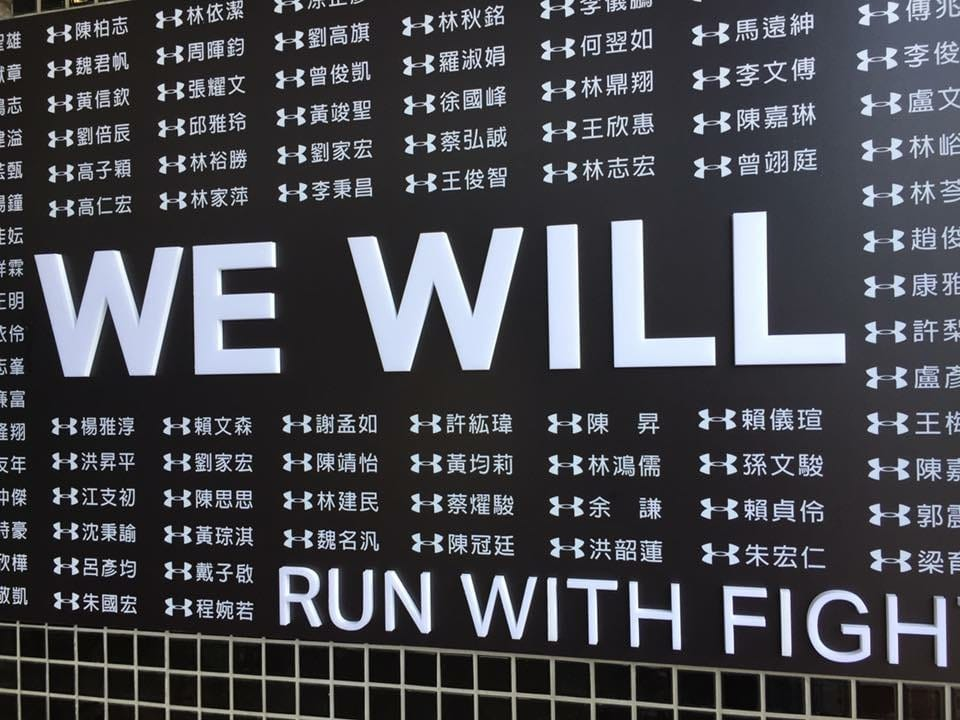
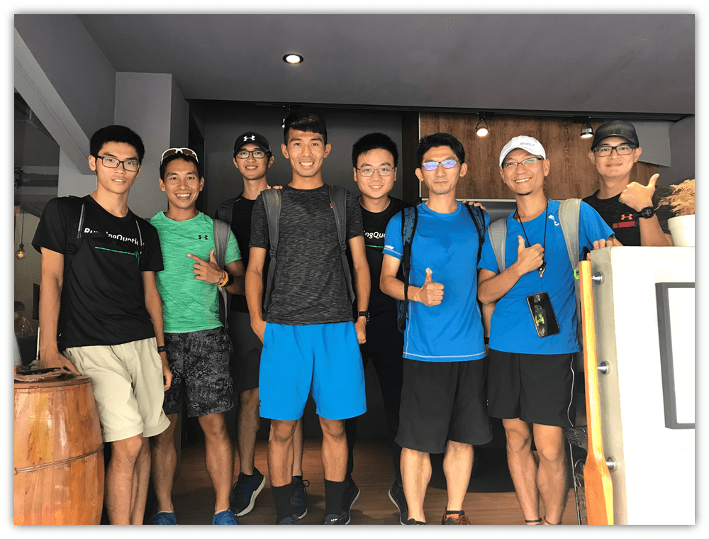
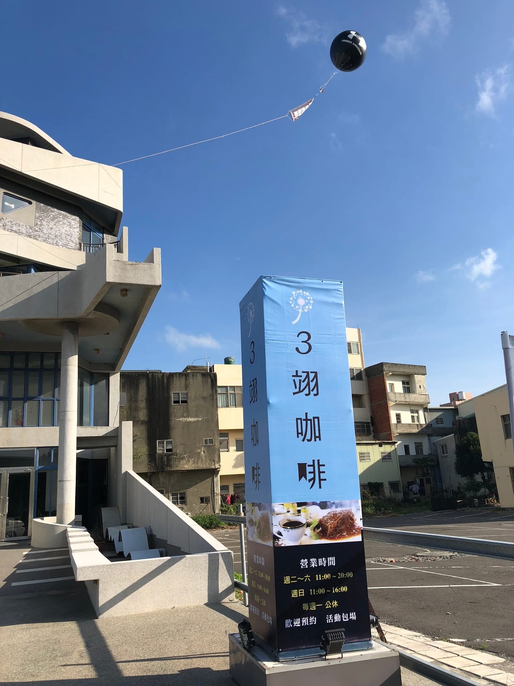
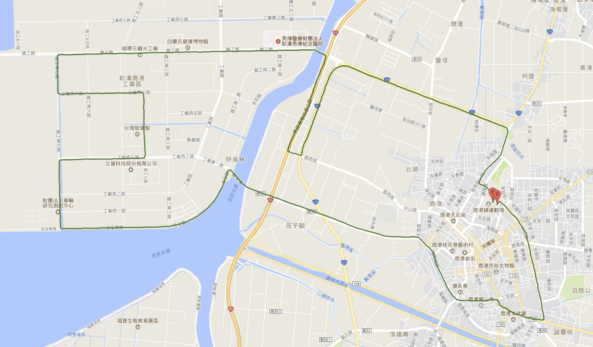
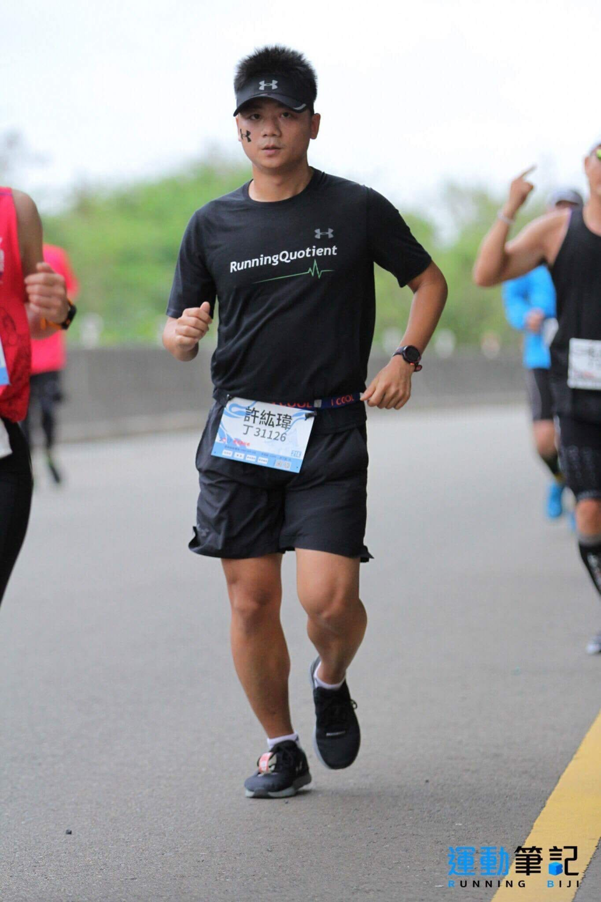
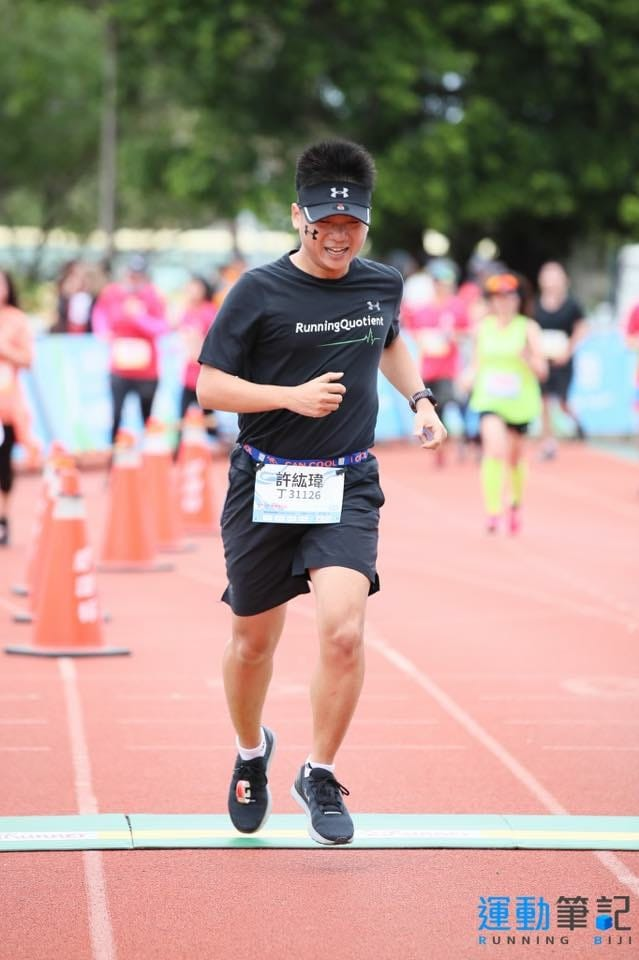
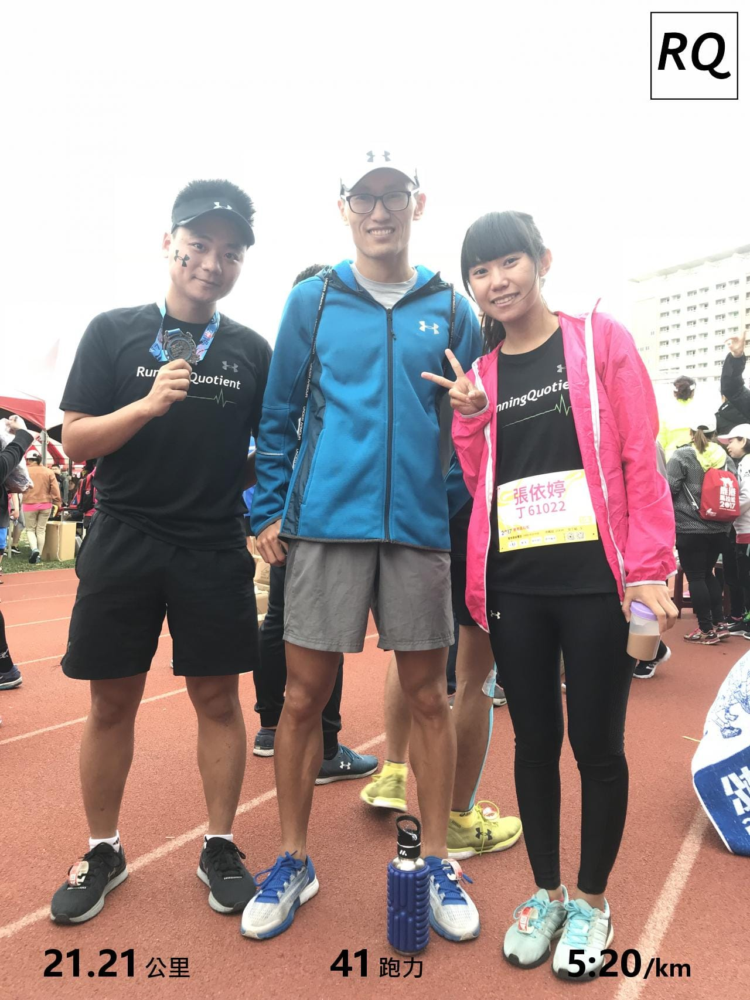
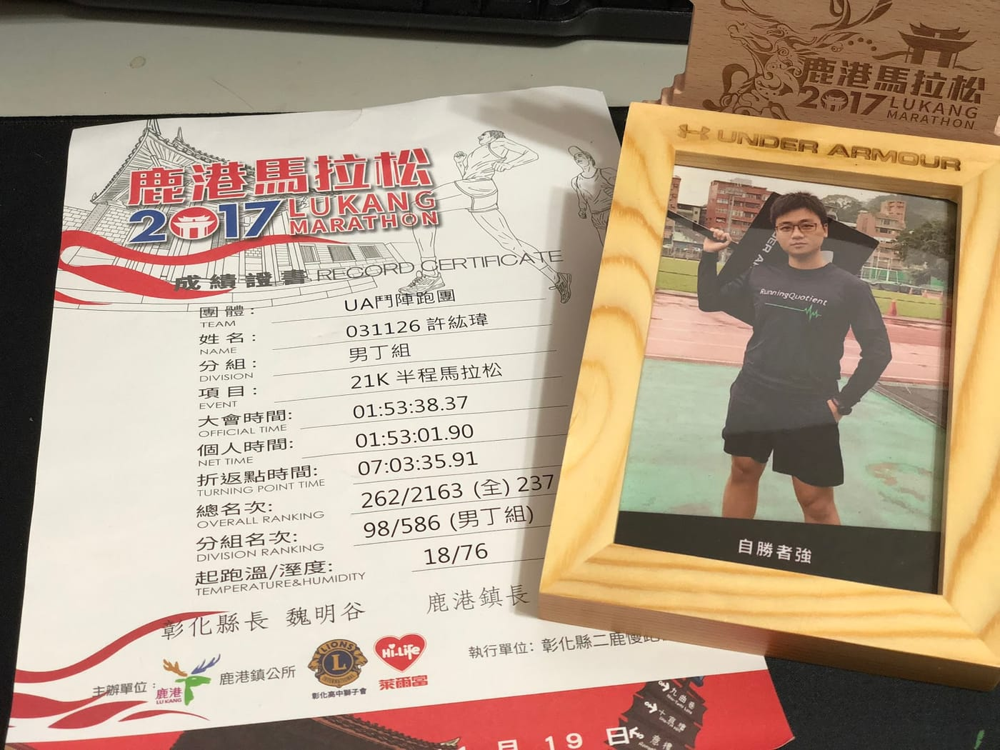
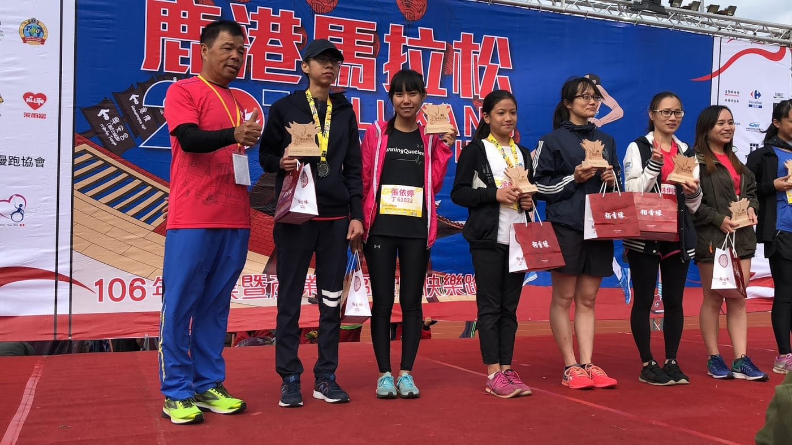

*令人動容的UA鬥士牆*

自從年初完成了人生初馬之後，對於跑步訓練這件事情一直提不起勁，也沒有甚麼目標，就這樣偶爾跑跑持續了四個月。直到五月多，一次聚會聊天中，忽然認知到既然我是在做幫助跑者在訓練上更科學的服務，那怎麼不自己來當代言人呢？一位活了29年才開始慢慢走出戶外運動的肥宅，是否能夠透過科學化訓練的力量，達到一個看似遙不可及的崇高目標呢？

很幸運地我身邊有很多專業的跑步教練，便邀請譽寅擔任主教練、文彥擔任肌力教練，一步一步朝著我遠大的目標前進。

*RunningQuotient跑步教練聚會*

而「鹿港半程馬拉松」就是我第一場目標賽事，這場除了是我個人年度最重要也是最後一場要全力以赴展現跑步能力的測驗賽之外，同樣也是RunningQuotient合作的UA鬥陣跑團-UA鬥士挑戰營台中場的目標賽事，著實意義非凡。

清晨五點，抵達UA貼心為大家包場的鬥士基地-三翊咖啡廳，不久後，就看到一群台北場的UA鬥士們也現身基地，以學長姐的身分，來一起參與這次台中場的目標賽事。這次，我也盡量遵守國峰教練賽前分享會的囑咐，賽前不要有太多社交活動，我們比完賽之後再來好好聊天、分享。

*UA超貼心包場的鬥士基地(前一天場勘拍的)*

**盡了全力就是為了不想留下遺憾**

「不要對自己太好。」

起跑前嘗試讓自己安靜下來，心中唸著昨天國峰對我說的這句話，這一次我沒有預設目標，我已準備好接受痛苦來到。

大家一起暖身後，便前往起跑點準備好好享受這一場比賽。一出發立刻就有個大轉彎，所以整體起跑速度算蠻慢的，但是沒過多久就可以依照自己的速度穩定前進。一路上專注自己的跑步動作，認真聽身體每一個部位傳達來的聲音。

就這麼順順跑上唯一有坡度的一座橋進入工業區，一股惡臭讓我第一次開始喘，接著一大段大逆風、一大段大側風交叉出現實在是考驗，好不容易撐到順風卻只有一小段，整個很不平衡啊！準備要出工業區的時候，又再度聞到那股惡臭，心裡又暗自罵了幾句。

*全程平坦卻有大逆風、側風的考驗 ([完整記錄](https://www.runningquotient.com/calendar/record/1208140))*

專注真的會讓人忘卻時間，就這麼一路上跑到16公里，原本就已經準備好「痛苦必然來到」的打算，安排最後5公里當成高強度課表，全力把它吃下來。才剛開始慢慢加速，沒想到就又遇到大逆風，身體立刻開始側腹痛，這是第二次有狀況出現，只好趕快調整呼吸、稍微降低速度穩住前進。

*調整呼吸、穩穩推進*

直到最後三公里又開始側腹痛，腳很酸、心很累、很想放棄但又說好這一次我不會放棄，便咬著牙死命撐住速度前進。不過，這時賽道上滿滿比十公里的「走路」跑者回來，要從左側超車又會進到車道，已經撐得很痛苦了，又要邊閃人，只好路上不斷大喘息，再加上偶爾喊聲為自己打氣，也順便讓走路跑者注意到後面有人還想要跑步。

*最後痛苦的三公里*

過了終點前最後一個大轉彎，就看到終點拱門上面寫著1:5x:xx的數字，全程都沒有看手錶時間的我，立刻感覺到一股電流全身通過，不自覺就濕了眼眶，加速跑過終點之後久久不能自己。

[https://www.youtube.com/watch?v=o0-yNojNAjE](https://www.youtube.com/watch?v=o0-yNojNAjE)

依婷很快就看到我，立刻來到我身邊，但我由於身體的痛苦再加上對自己能夠毫無保留的完成一場目標賽事感動不已，實在是完全說不出話來，邊慢走邊喘息邊感動了好幾分鐘，才脫口而出「我真的可以做到！爽！」休息片刻後，回終點旁找國峰跟UA的朋友們。

*很驕傲地告訴國峰，我這次沒有放棄*

我終於做到了，不只是突破PB的感動，是痛苦來到的時候，我沒有選擇放棄，全程專注在觀察自己的跑步狀態，完全用體感配速沒有看手錶的配速或時間，非常感動我自己真的能夠做到，我真的很開心我能夠毫無保留地以接受痛苦來到完成了一場半程馬拉松。

*自勝者強*

-   半馬 1:53:01 - 2017年11月19日 鹿港馬拉松
-   全馬 5:09:55 - 2017年2月19日 [台北渣打公益馬拉松(初馬)](https://xjackrun.blogspot.tw/2017/02/garminpb-2017.html)
-   半馬 2:09:21 - 2017年1月14日 渣打馬課表21K
-   半馬 2:18:40 - 2015年11月29日 [宜蘭冬山河馬拉松嘉年華](https://xjackrun.blogspot.tw/2015/11/pb27.html)
-   半馬 2:44:26 - 2015年3月15日台南古都國際馬拉松
-   半馬 3:14:47 - 2014年8月17日台東都蘭夏日馬拉松(初半馬)

真的非常感謝羅譽寅總教練的課表，還超快速幫我完成一篇[分析文章](https://www.runningquotient.com/article/single/123)。不過這只是個開始，還有很漫長的目標要追求；超感謝余文彥教練的肌力訓練總是這麼貼心地為了我一改再改。大感謝 Under Armour 的超高規格鬥士基地外加貼心服務，讓我跟UA鬥士們能夠無後顧之憂專心準備比賽；特別感謝小姨的在地招待、賽前補給、住宿還有超澎湃的賽後補給外加伴手禮。

另外，有一個小小插曲不得不分享，陪我來比賽的依婷，正在吃由小馬教練開設的[台北半馬課表](https://www.runningquotient.com/group/to/2017tphalf)，便報名一個十公里來當課表跑，沒想到居然就這樣上了凸台，拿下分組第13名，真的是太厲害了！

我的訓練故事，未完、待續。
