這一次的渣打半馬，從報名一開始就已決定好要擔任依婷的專屬陪跑員，幫她拿水、拿補給、加油打氣。天真的我自以為半馬都可以輕鬆破二了，陪著她完成半馬頂多就只是個長距離輕鬆跑課表(LSD)而已，殊不知...

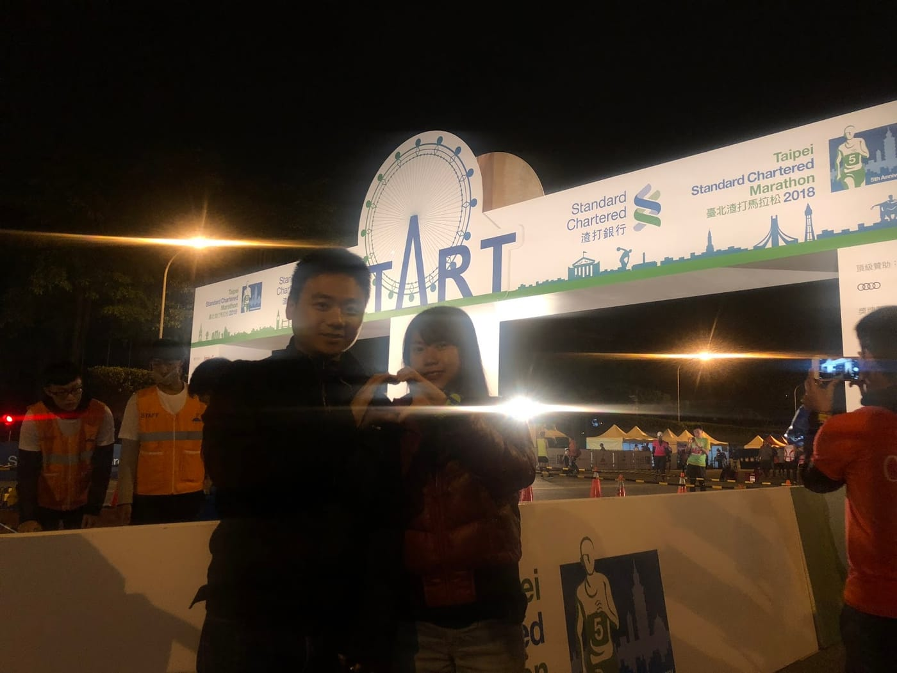

*開心在起點合照*

比賽當天，輾轉難眠的我只睡了四個多小時就得起床準備出門。到了比賽會場，先跟[決戰台北之續戰渣打](https://www.facebook.com/CompeteTaipei/)的學員們會合，由於我本來就打算輕鬆跑，所以心情相當輕鬆，不疾不徐地去寄物，跟著一起暖身，悠閒地去排廁所，慢慢等待第二梯次的半馬出發。

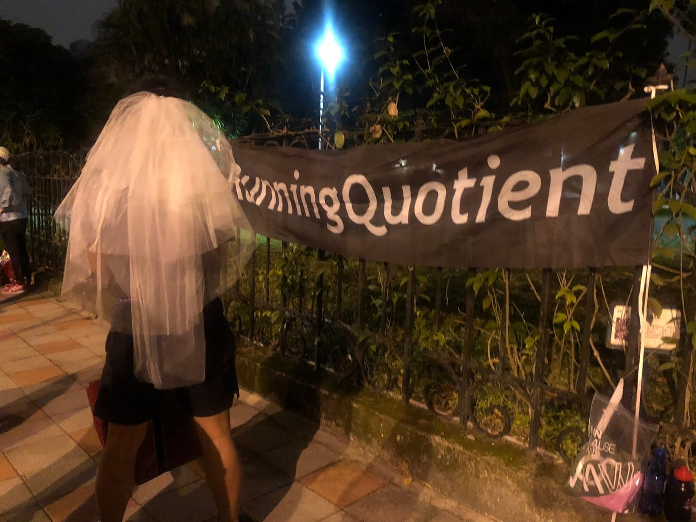

*決戰台北集合點*

這一次我們打算小小裝扮一下，討論一陣子後，由於之後很多場賽事我都要認真跑，沒辦法像這次能夠全程陪著她，所以打算好好把握機會，想獲得一些美美的照片，就決定她戴著頭紗；我打上啾啾，一起完成這次渣打半馬。

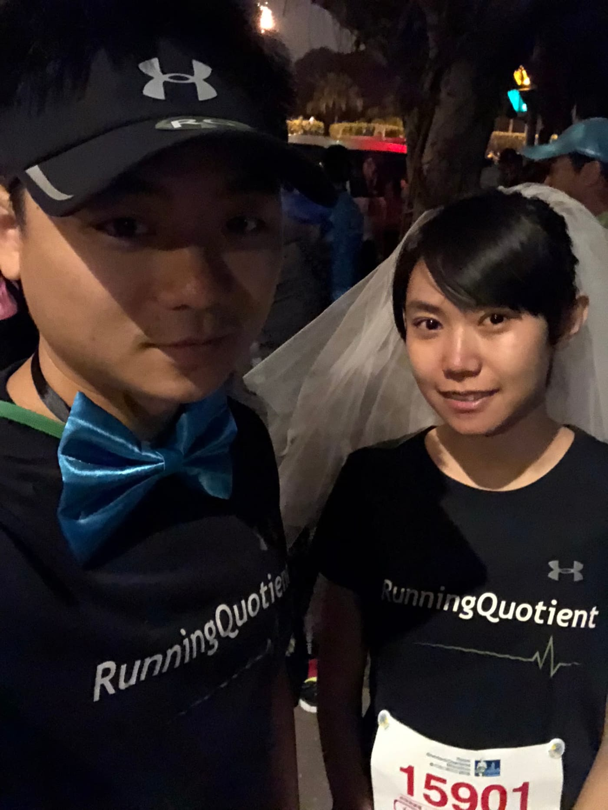

*稍微裝扮一下*

起跑後照原定計畫，我不是擔任她的配速員，完全讓她依照自己的速度跑，而我只是默默地跟著她後面觀察她的狀況，提醒地上的貓眼，或是注意她的速度會不會飄移太多。一路上聽到許多跑友說：「有新娘耶，等等會不會看到穿西裝的跑過去。」還蠻有趣的。

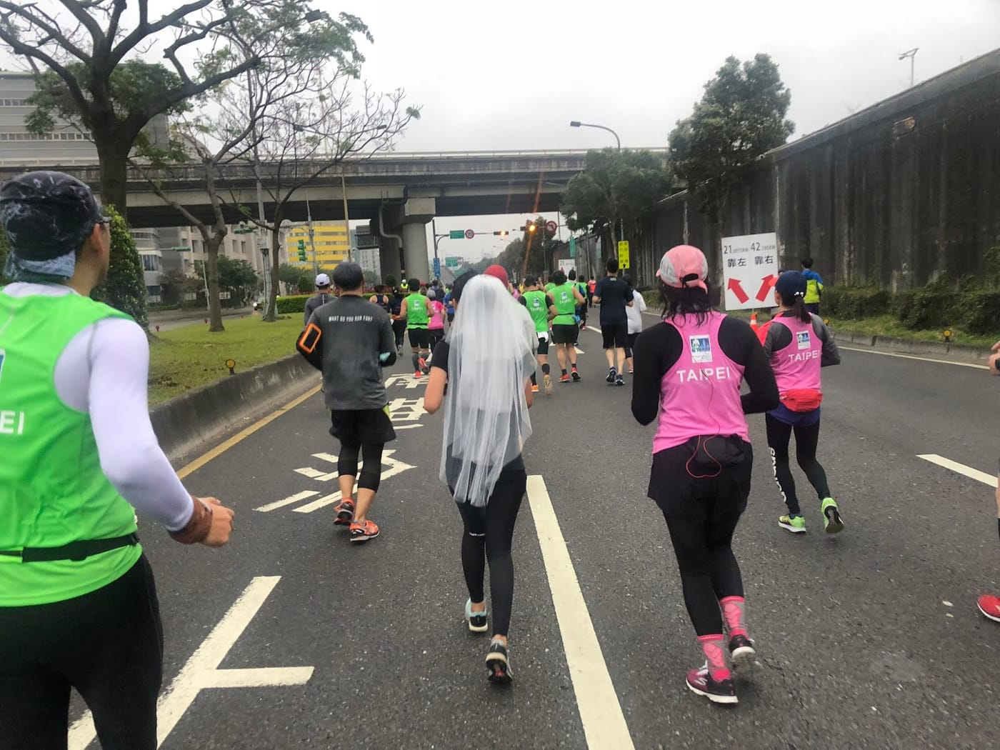

*一路上跟在頭紗後面*

第一個補給站已經過了五公里，依照計畫是讓她繼續慢跑，而由我進水站幫忙帶水出來。這次我們也嘗試了一個新武器，從第一個水站拿了兩個杯子之後，一路上使用到最後，直到終點才把這兩個杯子丟掉，只需要用識別帶夾子把水杯掛在脖子後方，比想像中的還要簡單，而且其實掛在後方的杯子沒啥感覺呢。

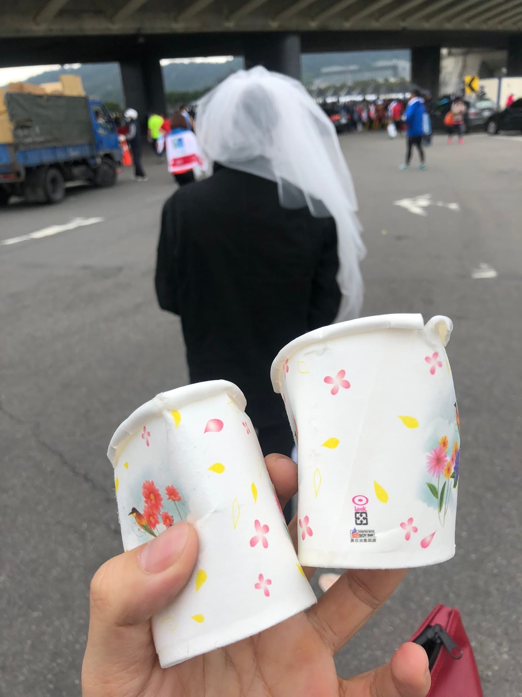

*從第一個水站跟我們到終點的杯子們*

前幾個補給站都還算蠻順利的，但隨著賽事的推進，我觀察到自己的心率一直居高不下，其實剛起跑的時候就有注意到，原本以為是剛開始比較興奮，所以沒有很在意。但後來就算跑個七分速還是感覺到自己有點吃力，猜想跟變速跑到她前面幫忙拍照、遇到認識的跑友聊天、或是昨晚沒睡飽都蠻有關係的。

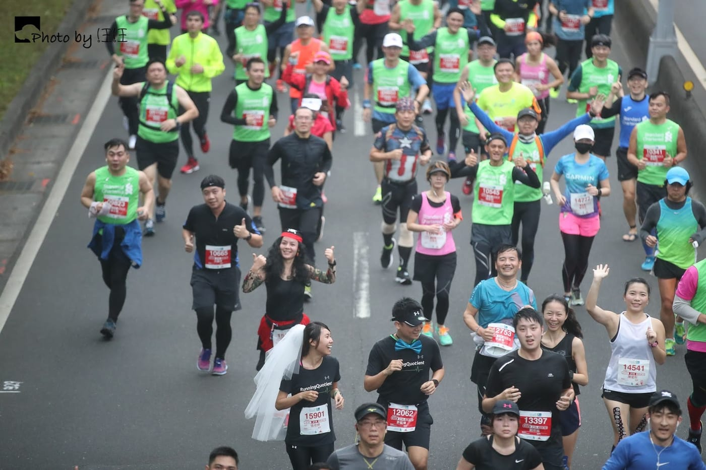

*開心地跟藍藍聊天被拍了下來*

過了十五公里後，身體明顯地感覺到疲勞，一直以來都蠻容易「放過自己」的我，看著跑在前面的依婷還能夠穩穩地前進，我也自然必須要打起精神跟上。

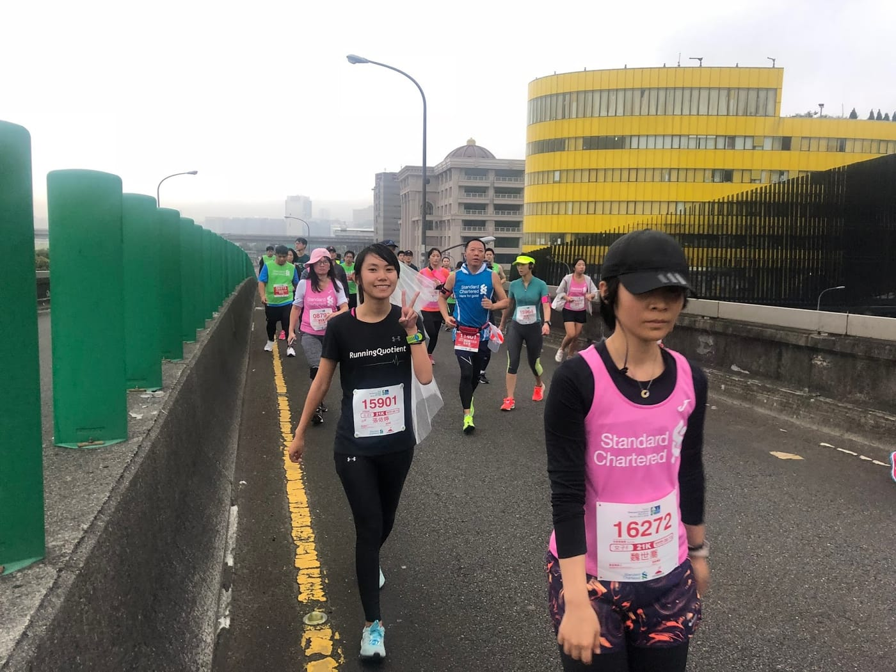

*後段上橋只能用走的了*

好不容易進入到河濱路段，離終點剩下三公里了。看著依婷還有力氣加了一點速度前進，我也只能勉強自己跟上。原本我還很怨嘆這場賽道好像沒看到幾個攝影師，沒想到在這最後短短的一段路上，根本每一個轉角點都有攝影師坐鎮。

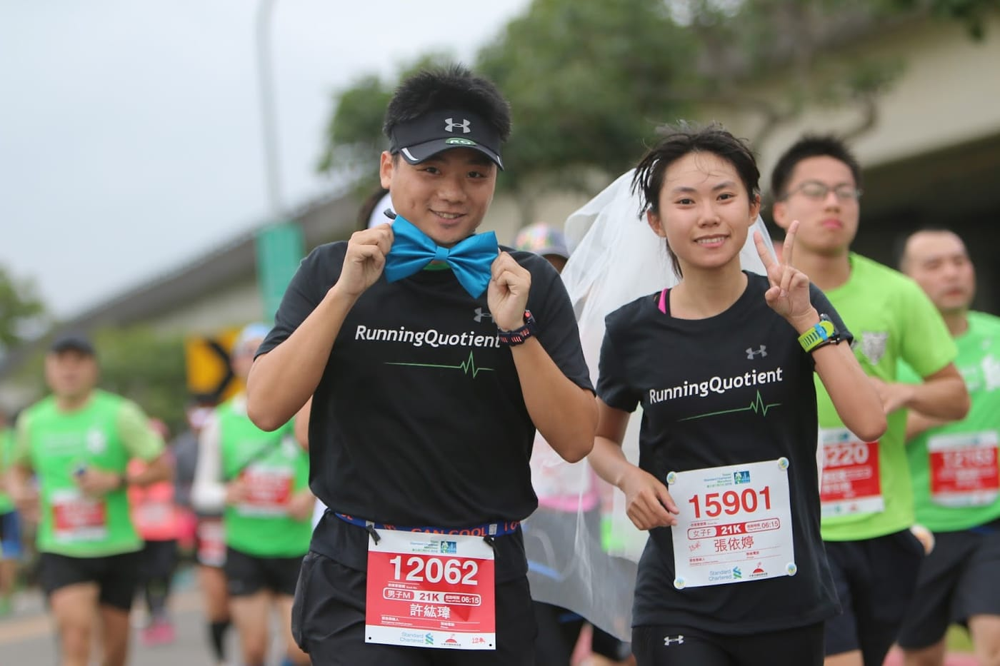

*快到終點啦~*

先求帥再求快，有了攝影師，自然而然的身體就好像自動補充了動力般，一路上跟隨著滿滿的人潮，想盡辦法邊跑邊找好角度能留下美美的照片。

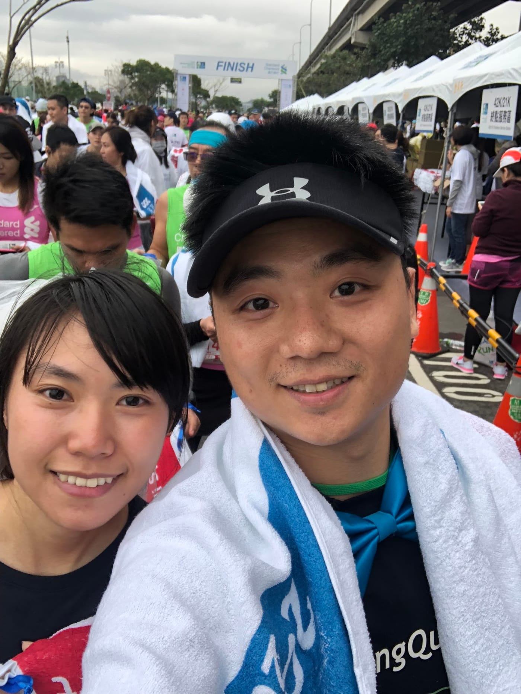

*終於跑完啦~ (累*

原本以為會是一場歡樂半馬，卻是感覺動用到意志力才能夠回到終點，自體感覺的疲累程度應該是跟台北半馬跑1:54差不多吧。這次陪著依婷以 2:26:54 的成績拿下一場半馬，也恭喜依婷突破半馬PB20多分鐘呢。

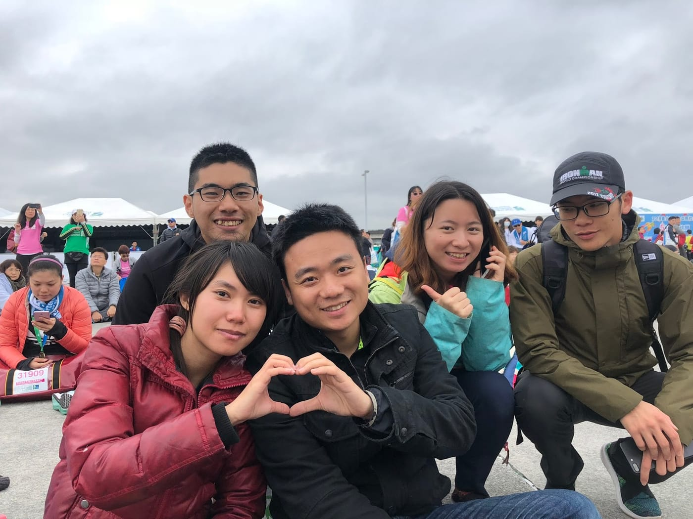

*DRC夥伴們也一起來了*

回到終點的時候，剛好我們贊助的選手江承鴻在終點接受媒體訪問，一問之下才知道原來他拿下國內總一的好成績，去年才[突破自己卡了七年了全馬成績](https://www.runningquotient.com/article/single/69)後，這次又一次[突破自己的最佳成績](https://www.runningquotient.com/article/single/143)，真是可喜可賀呢。

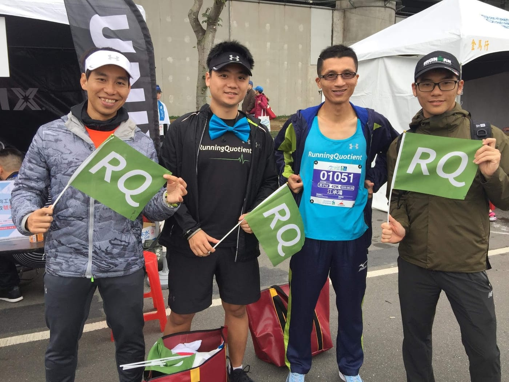

*恭喜承鴻拿下國內總一*

事後稍微分析了一下自己的數據，訓練指數高達56.6點，只比全力跑的鹿港半馬低了約15點而已。全程平均配速雖然只有七分速，但是平均心率卻已經達到2.1區間，怪不得這麼累啊。

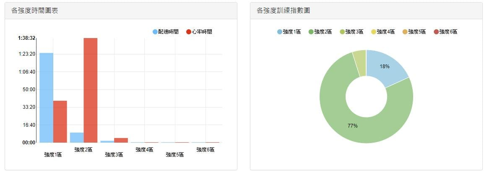

*[渣打半馬分析數據](https://www.runningquotient.com/calendar/record/1463380)*

事實證明，沒有好好訓練的話，就算是想要跑個歡樂半馬也會變得很不歡樂，原本打算要能夠一路上當護花使者好好幫依婷拍照、拿補給，但到了後段連維持自己穩定前進都很吃力了。有了這次經驗，未來如果還有要當專屬陪跑員，也一定要好好訓練並調整狀況到最佳，這樣才是正確的！

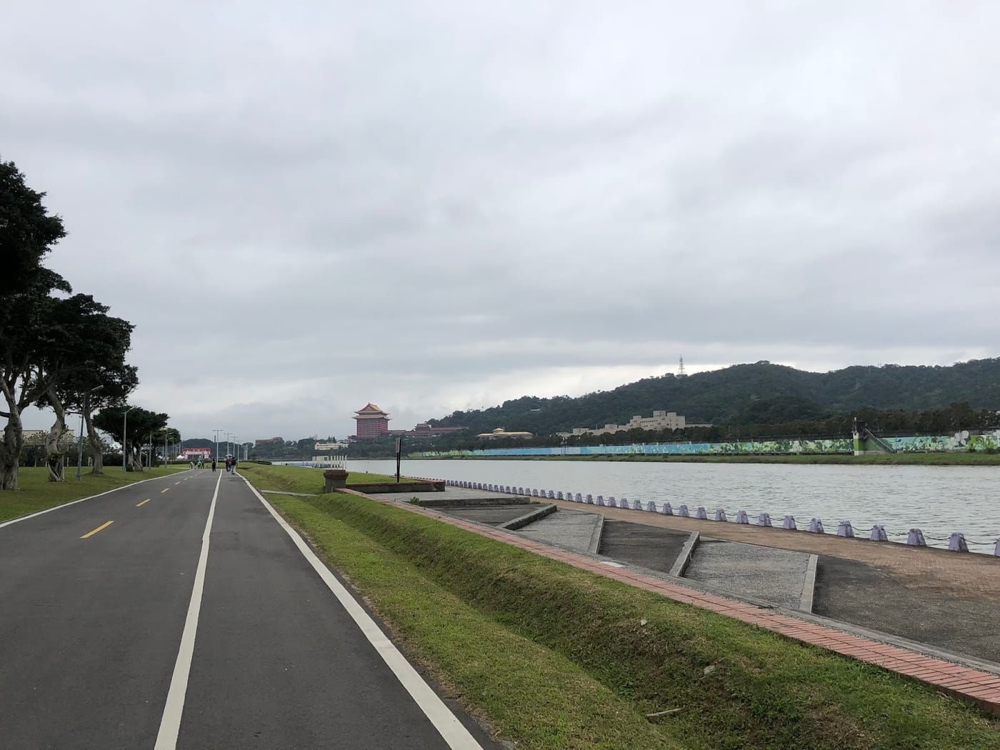

*河濱一景*
