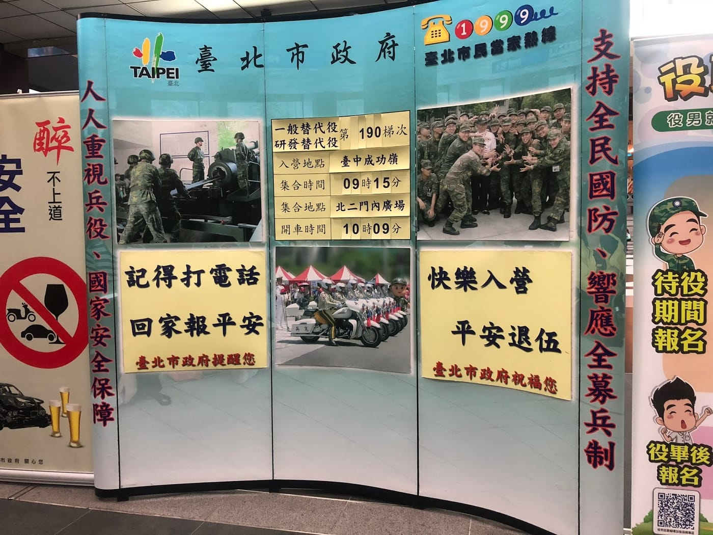

記錄一下接近夏天上成功嶺接受研發替代役基礎訓練這十二天的建議事前準備，希望能夠幫助到未來的學弟們。

## \[官方告知準備物品\]

1\. **身分證**\
必備 / 要跟健保卡一起一直隨身攜帶。

2\. **印章**\
完全沒用到，直接蓋手印。

3\. **入營通知書**\
就是徵集令，只有第一張有蓋大印跟寫市長柯文哲才是，後面夾雜一堆紙請看清楚哪些有需要的才帶進去就好。

4\. **折抵役期作業相關證明文件**\
其實出來之後也可以辦理，不過建議帶進去辦理，可以折抵第二階段天數。

5\. **郵局存摺封面影本**\
完全沒用到，拿來當筆記紙。

## \[極度推薦事先準備物品 (裡面買不到)\]

6\. **有夜光功能的手錶**\
沒戴手錶的我一直問鄰員現在幾點，蠻不好意思的，特別是在大便時，不知道時間會緊張。

7\. **手機**\
第一天就會被收走放在有鎖的貴重物品保管箱內(鑰匙自行保管)，還算蠻安全的，記得帶充電線。完全沒檢查使用的手機型號或是功能，應該是任何手機都可以。

8\. **滿電的大顆行動電源**\
非違禁品，可跟手機放一起。我只帶了一顆小的行動電源，第一天搭火車與客運過去時就用掉一半以上，大家表現好可以開櫃拿手機使用，所以我之後都只能靠鄰員救助行動電源。

9\. **爽身粉 / 痱子粉**\
必備，我買一大罐(400g)剩下三分之一，鄰員買兩大罐只用光一罐，教室有冷氣，寢室內只有抽風機跟電風扇，雖然有幾天晚上睡到一半會冷，但還是灑一下比較好睡。

10\. **三合一沐浴乳**\
一罐搞定，反正洗好澡馬上又會是全身汗，洗爽的。

11\. **全新大條牙膏 / 牙刷**\
擺起來比較好看，容易加分？營站好像有賣，忘記了。

12\. **會涼的小包濕紙巾**\
自從用過鄰員借我的超涼濕紙巾，我完全不想用帶進去的普通溼紙巾。注意，也不要帶太多，所有東西都必須要藏在指定位置，行李越少越好。

13\. **一般型刮鬍刀**\
千萬不能帶電動的，還有不能帶噴霧式刮鬍泡，任何噴霧型物品都是違禁品，營站好像有賣，忘記了。

14\. **喜歡的喉糖**\
裡面營站有賣喉糖，不過只有一種口味，我忘記帶了就第一天去營站前買了一盒金桔檸檬口味的念慈菴枇杷潤喉糖，出來剩一兩顆，推薦帶喜歡的喉糖進去。除了喉糖之外，所有零食糖果飲料都是違禁品。

15\. **現金**\
第一天去營站買了895元(只能去一次)、剪頭毛40元、12天洗衣服費用100元(含加洗)、買了全套四張團體合照250元、出營接駁車70元、肝膽相照(同樂會)50元、(逼~~)偷偷帶我們去吃冰28元，完全沒機會投飲料機(夢想破滅)，出營之後都是用手機 / 悠遊卡付款，就自行斟酌攜帶現金數量囉，後面會介紹我去營站買的物品。

## \[推薦進去營站再買的物品\]

16\. **有集屑盒的指甲剪**\
沒集屑盒的指甲剪是違禁品，第一天就會被沒收，建議去裡面買一個就好，考前剪一下修乾淨即可。

17\. **抽取式衛生紙**\
建議買兩包，一包檢查用一包自用，可以省一些小麻煩。

18\. **毛巾**\
會發一條全新的毛巾，我自己又買一條新的提供檢查使用。

19\. **內褲**\
會發兩條全新內褲，衣服每天送洗，正常情況下不用多買，我自己是多買兩件以防萬一，後來感覺其實可以不用多買。

20\. **內衣**\
會發兩件全新內衣，我自己又多買兩件。每天都必須穿著內衣，早上晨跑三千後會換一件，晚上洗澡又要換一件，多買一件差不多，怕弄丟可以買兩件。

21\. **襪子**\
有發兩雙，基本上夠用，我自己是多買兩雙。

22\. **洗衣袋**\
會發兩個全新洗衣袋，我又多買兩個。基本上就是昨天兩個洗衣袋還沒回來時，早上晨跑三千需要多一個洗衣袋裝換下的內衣，應該多買一個即可。

23\. **奇異筆**\
必備，大家東西都一樣，所以很多東西需要寫上自己的學號。第一天在營站買了一隻，也可以自己帶去。

24\. **藍白拖**\
建議直接去營站買，有規定藍白拖樣式要完全一樣喔。

25\. **透明零錢袋**\
放現金、雙證件以及貴重物品箱的鑰匙使用。

26. **針線盒**\
盒子裡面的針跟剪刀不算違禁品，其他刀類、長條狀細長物品(譬如：牙線棒、髮夾、棉花棒、雨傘等)都是違禁品喔。

27\. **輕便雨衣 (?)**\
第一天買了兩件，但是這12天都完全沒下雨沒用到，只有最後離營的時候規定要準備一個放在大行李袋旁邊，似乎也沒檢查是否真的有準備，意義不明，但是一開始會叫你要買兩件。

28\. **電話卡**\
第一天可以在營站買(台北市有送一張一百元給所有役男，所以我沒買)，如果不能拿手機的時候，可以在開放時間打電話回家(通常是晚餐過後六點~七點之間，倒數第二天沒開放打)，有投幣式公共電話，但是比較少台，而且投的錢是不能退的喔。

29\. **剪頭毛**\
規定是要三分頭，幹部會拿一個尺插在你頭上確認有沒有過長，只要超過一點點就必須要去給髮婆剪，聽鄰員說他已經剪很短了再被剪頭蠻痛的，我個人是頭髮很長進營區，被剪頭毛一點感覺都沒有，而且只要40元。

PS：以上沒有列出依個人情況必須藥品/裝備，噴霧式、顆粒、內服使用的藥品需要統一保管，每天會有規定幾個時段可以去取出使用，外擦類藥膏狀的藥品可以自己保管/攜帶。

## \[額外推薦\]

A. **先練一下替代役之歌 / 軍歌**\
所有中隊都必須要參加替歌比賽，如果得名，全部人都有榮譽假，個人覺得還蠻好聽的，而且在裡面其實聽的次數不多，練習時間也很短。另外，有時間也可以先練個一首軍歌，有機會加分。

[https://www.youtube.com/watch?v=4_Bmvzdc5co](https://www.youtube.com/watch?v=4_Bmvzdc5co)

B. **先練跑步**\
從第三天開始每天早上六點都會晨跑3000公尺，而且跑的路線不是平路，對於完全沒有跑步基礎的人會是一個挑戰。完全沒跑步經驗的朋友建議可以先從一週跑2~3次開始，每次慢跑30分鐘，跑不動就改成快走，恢復差不多就繼續跑，持續跑走到30分鐘，能持續三週就會有明顯的改善。跑步時建議只要注意步頻快一點，建議每分鐘左右腳交換180次以上，完全不用管速度，就算原地跑也是可以的。(延伸閱讀：[步頻是跑步技術之母](https://www.runningquotient.com/article/single/89))

總而言之，行李越少越好，準備到第15項即可，之後研發替代役應該就會走入歷史。基本上不同中隊的長官規定會不太一樣，我遇到的幹部/長官們都蠻不錯的，過得還算開心。其實我們已經比常備役爽多了，就乖乖聽從幹部指令，一個口令一個動作，大家不分彼此一起互相合作、提醒與協助，幹部們也不會太刁難，十二天忍一下就過去了，祝福你囉！

*快樂入營、平安退伍*
