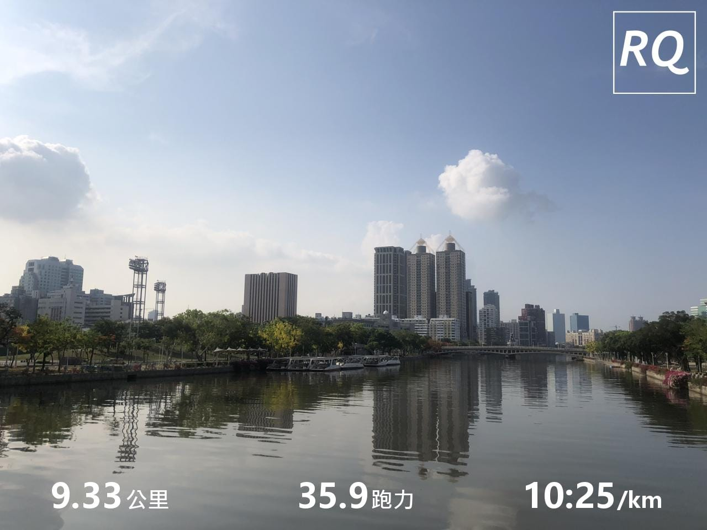
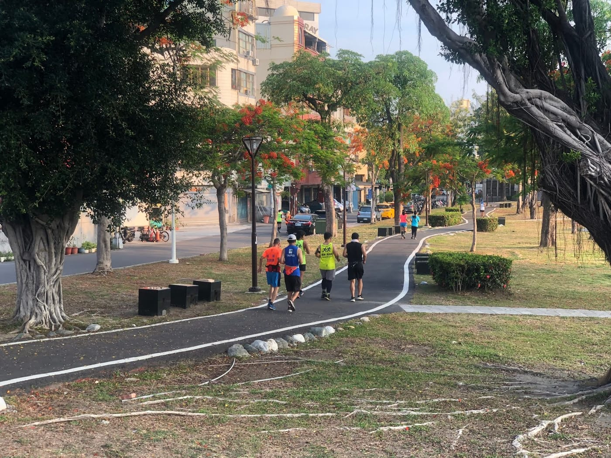
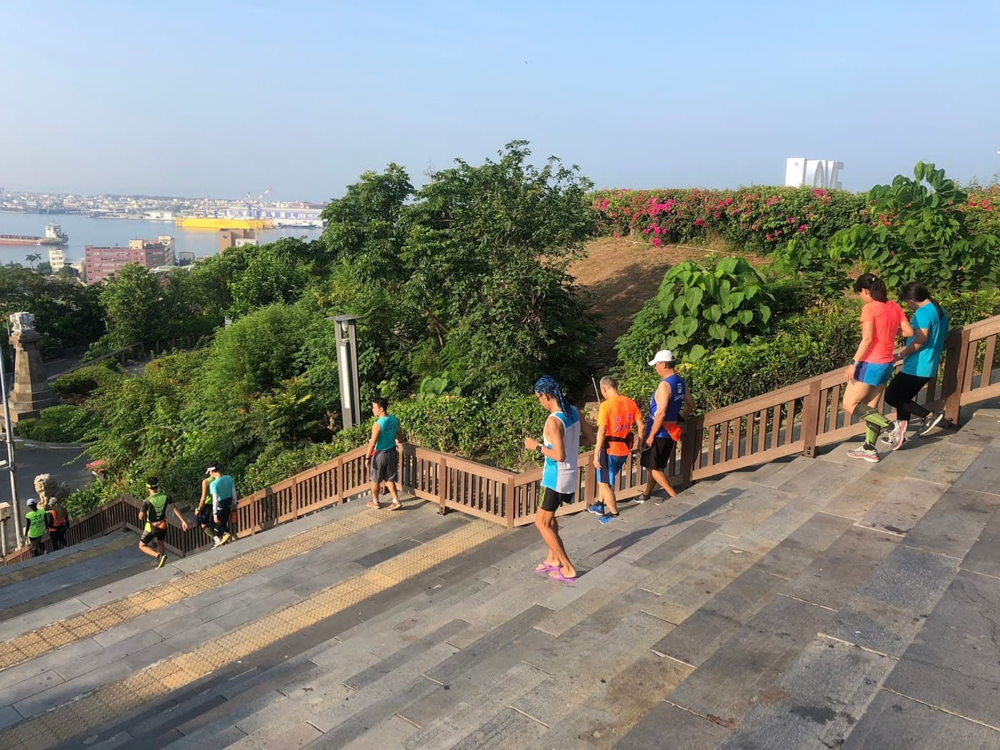
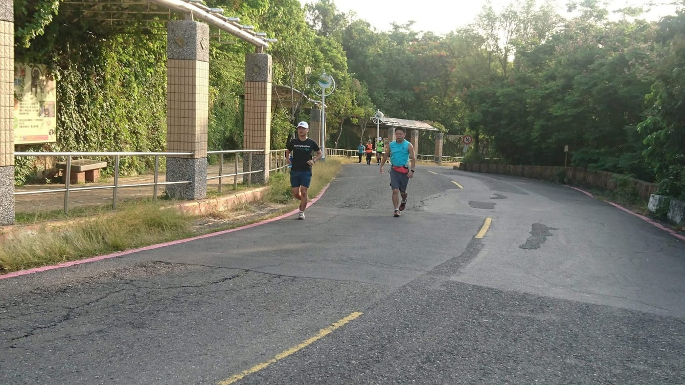
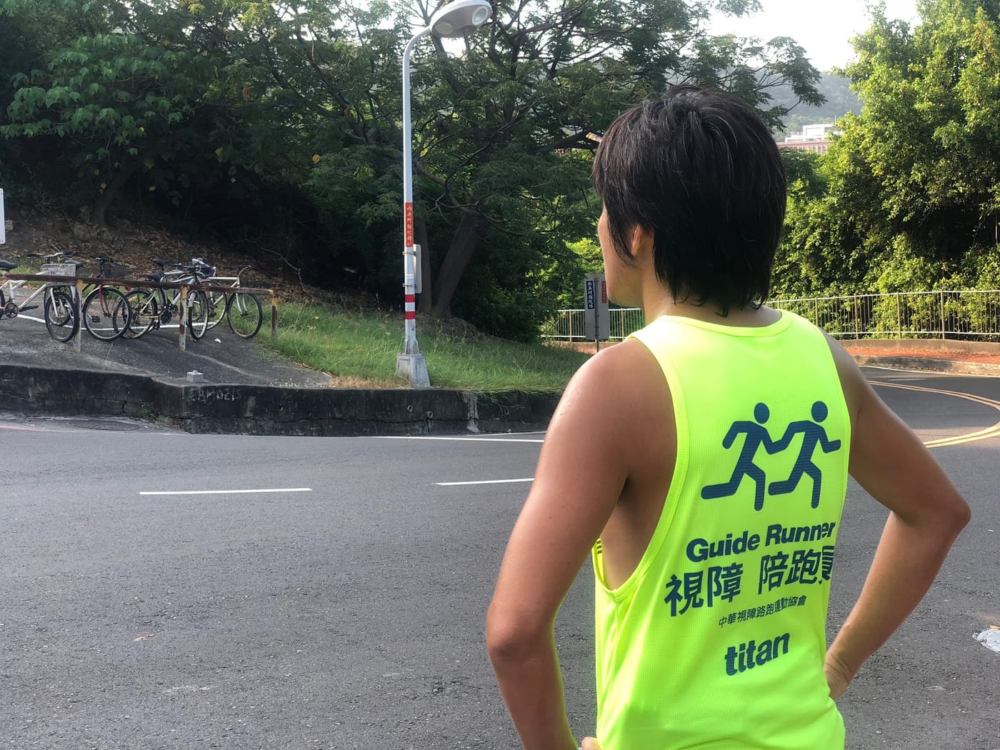
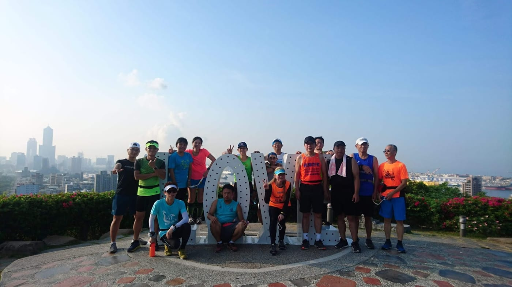

*愛河畔*

感謝 [董建弘](https://www.facebook.com/profile.php?id=100000435013825&fref=mentions) 教練的邀約，在高雄的週日清晨跟著視障跑團一起跑步走訪一趟壽山，用自己的雙腳體會高雄之美。

這是我第一次這麼近距離接觸視障跑者，一路上認真觀察了視障陪跑員與視障跑者之間的互動，以及負責帶團的董教練在各地點的重要提醒，跟以往的跑步團練真的很不一樣。

*出發囉！*

上下坡、過馬路、上下階梯、停紅綠燈、有車經過、有狗吠、拍團體照等等各種情況，對於可以正常使用視覺的跑者來說，並不會是個需要特別注意的「狀況」，但是，視障陪跑員卻需要用對應的指導語或動作，讓視障跑者可以行動。譬如：在下樓梯的時候，陪跑員先下一格，並且不使用陪跑繩，讓跑者可以直接扶著手臂下樓梯。

*下階梯～*

這次還遇到一位對訓練很認真的視障跑者庭旭，他自修了丹尼爾跑步方程式、姿勢跑法、氣功跑法、漢森訓練法等等各種訓練方式，立志要成為一位視障跑步教練！知道我是RQ創辦人後超級熱血的跟我討論國峰跟譽寅寫的每一篇文章呢。

*庭旭與我一起跑*

董教練於昨天正式接下了高雄視障跑團團長的重任，而現在的目標是希望能夠培訓出更多合格的視障陪跑員，並傳達正確的跑步技巧與運動觀念，讓更多視障朋友可以安全地體驗跑步的樂趣，在此歡迎有興趣的跑者們一起響應！

*帥氣的董教練*

這一次的跑步紀錄 >>>\
[https://www.runningquotient.com/calendar/record/1960051](https://www.runningquotient.com/calendar/record/1960051)

[#RunningQuotient](https://www.facebook.com/hashtag/runningquotient?source=feed_text) [#視障跑團](https://www.facebook.com/hashtag/%E8%A6%96%E9%9A%9C%E8%B7%91%E5%9C%98?source=feed_text)

*最高點合照*
