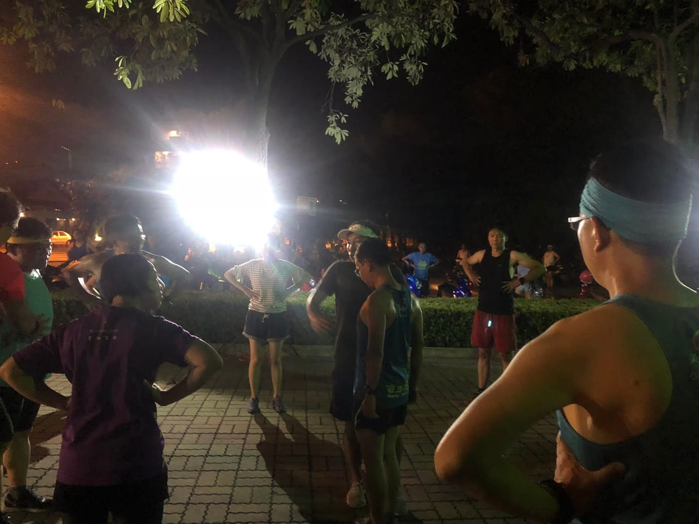
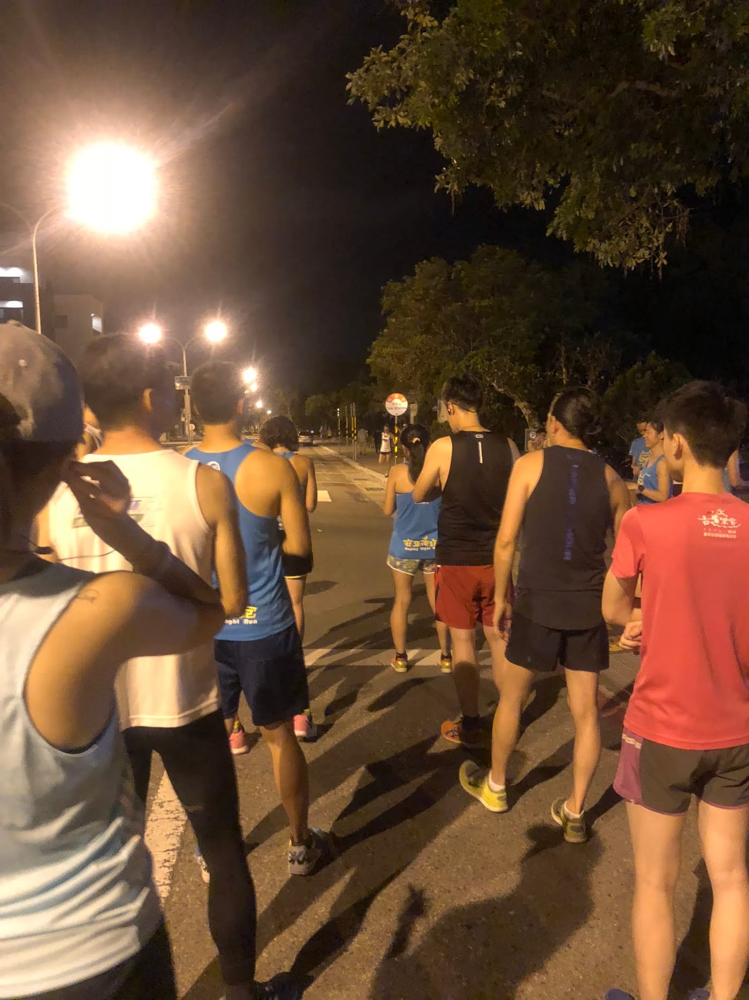
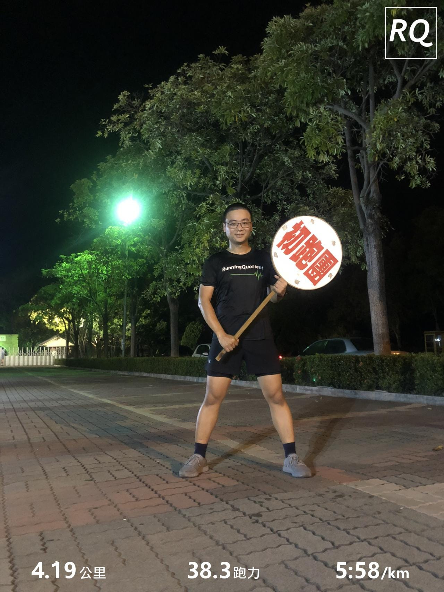
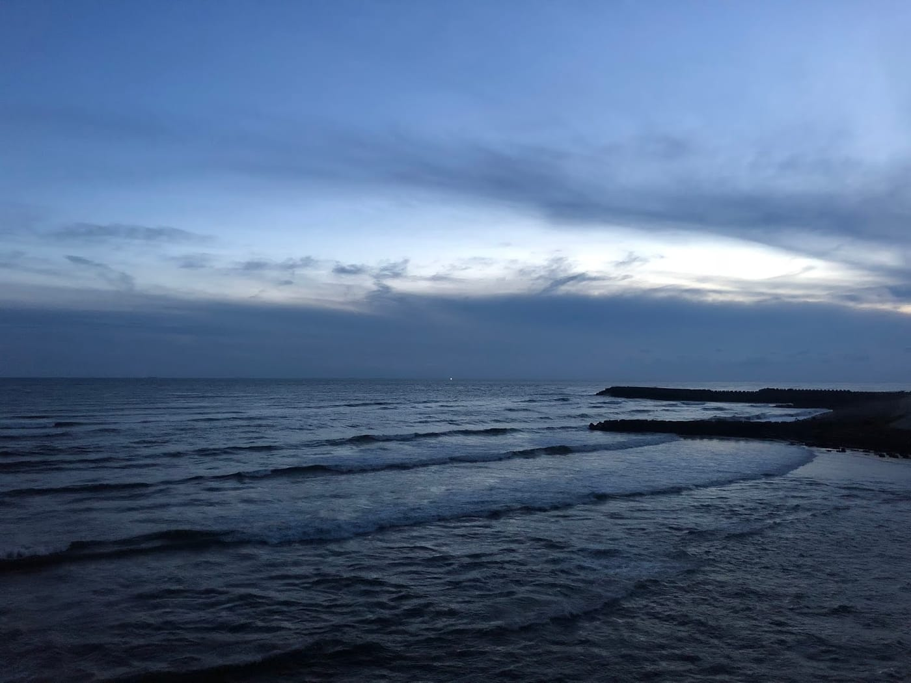

「安平夜跑」是一個台南在地的跑團，每週二、五晚上七點半固定會在億載金城舉辦跑步團練，還曾經創下一次跑步團練破千人的紀錄，是個很有名的大型跑團。而今天剛好是星期二，也剛好人在台南，當然就要來體驗一下安平夜跑團練囉！

*超可愛的動感安平夜跑車車*

文彥教練跟我大概七點半左右抵達億載金城，就有不少人在跑步了，而集合地點看到有發電機、電燈還有音響設備正在架設中，外加超可愛又動感的安平夜跑車子停在旁邊，整個就是氣勢十足啊！

*文彥教練帶大家暖身*

安平夜跑的團練總共分成四組，分別是五分速（極速）、六分速、七分速以及初跑團，每一團都會有領跑員，原本想跟太榮帶的初跑團一起跑完四圈，但又想到中午答應明德素食軒的老闆娘要挑戰一下自己，所以選擇跟了六分速團出發。

*六分速團準備出發*

今天跑的路線是大圈（約2.1公里），路線中會經過兩個十字路口，而六分速團除了有兩位領跑員之外，前後都還有跟一位拿交通指揮棒的陪跑員，負責幫忙提醒有車子經過，並且在快到十字路口的時候，會先加速過去協助指揮交通，真的是太甘心了。

[https://www.youtube.com/watch?v=T-yHHdCg8oI](https://www.youtube.com/watch?v=T-yHHdCg8oI)

跑了一圈後，天氣雖然不算涼爽，但是還有一點風，而且體感還算不錯，想說應該穩穩跑四圈沒問題，畢竟我也是曾經半馬破二的男人啊，六分速八公里ＯＫ的。ＢＵＴ！跑到第一圈半的時候，忽然有一段完全沒風，整個人感覺好像快燒起來一樣，超級悶熱，爆汗到褲子都濕透了，努力撐完第二圈之後決定先跳車到七分速團。

[https://www.youtube.com/watch?v=qDvaA4tbfLg](https://www.youtube.com/watch?v=qDvaA4tbfLg)

把握時間喝個水在起點等待時，忽然看到文彥教練大概以四分速衝回來喝水，那時候五分速團已經完成第三圈了。跟文彥聊了一下，我們決定先來跑看看茂森哥中午提到的有丈量過的一英里賽道（小圈），就一起重新紀錄跑了一個小圈當成恢復跑。跑完沒多久就看到太榮帶的初跑團也完成三大圈了，我就跟上去用七分半速跟太榮邊跑邊聊天完成最後一圈。

*[安平夜跑分速舉牌](https://www.runningquotient.com/calendar/record/1971976)*

剛好安平夜跑破三跑者峰哥今天生日，大家也準備了一個蛋糕幫他慶生，就這樣在歡笑中結束了這次參加安平夜跑團練。這是一次很難得的體驗，希望之後有機會可以再來挑戰六分速跑完四大圈！

*跑前先去四草大橋拍的海景送給大家*
