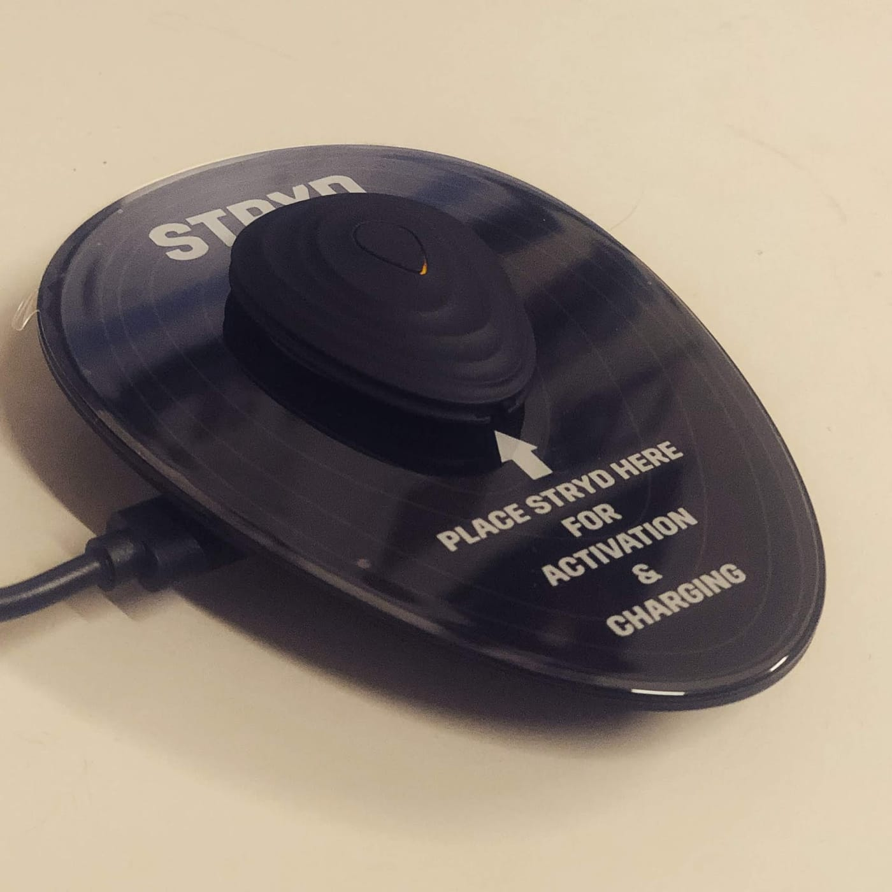

*跑步功率計Stryd*

終於收到期待很久的跑步功率計Stryd，其實大概兩年前就看到羅譽寅教練入手一顆，也陸陸續續與他有過幾次討論，不過，決議都是再繼續觀察看看還不急。

直到幾個月前，譽寅表示功率計已經相對成熟了，可以加入到RQ觀察分區變化，我便花了一些時間把功率數據串接到RQ上（尚未開放給所有用戶），但之後就忙其他合作案外加當兵去了。

*帥氣充電中~*

到了最近，我決定要以年底賽事為目標重新展開訓練，也就順勢購入一顆玩看看。今天是剛拿到的第一天，立馬設定好帶著出去跑步，不過，並沒有變厲害的感覺啊～

*第一次用功率計跑步去*

啊，大家先不要急，等我們先研究多一點資料或是取得代言之後再入手嘿~~
