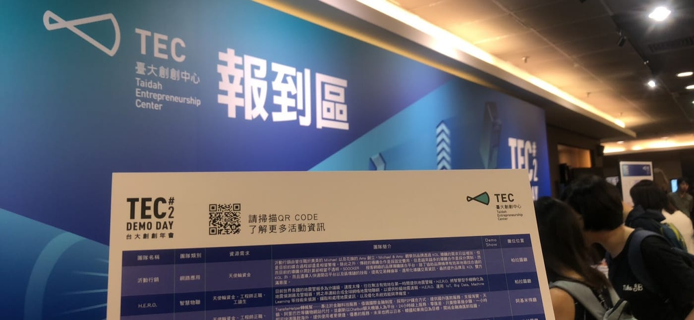
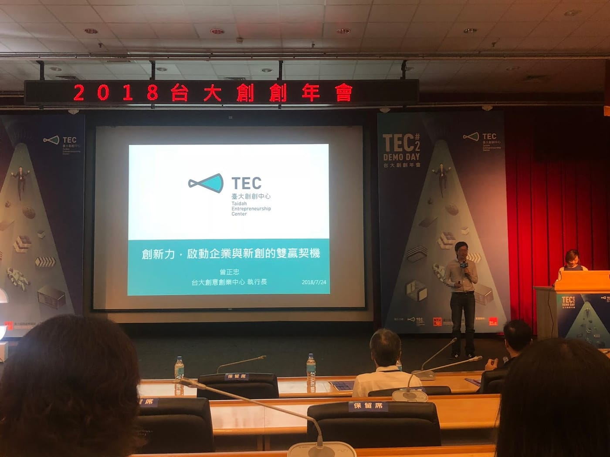
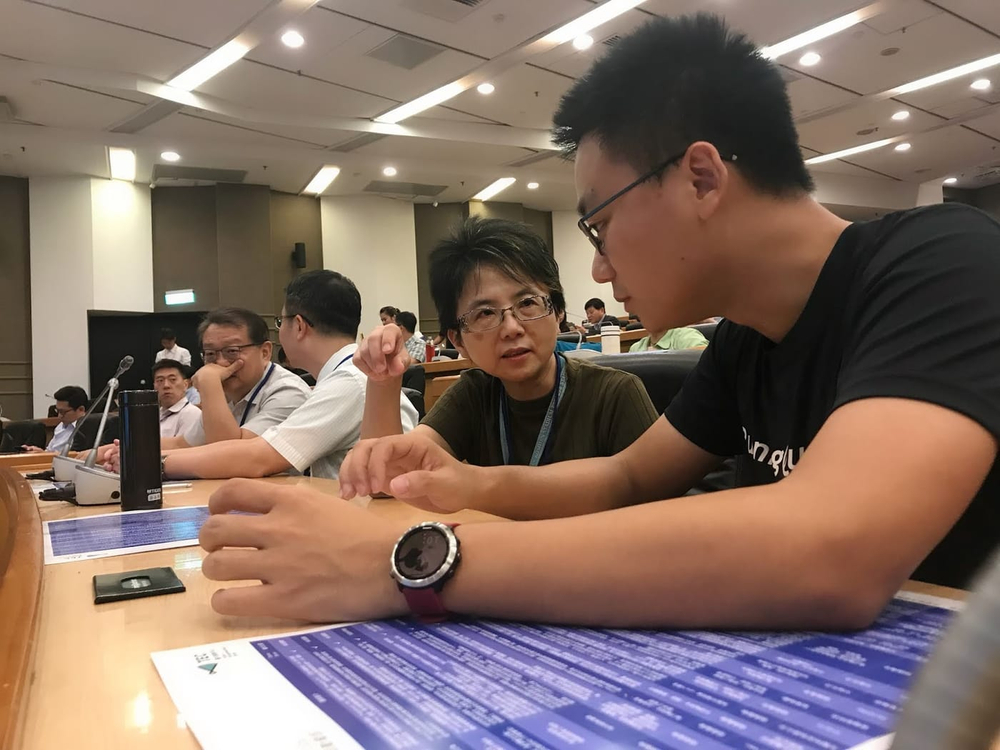
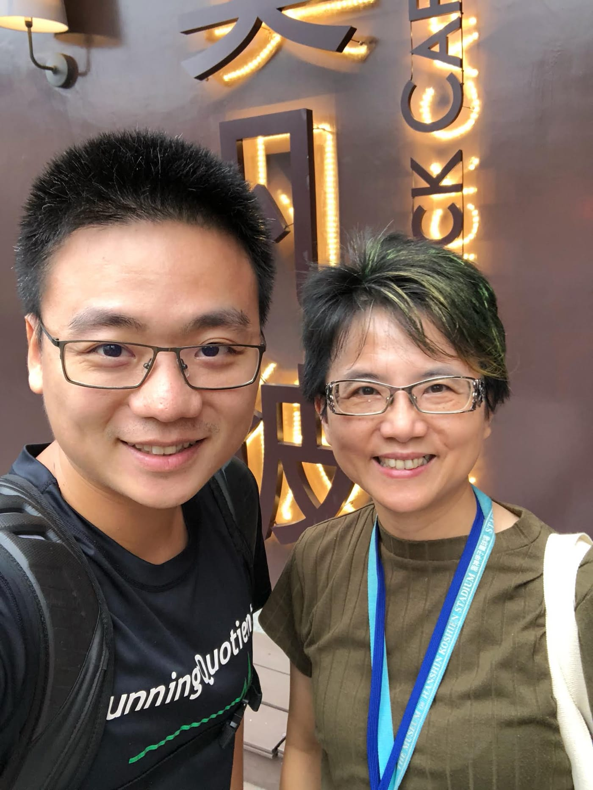

感謝「加力」老師的邀請，讓我可以認識台大創創中心以及相關資源，當然！最重要的還是獲得一場美好的午餐交流。

*TEC #2 DEMO DAY*

會議由台大的(代理)校長郭大維開場，並由台大國際產學聯盟以及台大創意創業中心這兩個單位分別介紹他們提供的服務內容，而後有兩場主題交流對談，讓已經媒合成功的大企業與新創團隊之間的故事，激發在場所有參與會議的企業代表或是有意加入新創團隊的學生、校友。

*台大創創中心曾執行長*

而我主要想要分享給大家的是我跟嘉利老師的午餐交流。

每個人做事都可以建立一套模型幫助我們事半功倍，而今天老師跟我分享的CPR模型中，讓我感到最有共鳴的非「熱情」（Passion）莫屬。

若你對一件事情有熱情，那你不單單只是做它的時候感覺到快樂，你還要願意為了它去「交換」很多事情，也就是我所認知的「犧牲」，但嘉利老師說她不會用這個詞，她覺得為了熱情並不是犧牲，是自己能選擇的交換。

*TEC開始前交流*

而三年前走上創業這條路，我已經數不清我到底「交換」了多少事情，但至今我依然跟譽寅以及夥伴們很樂在其中，努力把握每一分每一秒，發揮我們的價值！

一直以來我都是分享給跑者們，期望前往台大演講的時候，能夠帶給學生不同面向的啟發。

*感謝嘉利老師請的午餐，柏林馬後回禮*

至於嘉利老師跑了六場海外馬、近十場國內馬拉松/路跑賽事，僅僅只有一場花了13.5小時的夏威夷馬拉松成功完賽，其餘「被回收」的豐富經歷，這又是另一個很可以記錄的故事了。
