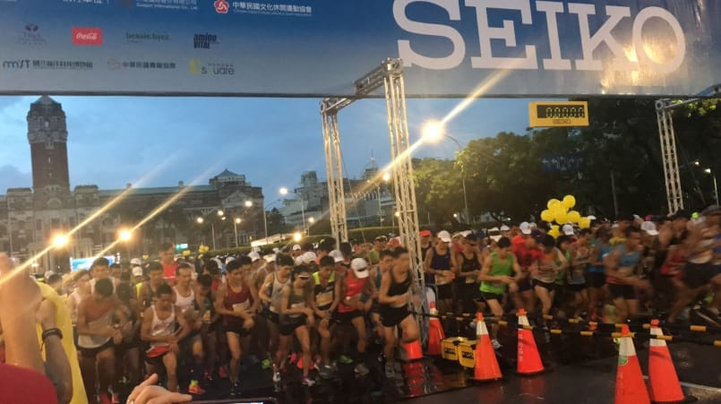
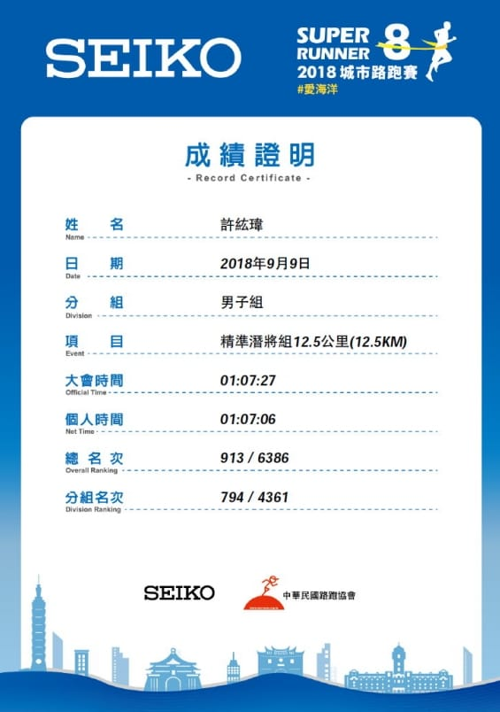

今早的SEIKO很明顯感受到秋天來了外加賽季終於要正式開始啦！

這是我第一次參加傳說中的SEIKO路跑，對於12.5公里這一種距離該怎麼配速完全沒有概念，比賽前的策略是前三公里暖身、接下來五公里跑體感有氧能力的上限，最後五公里當強度測驗跑。

這次比較早到起跑點等候，也難得排在比較前面的位置，鳴槍前盡量沉澱心思，想著過去的訓練要好好應用在這一場比賽上。一開始跑起來還算順，還有刻意壓一些速度，排在六分速的位置起跑，還被不少人刷卡。緩跑三公里之後覺得身體狀況不錯，就開始慢慢加速上去，但還是相對太保守了。

感覺才跑了沒多久，就看到第一集團在對向折返了，還有看到李銘勝飛奔而過，這就是神人與凡人的差異啊。持續維持保守體感到折返點，感覺差不多可以再加一點點速度上去，來到比較微喘的速度，這時候就開始換我刷人了。

正當感覺掌握到蠻不錯體感的時候，居然左腳鞋帶掉了，明明出發前還有特別綁好，不自覺地罵了一聲(自責)，好像被隔壁的跑友聽到轉頭看了一眼，現在想想我應該要保持形象才對。XDDD

最後一個水站約是十公里左右，原定計畫也是只喝水就好，但看到大家拿運動飲料，我就手癢也拿了一杯，沒想到喝一口就忽然覺得有點噁心反胃的感覺，可能是太甜了，不舒服的感覺過了好一陣子才消失，還不知道是什麼原因造成的。

跑下新生高架橋後一過彎，就看到總統府在遠方，這種感覺其實還蠻好的。但又忽然意識到剩下不到兩公里了，體力好像留得太多了，便決定在終點前先把體力開完，最後慢慢跑回去才可以讓在終點等我的依婷拍到好照片。

嘗試加速到四分速，大概撐了一分多鐘就急速消耗剩餘大部分的體力，最後維持五分速進終點，拿了個1:07:06的SEIKO初體驗，進終點看到一大群UAxGarmin的跑者們列隊歡迎同學，我也厚臉皮的跟各位一一擊掌，這種感覺超級好啊！在此，也恭喜力賓一小時保守完賽，可以準備迎接初馬挑戰了。

完整紀錄詳情：\
[https://www.runningquotient.com/calendar/record/2444766](https://www.runningquotient.com/calendar/record/2444766)

#RunningQuotient #SEIKO
