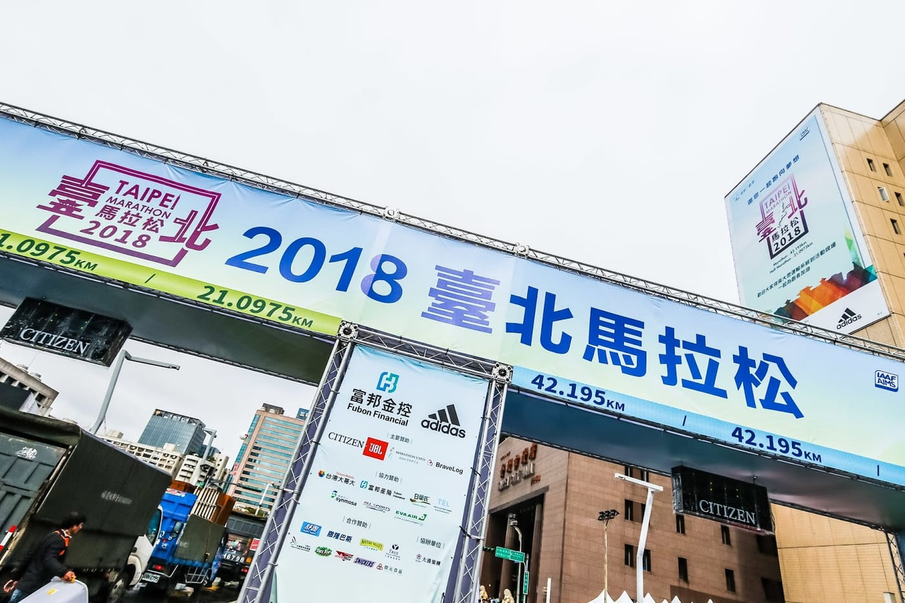
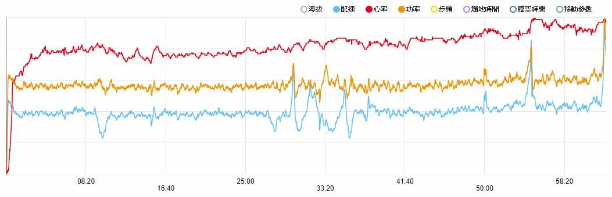
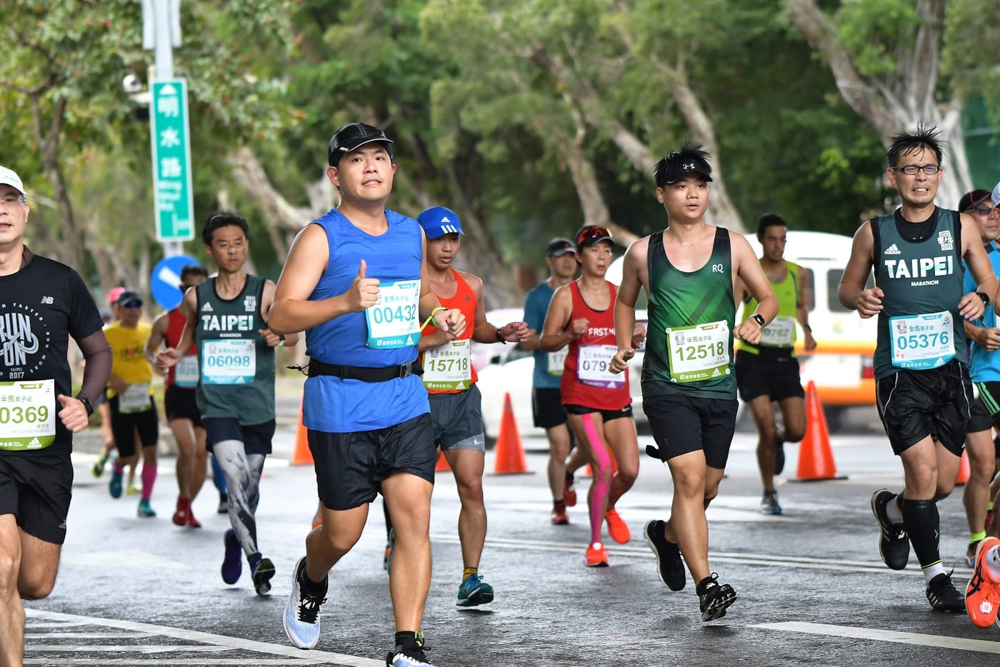
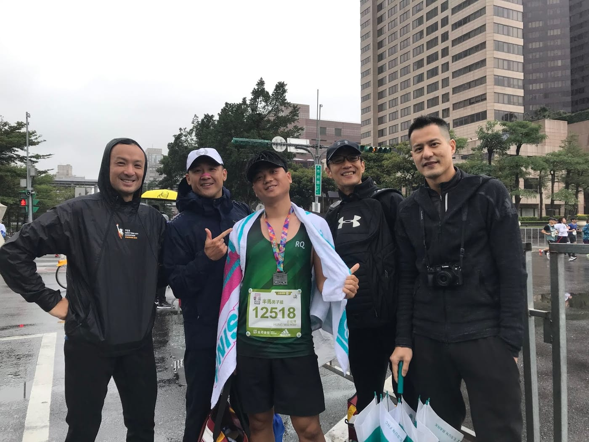
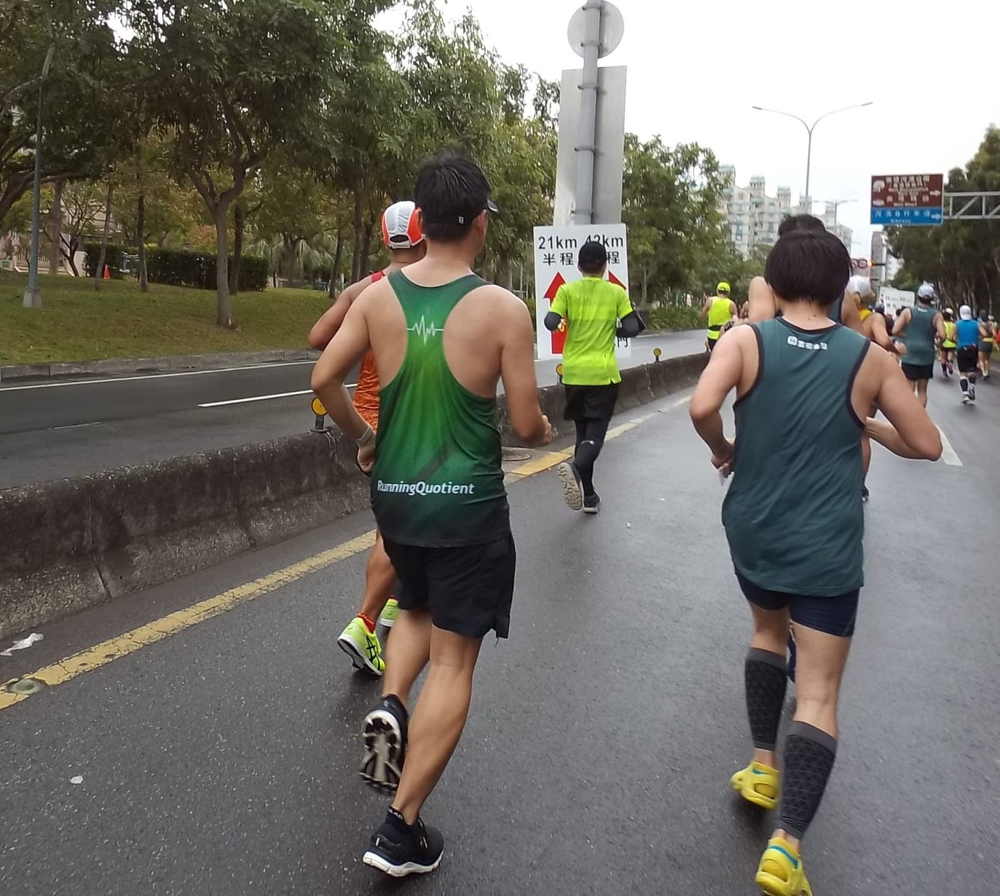
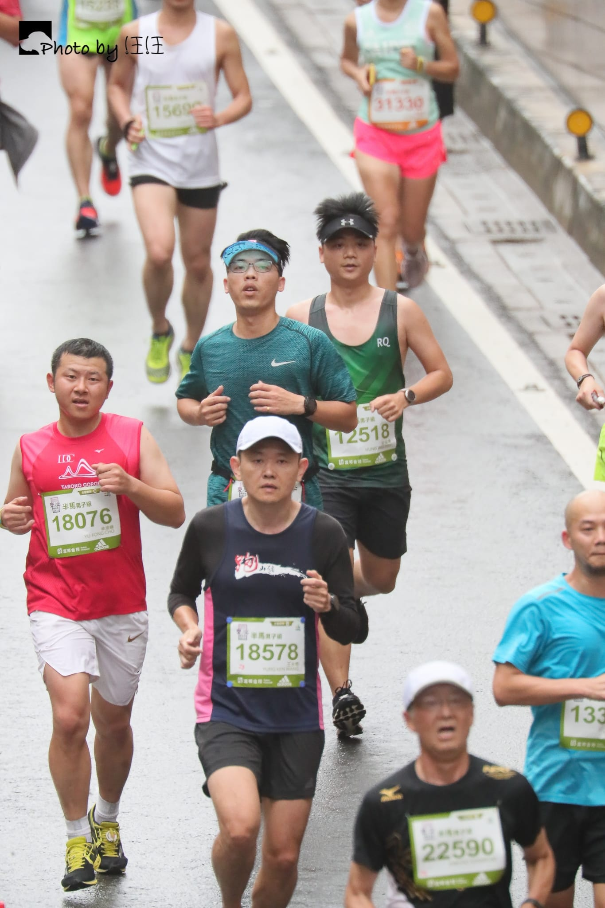
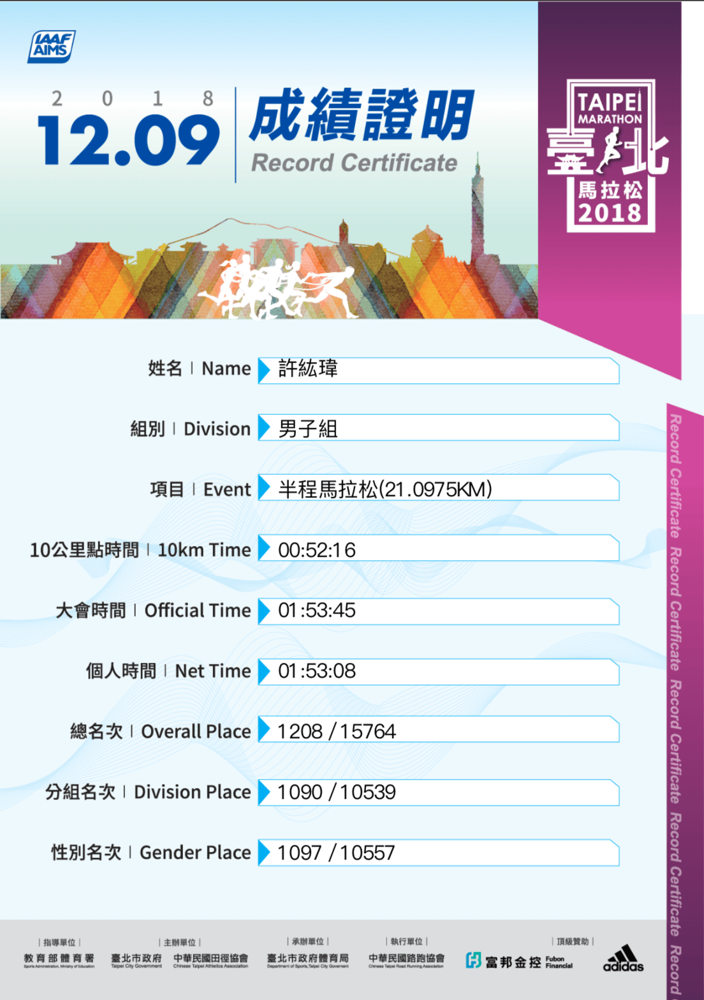
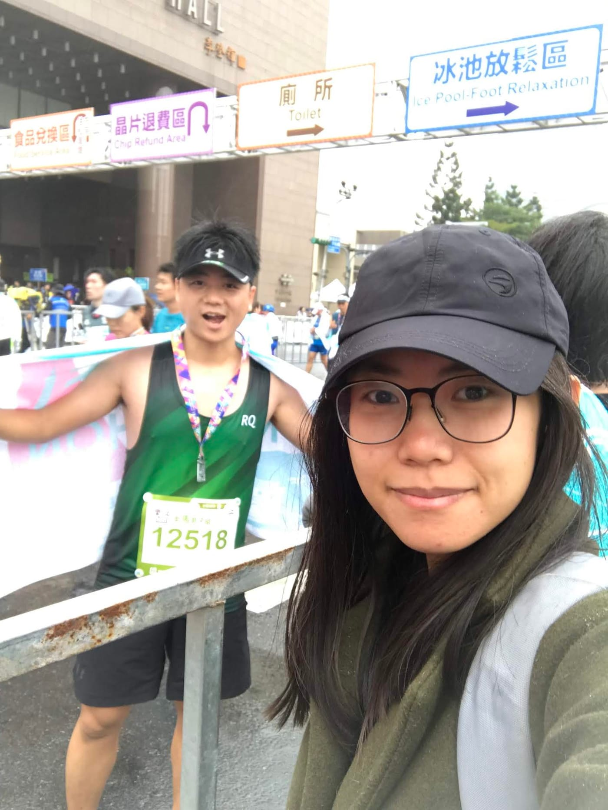

*2018目標賽事 - 臺北馬拉松*

（自我分析賽事檢討放最後面）

2018台北馬拉松-半馬是我今年最重要的目標賽事。我從六月開始正式進入訓練，邀請[羅譽寅](http://bit.ly/2NG9dMa)教練負責開設訓練計畫，搭配[余文彥](http://bit.ly/2zVEHs7)教練的力量訓練(不定期)，期望自己能夠在台北主場突破極限，再次推進我的半馬最佳成績(PB)。而且，我還為了獲得更多元的數據，添購了一項新數據武器-Stryd，用來記錄跑步功率、姿勢功率與下肢剛性。

這是我第二次採用跑步功率進行比賽配速策略（第一次是統一發票盃12.5K，突破場地PB近4分鐘），賽前譽寅教練針對我這台北半馬，開出了具體比賽策略為「全程無論上下坡都維持230 - 235瓦，從地下道上來後全開到底。」有了上次功率配速成功破紀錄的經驗後，其實相當有把握可以在台北馬上刷新自己的PB，完美結束今年度的目標賽事。

*統一發票盃採用功率配速策略破PB ([詳細記錄](https://www.runningquotient.com/calendar/record/2821803))*

BUT！人生總是充滿著無限可能，當然也是會出現各種意外。原本暖身跑運作正常的Stryd本人，它居然在正式起跑之後抓不到數據，過起點幾百公尺後我還嘗試暫停手錶紀錄重新啟動，期望能夠重新抓到功率數據，但事與願違，我只好放棄功率配速策略，開始邊跑邊重新擬定本次半馬作戰策略。（其實我自己的Stryd忘了帶回來，還是臨時跟文彥教練借的）

*難得的騰空照*

根據以往戰鬥經驗與知識，臨時決定前十公里保持在1.9-2.0心率區間，後面十公里採用體感配速完全不看錶，最後三公里全開。身為跑者大拜拜龍頭的臺北馬，果然一起跑就注定要繞圈圈卡一陣子，以往的我一定是會順順跟著人流前進，但這次因為沒有功率一開始慌了手腳，前面一直嘗試在人群內鑽了一陣子，很有可能在此埋下後期無力的種子。

第三公里以後人潮稍微舒緩一些（但還是很多人），終於可以穩穩進入1.9心率區間。而一路上也遇到不少認識的跑友，為了節省體力，都僅有寒暄幾句便繼續認真專注在跑步上。一直順順到十公里的水站，便開始抓體感配速上限，進入戰鬥模式。十二公里的水站補上一包羅教練贈送的能量棒。十五公里含了一顆臺北馬博覽會拿到的糖，開始進入全開階段。

*跑完回會場等承鴻巧遇四帥*

體感感覺最順的時候約在11～15公里出現，而這時有一個小插曲，遠遠地看到一位身穿RQ跑步背心的跑友，感覺很輕鬆地維持穩定五分速前進，那段時間他就變成了我的目標，一直想辦法努力跟上他的腳步，但卻一直無法接近。過了一會兒，發現他開始減慢速度，我也就順利跟著他共跑了一段，因為很認真跑，所以僅有比個手勢跟他示意，沒過多久就遇到全/半馬分流，只好自己獨立繼續跑下去。（後記：其實有想找一下他是誰卻找不到，最後感謝某馬尾正妹的臉書輾轉發現這篇貼文，原始是傳說中的順風車-明順大哥）

*感謝讓我穩穩跟跑還幫我拍照的明順哥*

約在18公里左右遇到全馬的小黑第一集團們高速刷過，這時候才驚覺到快結束了，想要再努力一點加速卻發現身體已無法負荷再加速，反而導致整個節奏打亂，出現除了起跑後的最慢配速。

最終大魔王的考驗「地下道」，跑過熟悉的松山高中後，做足心裡準備進入最艱難的時刻，這次很有感覺隧道內逆風好強，但身邊的跑者也都紛紛開始加速，我也緊咬牙關努力維持住。離開地下道的坡度一度很想放棄用走的，但腦海閃過「努力了這麼久，不是來這裡放棄的！」最後還是稱住了，回到地面上喊了一聲，開始加速衝往終點。

*進去最後關卡（圖片來源：運動筆記）*

轉過最後一個彎遠遠看到終點上面的1：5x：xx，由於我後半程完全沒看錶，知道自己達不到設定的目標後，心情其實蠻沮喪的，再跑進一點發現是1：53：xx時，代表連破PB都不保，一步步接近終點，速度便開始慢了下來。

[https://www.youtube.com/watch?v=dLC1DFuvNA4](https://www.youtube.com/watch?v=dLC1DFuvNA4)

最終以次佳晶片成績 1:53:08 完成賽事（[RunningQuotient](https://www.runningquotient.com/)預測成績1:54:32），要再快八秒才能夠突破去年鹿港馬創下的最佳成績。之後分析[完整數據](https://www.runningquotient.com/calendar/record/2887965)搭配回想比賽時的感受，其實已經是盡力了，但是仍然感覺到失落。

接著要好好地檢討自我缺失，並下決心明年再來重新挑戰。

*最終以1:53:08拿下次佳成績*

自我分析檢討：

**1. 賽事安排錯誤**

前一週去跑了場太魯閣馬拉松，雖然是用輕鬆跑的速度跑了半程，但是畢竟還是跑了兩個半小時，身體累積了一定程度的疲勞，直到比賽當天都還沒有完全消退，左大腿前側依然有緊繃感。

**2. 訓練量不足**

從正式開始訓練到目標賽事前，平均週[訓練指數](https://www.runningquotient.com/article/single/105)僅有42.84點，週跑量為24.27公里。想再更突破自己，顯然這樣的訓練量是完全不足的。其主要原因是近半年來出差頻繁，對我來說，在飛機、火車、高鐵等交通工具上很難休息，進而影響不少課表都無法如期執行。

**3. 質量課表未執行確實**

最重要的質量課表總是相當剛好（或是心裡逃避）因忙碌或者是其他原因沒有執行，整個訓練週期開始加入質量課表之後，居然只有跑過一次質量課表.... （倒

**4. 太晚進起跑點準備**

拍完承鴻(全馬)起跑後，才開始暖身跑7～8分鐘，接下來要進去B區起跑點的時候已經排在很後面，沒有辦法往前進一些，導致前面幾公里無法依照預定配速前進，又閃人加速浪費不必要的體力。

*明年再來挑戰*
