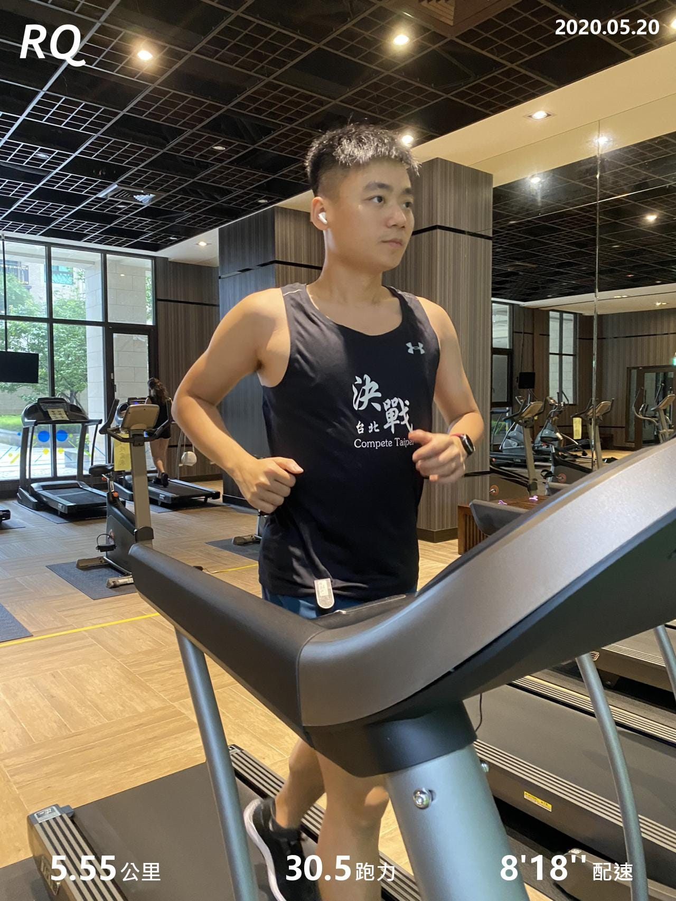

「當你想用下雨當藉口，作為休息不練的時候，你已經輸給自己的惰性了！」

早上打開 RQ APP 看到今天的課表說明，每一個字好像都是在提醒我昨天改成 Switch 健身環日不太洽當。

好，如果再下雨我就去跑健身房跑課表。

果不其然出門前看到窗外地板都濕了，就順便邀請我家大肚婆，在這個「特別」的日子，一同去健身房運動一下。

今天的課表是可敬又可怕的間歇日，先用最大心率（簡稱 MHR） 60 ~ 70% 暖身跑 15 分鐘，再來進入高強度的速度跑一公里，強度在 MHR 75 ~ 90%，共六趟組休 2 分鐘，最後緩和跑 12 分鐘。

心裡偷偷想著，難得跟老婆一起出來跑，等等間歇速度就配個 5:20 ，然後跑完六趟還可以看看到底有幾趟達標，順便可以放閃一下，結果...

跑步機上的速度根本跟手錶上的完全不同啊....（倒
