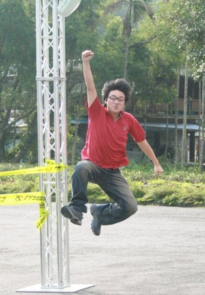

我曾是一位沉迷在虛擬世界練遊戲角色的資工宅男，念博士班期間因為晶片計時系統專案，而認識了當時 226 三鐵紀錄保持人徐國峰教練、東華鐵人隊長羅譽寅以及一群熱愛耐力訓練的朋友。

計時系統在數十場自行車與路跑賽事上使用，太魯閣馬拉松也有用過此系統。在擔任晶片計時負責人期間，看到好多人通過終點的帥氣、開心與感動，為此默默許下就算是肥宅如我，總有一天也要完成全程馬拉松的夢想。

因此，毅然決然全職投入於推廣跑步科學化訓練，打造台灣從來沒有人做過的創新服務，若能讓跑步體能測驗從沒及格過的我，也能順利完成初馬夢，就算是成功第一步了。

至今六年多，匯集了近十位跑步教練與運科教授的精華，就在 RQ 這個跑步科學化訓練大平台上。海內外已經有十萬會員的肯定，同時也幫助了數萬名跑者完成人生初馬或是突破個人最佳成績。

但這只是開始，我給自己立下了一個永不結束的目標，利用數據把跑步訓練遊戲化，讓所有人都可以享受到跑步的樂趣，並擁有更健康更強大的真實世界角色。

2014 與夥伴們一起創業\
2014 完成人生初半馬【都蘭夏日馬拉松】 3:14:47\
2015 推出耐力網-自動生成科學化訓練課表\
2016 成立 RQ / 十萬會員 / 千萬筆跑步紀錄\
2017 完成人生初馬【臺北渣打馬拉松】 05:09:55\
2018 推出全台首創的【一對一線上教練服務】\
2019 RQ 正式贊助中長跑選手【李奇儒】訓練經費至今\
2020 沒被疫情打倒的我們持續朝著夢想邁進
