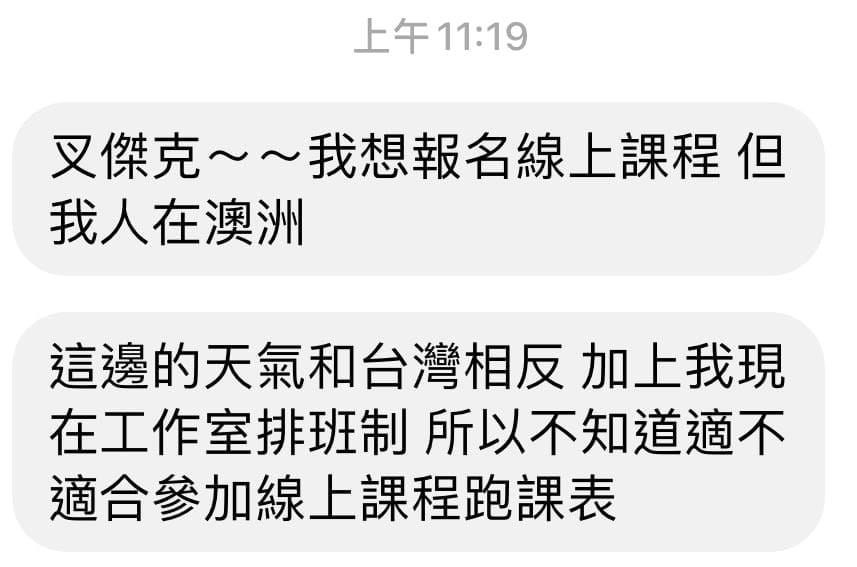

「叉傑克，我想報名線上課程，但我人在澳洲，這邊的天氣和台灣相反，加上我現在工作室排班制，所以不知道適不適合參加線上課程跑課表」

這是今天收到朋友的一則私訊，我們曾在同個訓練營內吃課表過，印象還停留在毫無保留跑比賽的美美小女生。

看到訊息其實有點小驚訝，但這就是「純線上訓練」的優勢，打破時間與地點的侷限。像她這樣的排班工作者，有時上班 12 個小時而且不一定是哪天，仍然保持每週 5 天運動，她來訊是擔心課表無法完全照著吃，而已排定的直播互動課程會臨時無法參加。

以下為我個人參加過數十場訓練營經驗的回應，就直接公開給大家參考。

Q：因為排班或生活上無法照著吃課表？

A：其實不論是線上或實體訓練營都會有此問題，教練安排的訓練計劃都有其「訓練邏輯」，整體上完全照著課表進行效果會最好。

但生活上難免會遇到各種狀況，這時就可以捨棄非質量課表(教練會特別註明)，先把最優先的狀況處理好，再來全心投入訓練。

課表跳過就當作安排一次完整的「休息課表」，休息跟訓練同等重要。基本上，能跟到七成以上課表完成率就是相當自律了，當然，我們也是看過很多完整 14 週課表全勤的市民跑者呢！

Q：已排定的直播互動課程會臨時無法參加怎麼辦？

A：我們提供影片側錄無限看。

這也是無論實體或線上都會存在的問題，但實體課程一般不會提供課程影片，而線上課程側錄相對容易。

在實體課程，教練的安排會以「現場」為主，縱使授課內容相同，不同人之間的互動，都會因為現場熱絡度不同，有著截然不同的氛圍，這也是很難取代的實體課程價值所在。但是，若要在現場側錄課程影片，通常都會受限於場地，較容易會有不好的鏡頭或角度，或是聲音沒辦法掌控。

而線上課程就完全不同，從一開始的規劃就是要提供大家線上觀看，所以影像、聲音與課程流程都會以最適合線上觀看的方式準備，無法參加直播課程，少了就只是 Q&A 互動環節，事後挑自己有空時補看，基本上也是能吸收完整的內容喔！況且 Q&A 也是會特別剪輯出來提供，而有問題也可以預先提問，讓小幫手代替於課程上解答呢。

所以，我當然是認為線上訓練營就是最適合她的選擇啊！
