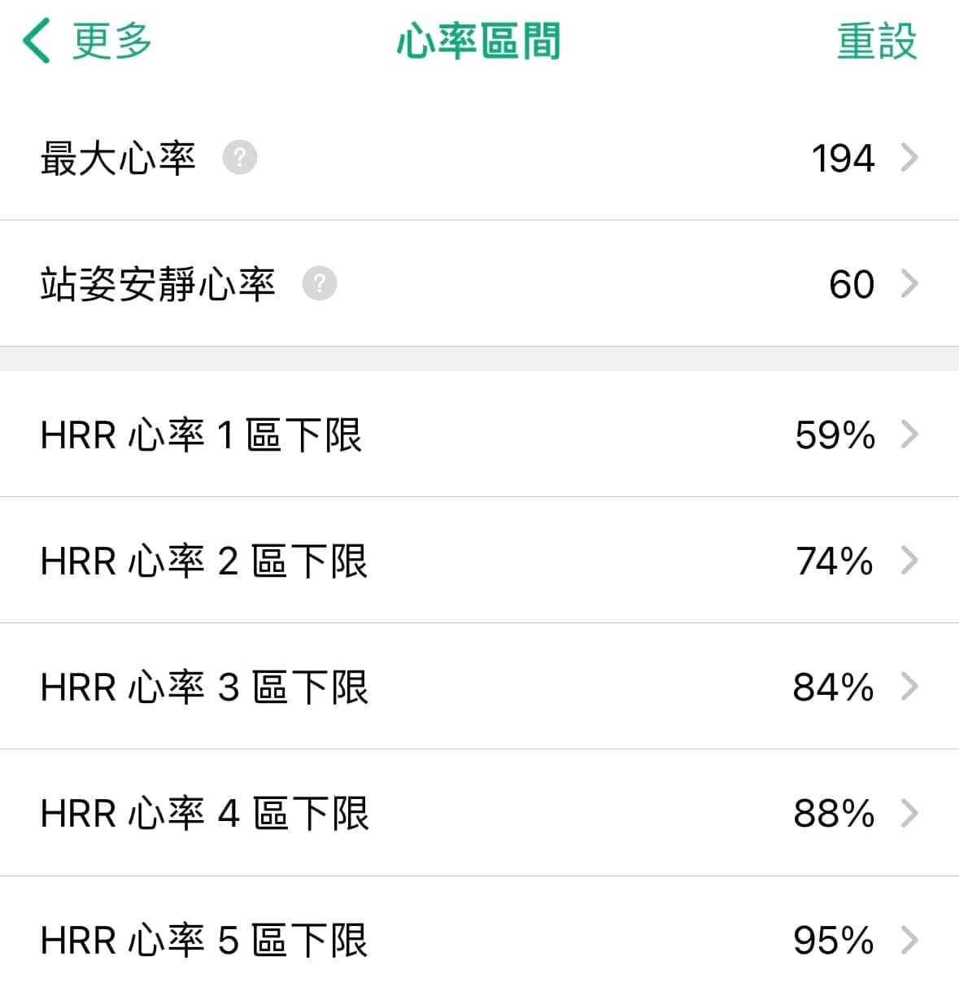

RQ 上所使用的心率區間為「訓練區間」，建議使用該運動姿勢的安靜狀況測量，對於跑步來說，就是「站姿」。

建議量測步驟：\
1\. 選一天睡眠充足的早晨。\
2\. 起床戴上手錶開啟一筆跑步紀錄。\
3\. 雙手放鬆站立 3 分鐘。\
4\. 結束紀錄並儲存，查看這 3 分鐘內出現的「最低」心率，就是建議設定在 RQ 的安靜心率喔！

不同訓練項目由於姿勢不同，如果想要使用心率區間作為訓練方式，建議要分開量測，譬如：騎車就用趴在車上的姿勢量測，游泳就… 趴在水中？

注意：如果有枕邊人，請事先告知哪天早上要進行安靜心率量測！很重要~
