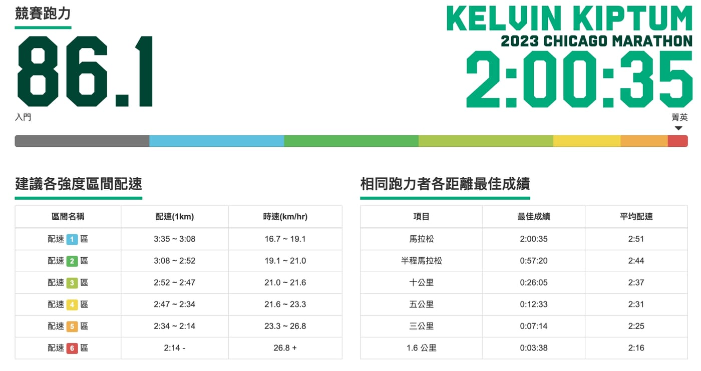

啊啊啊，Kelvin Kiptum 在 2023 芝加哥馬拉松上以 2:00:35 極速完賽，換算成跑力達 86.1 ，再次把馬拉松世界紀錄往前推進 34 秒。

話說當年聽象總「去你的人生低谷」新書分享會時，象總說芝加哥馬拉松路線九彎十八拐，已經不再是最速賽道，又剛好遇到連假，我跑去鹿港補上週的中秋烤肉，就沒有線上看轉播了。

結果剛剛收拾完才看到這消息，立刻跑去確認，居然少看到一次破世界紀錄啊啊啊啊啊～～～
