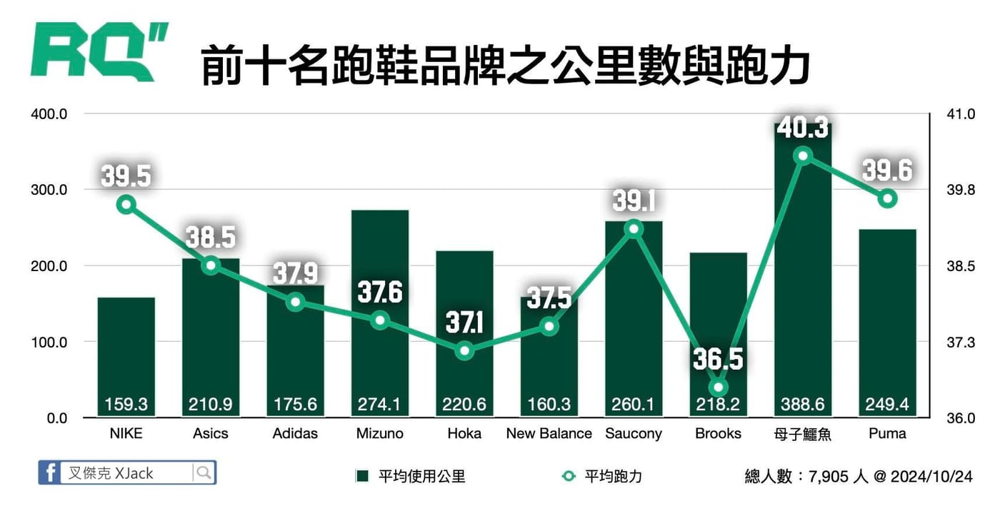

雙料冠軍出爐！

有了各跑鞋品牌人數後，我又很好奇到底大家一雙鞋子平均跑多少公里（直條圖），結果大致上跟我想像得差不多，最多人使用的 NIKE 跑鞋，公里數果然最低，僅有 159.3 公里，可能有很多比賽專用鞋；其他品牌大概就是 200 公里上下。BUT！有一根長條直接突破天際，就是有 201 人使用的母子鱷魚，居然一雙鞋平均跑高達 388.6 公里，該不會都是超馬跑者吧？

再來看看各品牌用戶的平均跑力（折線圖），有 1,614 人使用的 NIKE，平均跑力有 39.5，換算全馬成績大概 4 小時出頭。從左至右品牌依序為使用人數排名，前五名跑力逐漸降低，第六名之後的人數不到 300 人，平均跑力就變化比較大。BUT！又看到唯一破 4 的品牌 - 母子鱷魚，跑力平均達 40.3，再度拿下第一；跑力第二高的 Puma 有 138 人；而第四高跑力 39.1 的 Saucony 似乎最近比較常看到，有 259 人使用。

不說了，我先去看我家附近哪裡有 母子鱷魚  店面了。（誤

PS：各品牌跑鞋的人數統計，無論有多少雙鞋 1 個用戶只算 1 人。\
以上僅代表個人看法，如果大家有興趣的話，我等臺北馬再來用跑鞋品牌統計分析囉。
