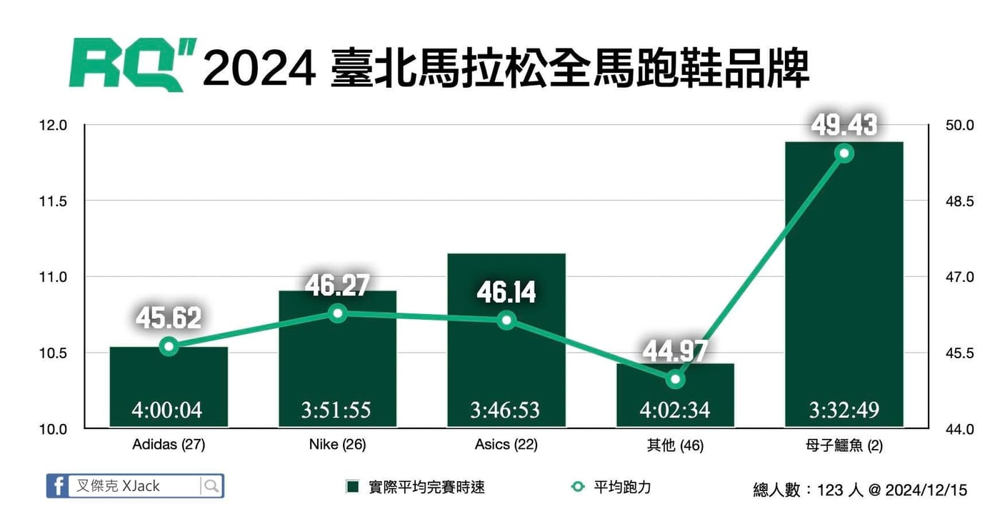

我整理了今年台北馬的跑鞋品牌表現圖表，分析了上傳數據到 RQ 跑力 的 2,145 位全馬跑者中，有設定跑鞋的 123 位跑者，依據 「跑力」與「全馬完賽成績」 進行比較。

身為台北馬頂級贊助商 adidas 果然最多人用，平均完賽成績 4 小時，跑力平均 45.62；第二多人使用的 Nike，平均跑力達 46.27，完賽成績為 3:51:55；比較特別的是穿 ASICS 的跑者，平均跑力比 Nike 低了 0.13，但是平均完賽成績居然快了 5 分鐘呢。最後，再次一枝獨秀的母子鱷魚，平均跑力高達 49.43，而且完賽成績也是最快的 3 小時 32 分 49 秒，原來真的有高手可以穿 Y 拖高速跑完全程馬拉松啊！

這些數據不僅僅是冷冰冰的數字，背後其實蘊藏著每一位跑者的努力與故事。不論是職業運動員還是市民跑者，他們都在訓練、比賽中全力以赴，這份堅持真的令人敬佩。

在運動圈打滾十幾年，雖然還沒到愛上跑步，但我徹底喜歡上愛跑步的你們，特別是很多合作過的運動品牌夥伴，大家都是打從心底熱愛運動，並不計成本想讓全世界看到臺灣。職業運動員的訓練很辛苦我們都知道，但是身為市民跑者，在家庭、工作、生活的多重平衡下，努力抽出時間想要挑戰自己，也是相當令人尊敬的。當被品牌看到，提出贊助可能性，如果是本來就會買的商品，贊助品牌的產品不也算是金錢贊助嗎？

話說，母子鱷魚是否該贊助我 Y 拖了，產品即可，繳房貸的錢我可以自己賺就好。（誤）

好啦，我故意把只有 2 人的母子鱷魚品牌數據挑出來，就是想說這句話。

什麼是跑力？

跑力是 RQ 的核心指標，幫助跑者衡量自己的表現實力，就像跑步的「戰鬥力」數值！跑力越高，通常代表跑者的穩定性、效率和表現越好。更棒的是，跑力還能用來制定不同配速區間的建議速度，並提供各距離完賽最佳成績，讓你訓練得更科學、更有效率。

圖表補充說明

直條圖顯示的是平均完賽時速，越高代表實際完賽時間越快，看左邊的 Y 軸，下方列出的是手錶紀錄的平均完賽成績（並非大會成績）；折線圖則是比賽當天的平均當前跑力。括號內的數字則代表實際穿該品牌跑鞋參賽的人數。
