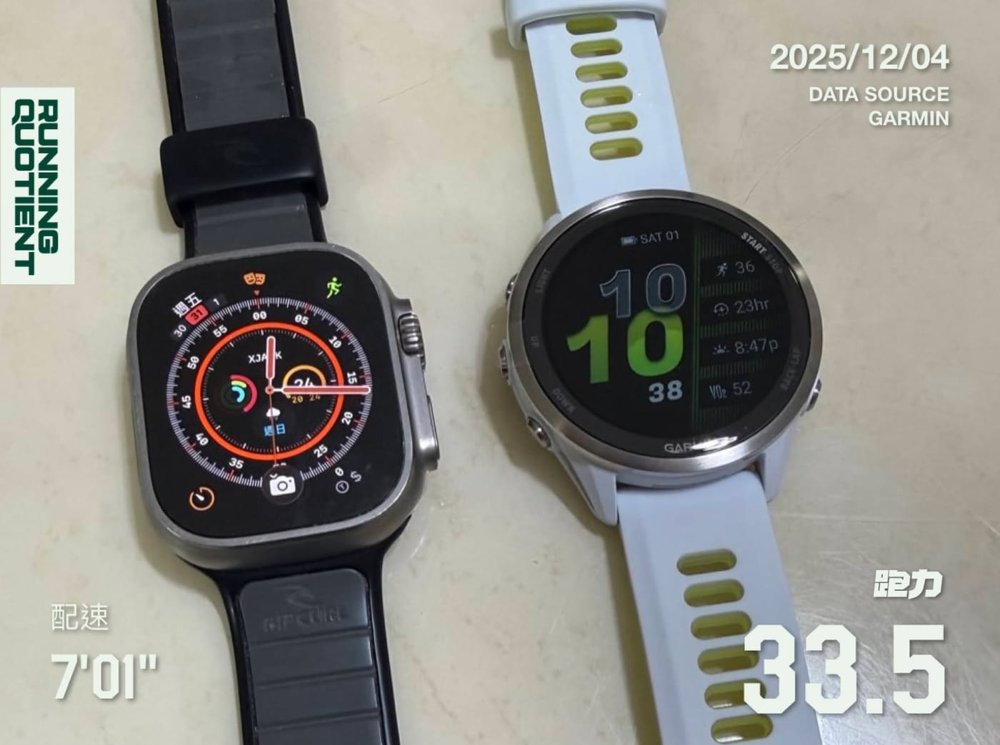

你有發現 RQ 跑力 的紀錄跟浮水印，都新增加了「數據來源」標示嗎？

其實這件事的起因，是在今年七月的時候，GARMIN 官方突然通知我們：

只要有使用到 GARMIN 的資料，不管是我們自己演算法算出來的新資訊，或是用數據產生的浮水印照片，都必須清楚呈現資料來源。

若沒有在 11 月 1 日之前完成，GARMIN 會中斷我們的數據同步。

為了符合這個新規定，我們團隊只好先暫停手上正在開發的新功能，立刻投入重新設計整套樣式，並從資料庫開始一路改到前端，把新增的欄位全部補上。

但需要更動的地方實在太多了，到了十月我只好再寄信給 GARMIN，硬著頭皮請求再給我們一點寬限期。對方也很阿莎力，直接把期限延到 11 月底。

現在，不論是在 RQ APP 還是網站，你都能非常清楚看到每一筆同步數據的來源了。

資訊透明，本來就是我們一直想做到的事，只是這次推進得比預期快很多。

PS：然後我就買了一支 Garmin FR970 了，這招真的厲害。Apple Watch 掰掰！
