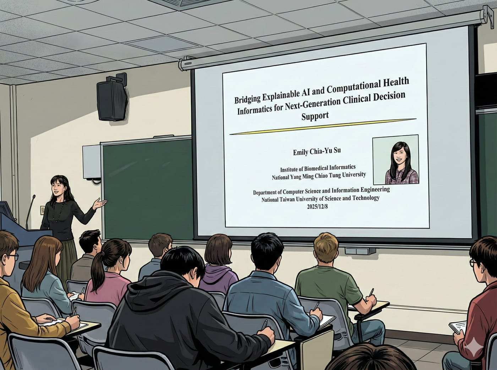

研究生的必修課之一：論文研討（Seminar）。

每週會邀請一位教授分享他的研究思路與成果，讓我們點點不同領域的技能。

老實說，當年我在唸書的時候，只要題目沒興趣、或者講者不有趣，我就會在台下默默做自己的事。

但創業十年後，再回來坐在同一種教室裡，感覺完全不一樣了。

現在的我很清楚一件事：

「每一個人的分享，都一定能挖到價值，只是你有沒有準備好去接住。」

所以，現在每週的 Seminar，我都聽得異常認真。

就算這週的主題是我完全不感興趣的「生物醫學」資訊，我還是全程專注，結果也真的拿到一個意外的收穫。

不是研究方法。\
不是模型設計。\
而是…

👉 原來當年台大資工的夜衝，是跑到軍艦岩上吃泡麵。

這我一定要說一句。

我們東華資工當年夜衝，可是直接跑到太麻里看日出的！

（勝。）
