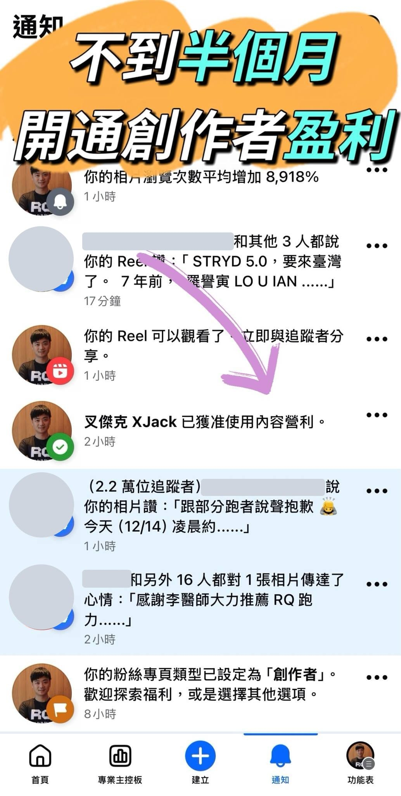

12/18 的今天，一起床就看到 Facebook 的通知，邀請我成為創作者，這意味著未來發佈的內容，將能依瀏覽量獲得美金回饋。

說實話，這完全在我預期之外。一個追蹤數才一千人的粉絲頁，居然能走到這一步。所以想整理一下，這半個月我到底做了哪些「反直覺」的事。

一、停止分裂，建立一個「真實」的自己

我一直都有記錄生活的習慣，過去為了區分「工作」與「生活」，我刻意經營不同的帳號。結果每次想動筆，都要先糾結這篇要發在哪？這無形中成了創作的最大阻力。

後來我決定「砍掉重練」，直接用最簡單的名字：「叉傑克 XJack」。

刻意打破身分限制，讓 Facebook 成為一個多重定位的空間。我不經營人設，而是讓原本就存在的面向被看見：

✓  一位鑽研科學化育兒的父親\
✓  RQ 跑力的執行長與創業工程師\
✓  從博士班休學，又重新考上臺科大資工博班的學生

當你不再分裂，創作的阻力就消失了。

二、不糾結長短，重點是「持續產出」

我給自己的原則只有一個：完成 Facebook 提供的「每週創作目標」。

我沒有過多的評價或自我懷疑，就是照著系統目標去做：發貼文、去公開社團留言、回覆讀者。臉書說要做什麼我就做，至於內容長短？我完全不糾結。

品質的標準只有一個：對得起當下的自己。

那篇意外有 44 萬瀏覽的〈家庭會議〉在發布前，就是請 AI 跟親友協助指出「哪裡看不懂」，前後修改至少五個版本以上。

三、先有「共鳴」，才買 Meta 認證

很多人以為追蹤人數要夠高，才會有盈利資格。但依照我的經驗，反而是：

1\. 持續寫\
2\. 出爆文\
3\. 補認證

感謝友人提醒，買完認證後不到兩天，Facebook 就開通了盈利功能。對我來說，Meta 認證不是起點，而是當事情已經發生後，順勢補上的臨門一腳。

結語：這不是速成，而是一個紀錄的開始

回頭看這半個月，我沒有做什麼特別聰明的事。起心動念只是因為在規劃明年計畫時，發現 2026 年 3 月 15 日 RQ 就要滿十週年了，我希望為這段旅程留下紀錄，也希望有一天能把自己寫成一本書。

目前看來，這本「書」就是我的個人臉書。
