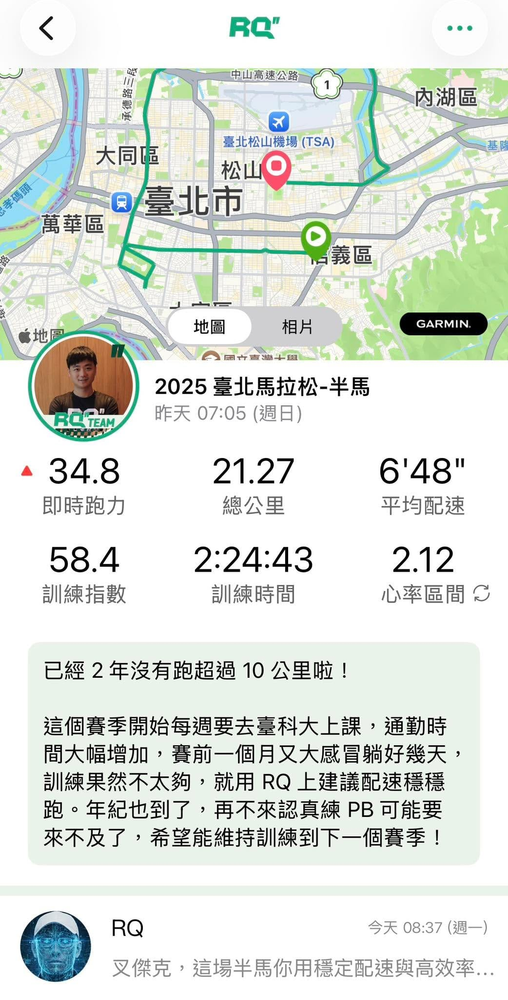

終於站上臺北馬拉松賽道。

這不是什麼突破的一場，\
而是一個「我還在跑」的確認。

上一次跑超過 10 公里，\
已經是 2 年前的臺北半馬。

這個賽季開始，每週都要去臺科大上課，通勤時間大幅增加；賽前一個月又大感冒，直接躺平好幾天，整個備賽期的平均週跑量連 7 公里都不到。

所以這場策略其實很單純：

👉 不逞強，用 RQ 建議配速，穩穩跑完。

能夠 2:24:43 完賽，以現在的生活節奏與身體狀態來看，我會說這是一場「有好好面對自己」的比賽。

老實說，年過四十的阿宅如果還想追 PB，現在不開始把訓練優先級拉上來，可能真的就來不及了。

好想要半馬超過 Izero 的 1:45 啊！（遠目）
