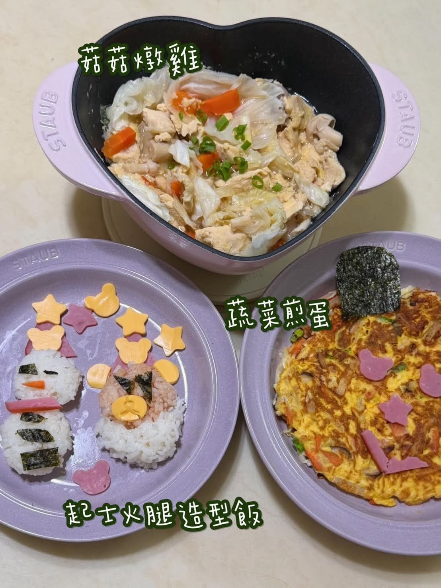

居然買了一萬元的鍋子！

今年開始，老婆下廚的次數明顯變多了，不為別的，就是希望我這個日漸發福的身材，能稍微被控制一下。

她開始研究做菜後，一直說想換一個鑄鐵鍋，原本已看好的是一個一千多元的鍋子。

直到有一天，我們去了一趟台北，回來之後，餐桌上出現的是這個——

【法國 STAUB 粉紅奶酪色、心型、琺瑯鑄鐵鍋】\
整組定價 NT$ 11,076。

身為工程師，我很習慣分析 CP 值，但這次「投資」，真的不能用試算表計算。

有人願意為你、為家人，站在廚房裡，無價。

結論很簡單，也很科學：

HAPPY WIFE, HAPPY LIFE！

平安夜快樂。

後來我還是很務實地，一路追蹤到這組特價不到六千元的時候才下手。該算的，還是要算一下。xDDD
