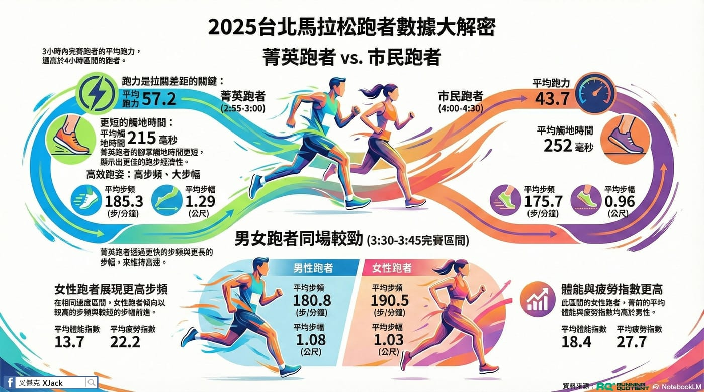

本圖分析為 2025 臺北馬拉松Taipei Marathon ，全馬完賽的 RQ 跑者 1,955 人數據。今年有移除不活躍會員的紀錄同步，讓樣本更集中在實際有穩定訓練的跑者。

一、為什麼特別拉出「剛破三」這群跑者？

圖中所謂的菁英跑者，我們抓的是 2:55–3:00 完賽區間，也就是剛破三的那群人。

原因很單純：\
👉 這正是許多 RQ 用戶正在追求、也最有參考價值的目標。

和世界級菁英相比沒有太大意義，但「差一點點就破三」的這群人，反而最值得拆數據。

他們和 4:00–4:30 完賽跑者的差異：

● 觸地時間更短\
● 步頻更高\
● 步幅更大

👉 速度差，來自效率差。

補充一個常被問到的點：\
理論上跑力達到 56.38 就有全馬破三的可能，但從近 9 年的實際分析來看，破三跑者的平均「當前跑力」仍然落在 57.5 左右，較能去除其他因素的影響。

二、為什麼拿 3:30–3:45 來做男女比較？

因為這是女性跑者人數最多的完賽區間，樣本數充足、分布集中，比較不容易失真。在這個區間，可以同時看到兩個層面的差異：

技術層面

男性跑者：步幅較大、步頻較低\
女性跑者：步幅稍短，但步頻明顯更高

訓練層面

女性跑者的體能指數累積明顯較高

這裡的體能指數，反映的是整個備賽期的訓練累積結果，而不只是比賽當天的累積。

👉 換句話說：

要跑出同樣的完賽成績，女性跑者在備賽期需要承擔較大的訓練壓力，也必須投入更多訓練量。

最後一個提醒

這些進階數據指標（步頻、步幅、觸地時間）都只是結果，不該成為你每天訓練時硬去追的數字。

真正該在意的，是你在備賽期間，各種訓練與恢復的安排，要搭配你工作型態跟生活的節奏，而數據自然會往你該到的位置移動。
