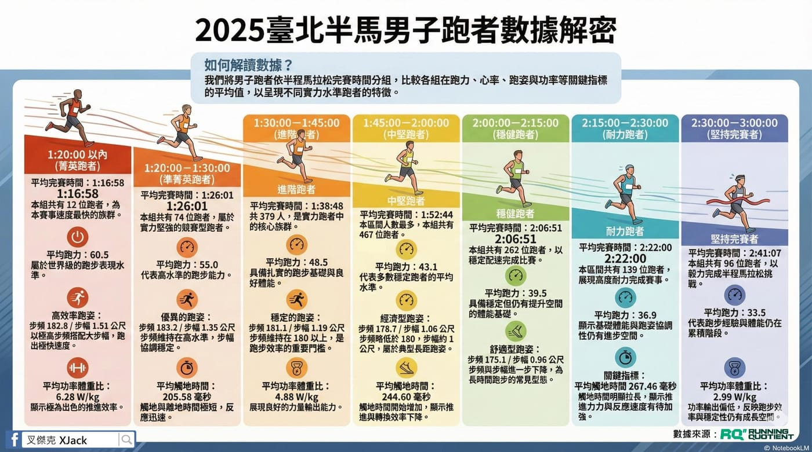

這張圖把 2025 臺北馬拉松Taipei Marathon  半馬男子跑者，依照完賽時間分組，攤開來看他們在跑力、步頻、步幅、觸地時間與功率上的「平均樣貌」。

不是為了分誰強誰弱，而是想回答一個跑者最常問、卻最難被說清楚的問題：

👉 為什麼我明明也很認真練，成績卻總是卡在這裡？

先講結論：跑力，真的很誠實。

從 1:20 內到 3 小時完賽，你會看到一件幾乎沒有意外的事：

● 成績越好\
● 平均跑力越高\
● 幾乎是一條直線往上走

這代表什麼？\
👉 比賽當天你能輸出多少「有效能力」，基本上就決定了你會站在哪一欄。

這也是為什麼單看配速或心率，常常會被誤導；\
但跑力一攤開來看，就很難騙人。

真正有意思的，其實是中間那幾欄。

如果你把目光放在 1:45～2:30 這幾個區間，會發現一個很關鍵的現象：

● 跑力下降的幅度，明顯小於成績變慢的幅度\
● 速度掉得快，但輸出能力其實還沒掉那麼多\
● 步頻與步幅同步下滑\
● 觸地時間卻持續拉長

這代表一件很重要的事：\
👉 多數跑者不是「不夠強」，而是「用力的方式越來越沒效率」。

也就是說，問題不在你能不能出力，而是在你還能不能把力「用在前進上」。

當效率開始崩，後面會發生一連串連鎖反應：\
同樣的跑力，換不到原本的速度，為了撐配速，只能增加用力，觸地變久、反作用力變差，最後速度還是掉。

這就是很多人明明有練、數據看起來也不差，但比賽卻一直卡關的原因。

所以，這張圖真正想告訴你的是什麼？

不是你現在在哪一欄， 而是你該問自己三件事：

●  我目前的跑力，真的撐得起我想要的成績嗎？\
●  我的速度掉下來時，是能力不夠，還是效率先崩？\
●  我現在的訓練，有沒有在處理這個問題？

數據不會給你安慰，但會很清楚地指出方向。
