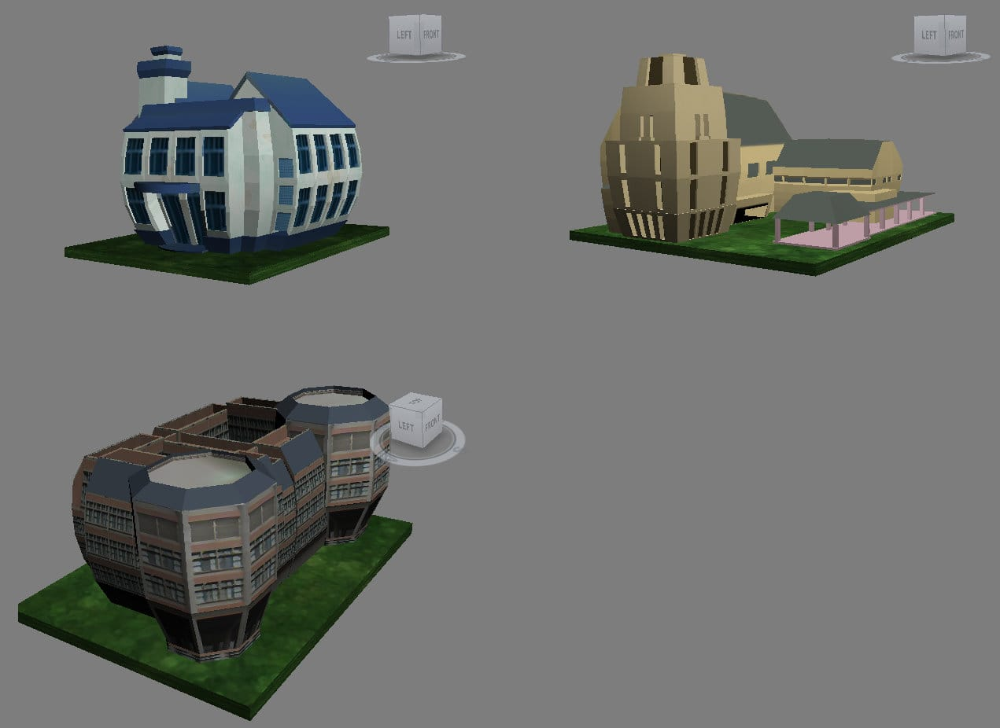

搬資料搬到一半，我真的被自己背刺。

居然挖到 15 年前做的第一個網路遊戲專案：「NDHU Online」— 沒錯，就是那個年代多邊形還很珍貴、貼圖還要省著用、做完一個多人連線遊戲後，就覺得自己可以直接去暴雪上班的時代。

看到這張預覽圖，直接回到東華的空氣、壽豐的風、花蓮的土、還有東華那種「能走到教室就算今天完成有氧訓練」的距離感，跟臺科大校園完全不同風格啊！

問題來了：

猜猜看，這三棟是東華大學的哪三個建築？
