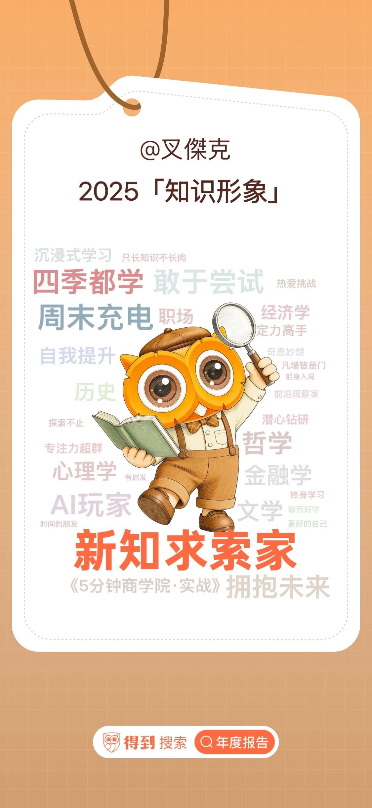

2018 年，我在手機裡裝了一個 App，叫做「得到」。

幾乎不看書的我，意外找到了一個適合自己的吸收知識方式。

不是逼自己坐下來讀，而是跑步、做家事、開車的時候，把知識慢慢放進耳朵裡。

結果這一裝，就變成了每天的習慣。

從 2018/11/1 到現在，不知不覺，已經 2615 天。

今年其實算是聽得比較少的一年，但回頭看年度報告，還是留下了一些紀錄：\
・學了 310 天\
・投入 149 小時\
・有一段時間連續 40 天都在學\
・一年聽了 37 門課

我一直很相信一件事：

真正能拉開差距的，不是哪一次靈感爆發，而是你有沒有找到「你吃得下去的那種學習方式」。

跑步是這樣，寫程式是這樣，創業、研究、當爸爸，也都是。

如果你也跟我一樣，不是那種可以安靜坐著看書的人，也許只是還沒找到適合你的學習介面。

有時候，方法對了，時間自然會站在你那邊。
